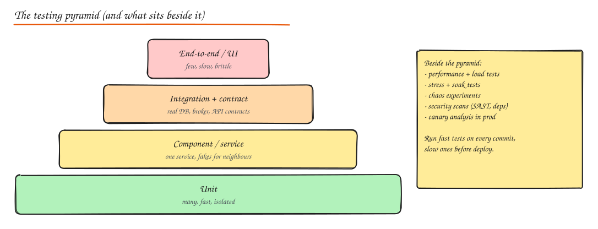

# Testing and Code Quality

> **TL;DR**
> - Many fast **unit** tests, fewer **integration/contract** tests, very few **end-to-end** tests.
> - Load and stress tests answer capacity questions before users do; chaos experiments prove resilience patterns actually work.
> - Coverage is a flashlight, not a goal: aim for well-tested critical paths, not 100%.
> - CI runs linters, static analysis, tests and security scans on every change; nothing merges red.



## Functional tests

| Level | Scope | Speed | Example |
|---|---|---|---|
| **Unit** | One function or class, dependencies faked | Milliseconds | `Order.cancel()` refuses shipped orders |
| **Component / service** | One service with in-memory or containerized dependencies | Seconds | POST /orders returns 201 and writes a row |
| **Integration** | Real DB, broker, cache (Testcontainers) | Seconds | Repository SQL works against real Postgres |
| **Contract** | API compatibility between consumer and provider | Seconds | Pact: mobile app's expectations of the orders API still hold |
| **End-to-end (E2E)** | Whole system through the UI or public API | Minutes | Sign up, add to cart, check out in a staging env |

Good unit tests are **fast, isolated, deterministic and readable**: inject clocks and random seeds, avoid sleeps, one behaviour per test, arrange/act/assert.

```python
def test_cancel_refunds_paid_order():
    payments = FakePayments()
    svc = OrderService(InMemoryOrderRepo([paid_order(id=7, total=500)]), payments)

    svc.cancel(7)

    assert svc.repo.get(7).status == "CANCELLED"
    assert payments.refunds == [(7, 500)]
```

**Testability comes from design**: dependency injection and ports/adapters ([Hexagonal Architecture](../05-architecture/03-architecture-styles.md)) let you swap real infrastructure for fakes.

## Non-functional tests

| Test | Question it answers | Tools |
|---|---|---|
| **Performance test** | How fast is it at expected load? (latency percentiles) | k6, Gatling, JMeter, Locust, wrk |
| **Load test** | Does it meet SLOs at peak (and 2x peak)? | same, run against prod-like env |
| **Stress test** | Where does it break, and how (gracefully?) | Ramp until failure |
| **Soak test** | Does it degrade over hours (leaks, connection exhaustion)? | Long steady runs |
| **Spike test** | Can it absorb sudden bursts (sale start)? | Instant ramps |
| **Chaos engineering** | Do failovers, timeouts and breakers really work? | Chaos Monkey, Gremlin, Litmus, AWS FIS |
| **Security tests** | Known vulnerabilities, injection, auth bypass | SAST, DAST, dependency scanning, pentests |

Load testing tips: use realistic traffic mixes and data volumes, test from outside the cluster, watch the system's saturation metrics (not only the test tool's numbers), and include warm-up.

Chaos engineering principles: define steady state (SLO metrics), hypothesize it holds when X fails, inject the failure with a small blast radius, observe, and automate the experiments that pass.

## Test coverage

- **Line/branch coverage** shows what tests never touch; low coverage on critical code is a red flag.
- High coverage does not mean good tests (assertions may be weak). **Mutation testing** (Stryker, PIT, mutmut) checks whether tests fail when the code is deliberately broken.
- Target: high coverage on domain logic and money paths, lighter on glue code and generated code.

## Continuous integration

A typical pipeline on every pull request:

1. Format check and **linters**.
2. **Static analysis** and type checking.
3. Unit tests, then integration and contract tests (parallelized).
4. **Security scans**: dependency vulnerabilities (Dependabot, Snyk), secret scanning, SAST.
5. Build the artifact/image once; deploy it to staging; run smoke and E2E tests.
6. Progressive production rollout with automatic rollback on SLO regression.

Keep CI fast (under ~10 minutes for the PR path) or people stop waiting for it; quarantine and fix flaky tests quickly.

## Code quality tools

| Tool type | Examples | Catches |
|---|---|---|
| **Linters** | ESLint, Ruff/Flake8, golangci-lint, Checkstyle | Style issues, suspicious constructs, unused code |
| **Formatters** | Prettier, Black, gofmt | Style debates (end them) |
| **Static analysis / type checking** | mypy, TypeScript strict, SonarQube, SpotBugs, CodeQL, Semgrep | Type errors, null bugs, security patterns |
| **Code coverage tools** | coverage.py, JaCoCo, Istanbul/nyc, go test -cover | Untested code |
| **Dependency and secret scanners** | Dependabot, Snyk, Trivy, gitleaks | Vulnerable libraries, leaked keys |
| **Code review** | Pull requests, CODEOWNERS | Design issues tools cannot see |

## Interview questions

<details>
<summary>Your E2E suite takes 90 minutes and is flaky. What do you do?</summary>

Push most checks down the pyramid: cover business rules with unit tests and service boundaries with contract tests, keep only a handful of critical-journey E2E tests. Make the remaining ones deterministic (stable test data, no sleeps, explicit waits), run them in parallel, quarantine flaky tests and fix root causes, and run the full suite on merge rather than on every commit.

</details>

<details>
<summary>What is the difference between load testing and stress testing?</summary>

Load testing checks behaviour at expected and peak load against SLOs (does p99 stay under 200 ms at 5k RPS?). Stress testing pushes beyond capacity to find the breaking point and verify the failure mode is graceful (load shedding, clear errors, recovery) rather than a cascading collapse.

</details>

<details>
<summary>How do contract tests help microservices?</summary>

They verify that a provider still satisfies the expectations of each consumer without spinning up the whole system. Consumers publish contracts (requests and expected responses); the provider's CI replays them. Breaking changes are caught before deploy, and teams can release independently.

</details>

## Related

- [Logging and Debugging](09-logging-and-debugging.md)
- [Resilience Patterns (chaos)](../06-reliability-ops/01-resilience-patterns.md)
- [Deployment (CI/CD)](../06-reliability-ops/04-deployment-and-cost.md)
- [OOP and SOLID](01-oop-solid-principles.md)
