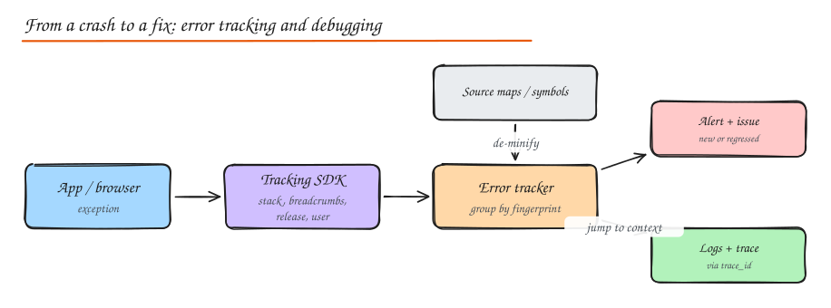

# Logging and Debugging

> **TL;DR**
> - Log **structured events** (JSON) with a trace id and business ids, at the right level, without secrets or personal data.
> - Ship logs to a central store; sample noisy success logs, keep all errors.
> - Use an **error tracker** for exceptions: grouped, deduplicated, with stack traces, releases and source maps.
> - Debug systematically: reproduce, narrow with data, form a hypothesis, test it, fix the cause, add a test and a guard.

## Structured logging

Logs are data. Emit key-value events instead of sentences so they can be filtered and aggregated:

```python
import logging, json, sys

class JsonFormatter(logging.Formatter):
    def format(self, r):
        base = {"ts": self.formatTime(r), "level": r.levelname, "logger": r.name, "msg": r.getMessage()}
        base.update(getattr(r, "fields", {}))
        if r.exc_info:
            base["exc"] = self.formatException(r.exc_info)
        return json.dumps(base)

log = logging.getLogger("checkout")
handler = logging.StreamHandler(sys.stdout)
handler.setFormatter(JsonFormatter())
log.addHandler(handler)

log.info("payment authorized", extra={"fields": {
    "trace_id": "4bf92f35", "order_id": 9001, "provider": "stripe", "latency_ms": 212}})
```

Always include: timestamp (UTC), level, service, version, **trace_id / request_id**, and the business identifiers you will search by (order_id, user_id hashed if sensitive).

## Log levels

| Level | Use | Production default |
|---|---|---|
| ERROR | A request or job failed; someone may need to act | On |
| WARN | Unexpected but handled (retry succeeded, fallback used) | On |
| INFO | Lifecycle and business events (started, order placed) | On, sampled if huge |
| DEBUG | Detail for diagnosing specific problems | Off (enable per request or per service temporarily) |
| TRACE | Very fine grained, local only | Off |

Make the level changeable at runtime (config flag) so you can turn on debug logging for one service or one user during an incident without redeploying.

## What not to log

Passwords, tokens, API keys, full card numbers, secrets in URLs, raw personal data you do not need. Mask (`****4242`) or hash. Treat logs as sensitive data with access control and retention limits.

## Log aggregation

```text
app stdout  ->  agent (Fluent Bit / Vector / OTel Collector)  ->  buffer (Kafka, optional)
            ->  store (Loki, Elasticsearch/OpenSearch, Splunk, CloudWatch)  ->  search + dashboards + alerts
```

- Write to stdout in containers; let the platform collect.
- Parse once at the edge, add metadata (pod, region, version).
- Retention tiers: hot searchable for 7 to 14 days, cold archive in object storage.
- Control cost: drop debug, sample success logs, keep every error. See [Observability](../06-reliability-ops/02-observability.md).

## Debug logging and performance logging

- **Debug logging**: targeted, temporary detail around a suspected problem; guard expensive message construction (`if log.isEnabledFor(DEBUG)`).
- **Performance logging**: record durations of key operations (`db_query_ms`, `external_call_ms`) as fields, or better, as histogram metrics and trace spans. Slow query logs in the database are a form of performance logging. Log a warning when an operation exceeds a threshold, with its parameters (sanitized).

## Error tracking



Error trackers (Sentry, Rollbar, Bugsnag, Datadog Error Tracking) capture exceptions with context and **group** them by fingerprint so a million occurrences become one issue with a count, first seen, last seen and affected users.

- **Stack traces**: the call path at the failure; keep them complete (do not swallow and re-throw without the cause).
- **Breadcrumbs**: recent events before the error (navigation, requests, logs).
- **Release tracking**: see which deploy introduced or fixed an issue; alert on regressions.
- **Source maps**: browser and React Native bundles are minified; upload source maps (privately) at build time so the tracker shows original file names and lines. Same idea for native symbol files (dSYM, ProGuard mappings).

## A debugging method for production

1. **Stabilize first**: roll back, toggle the feature flag, fail over. Fix later.
2. **Reproduce or characterize**: who, what, when, how often, since which deploy?
3. **Narrow with data**: dashboards (which service, endpoint, region), traces (which span), logs (which error), error tracker (which stack).
4. **Hypothesize and test**: change one thing at a time; confirm in staging or with a canary.
5. **Fix the root cause** and add a regression test plus a guard (alert, limit, validation).
6. **Write the postmortem** if users were affected.

Useful techniques: binary search through commits (`git bisect`), diffing configs between working and broken environments, comparing a good and a bad request trace, and adding targeted logs to a canary instance.

## Interview questions

<details>
<summary>How do you trace one user's failing request across 8 microservices?</summary>

Propagate a trace context (W3C `traceparent`) through every hop, include the trace id in every structured log line, and send spans to a tracing backend. Find the request by user or request id, open the trace to see which span failed or was slow, then jump to that service's logs filtered by the trace id.

</details>

<details>
<summary>Why are minified JavaScript stack traces useless, and how do you fix it?</summary>

Minification renames symbols and puts code on a few long lines, so traces point to `a.js:1:48213`. Generate source maps at build time, upload them privately to the error tracker tagged with the release version, and the tracker maps frames back to original files, functions and lines.

</details>

<details>
<summary>What is wrong with logging every request at INFO with the full body?</summary>

Huge volume and cost, slower services, and a privacy/security risk (bodies contain personal data, tokens, card numbers). Log a concise structured summary (route, status, latency, ids), sample successes, keep full details only for errors after redaction, and rely on metrics and traces for aggregate behaviour.

</details>

## Related

- [Observability](../06-reliability-ops/02-observability.md)
- [Testing and Code Quality](08-testing-and-quality.md)
- [Security (data protection)](../07-security/02-encryption-data-network-security.md)
