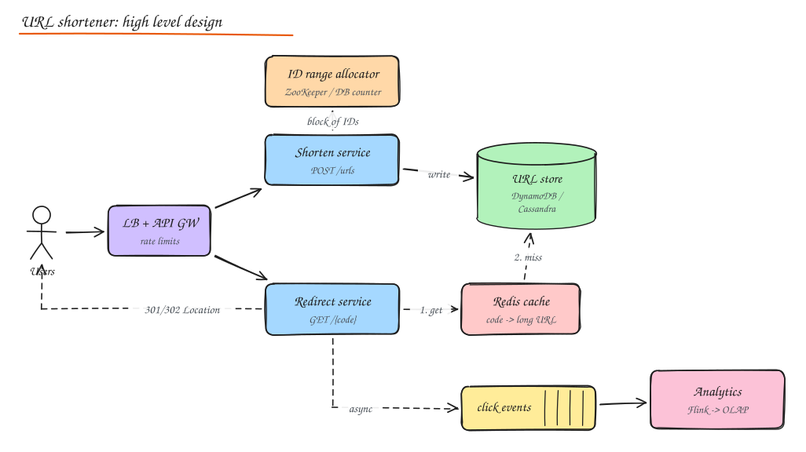

# Design a URL Shortener

> **TL;DR**
> - Read-heavy (about 100:1) with tiny writes; the interesting parts are ID generation and fast redirects.
> - Use range-allocated counters scrambled into 7-character base62 codes: unique, short and not guessable.
> - Serve redirects from cache; choose 302 if you need per-click analytics.
> - Send click analytics asynchronously and guard against abuse with rate limits and URL checks.

A classic first question. The scale is modest; the interesting parts are **ID generation**, **read path latency**, and **analytics**.

## 1. Requirements

**Functional**

- Given a long URL, return a short URL (`https://sho.rt/aZ3k9Qx`).
- Visiting the short URL redirects to the long URL.
- Optional: custom alias, expiry date, click analytics per link, user accounts and link management.

**Non-functional**

- Very read heavy (redirects >> creations), around 100:1.
- Redirect latency p99 < 50 ms (it sits in front of every click).
- Highly available for redirects (a broken short link breaks someone's campaign).
- Short codes must be unique and not easily guessable/enumerable (privacy of links).
- Durability: a created link must never disappear before expiry.

## 2. Estimation

| | Value |
|---|---|
| New URLs | 100M / month ≈ **40 writes/s** (peak ~200/s) |
| Redirects | 100:1 ≈ **4,000 reads/s** (peak ~20k/s) |
| Storage per record | ~500 bytes (code, long URL, owner, timestamps) |
| 5 years of links | 100M x 60 = 6B records x 500 B ≈ **3 TB** |
| Cache | Hot 20% of daily redirect keys ≈ tens of GB, one Redis cluster |

Code length: base62 (`[a-zA-Z0-9]`) with 7 characters gives 62^7 ≈ **3.5 trillion** codes, plenty for 6B links. 6 chars (56.8B) would also work but leaves less room.

## 3. API

```http
POST /v1/urls
{ "long_url": "https://example.com/very/long?x=1", "custom_alias": "summer-sale", "expires_at": "2027-01-01T00:00:00Z" }
-> 201 { "code": "aZ3k9Qx", "short_url": "https://sho.rt/aZ3k9Qx" }

GET /{code}            -> 302 Location: <long_url>   (or 301)
GET /v1/urls/{code}/stats?from=&to=   -> clicks by day, country, referrer
DELETE /v1/urls/{code}
```

## 4. Data model

```text
urls(code PK, long_url, user_id, created_at, expires_at, is_custom)
users(user_id PK, ...)
clicks: event stream -> aggregated tables (code, day, country, count)
```

Access pattern is a pure key lookup by `code`, which fits a key-value store (DynamoDB, Cassandra) or a sharded relational DB. 3 TB is small enough that Postgres with partitioning plus replicas is also fine; say so.

## 5. High level design



- **Shorten service**: validate URL (scheme, length, malware/phishing check), get a code, write `code -> long_url`.
- **Redirect service**: look up code in Redis, fall back to the DB on a miss, return the redirect, emit a click event asynchronously.
- **Analytics**: click events to Kafka, aggregated by a stream processor into an OLAP store.

## 6. Deep dive: generating short codes

| Approach | How | Pros | Cons |
|---|---|---|---|
| **Hash the URL** | `base62(md5(long_url))[:7]` | Same URL gives same code (dedupe), stateless | Collisions must be detected and resolved (append salt, retry), lookup before every insert |
| **Global counter + base62** | Unique integer ID, encode in base62 | No collisions, short, simple | Counter is a coordination point; sequential codes are guessable |
| **Range allocation** | Each app server leases a block of 1M IDs from ZooKeeper/DB; issues locally | No per-request coordination, no collisions | Gaps if a server dies (fine) |
| **Pre-generated key service (KGS)** | Offline generate random unique codes into a table; servers claim batches | Random-looking codes, no collisions at write time | Extra service and storage, must mark keys used atomically |
| **Snowflake ID + base62** | 64-bit time-ordered ID | No coordination | 11 chars in base62, longer URLs |

Good default answer: **range allocation** for uniqueness, then **scramble** the integer before encoding (multiply by a large odd constant mod 62^7, or a format-preserving cipher/Feistel network) so codes do not look sequential and cannot be enumerated.

```python
ALPHABET = "0123456789abcdefghijklmnopqrstuvwxyzABCDEFGHIJKLMNOPQRSTUVWXYZ"

def base62(n: int, width: int = 7) -> str:
    s = []
    while n:
        n, r = divmod(n, 62)
        s.append(ALPHABET[r])
    return "".join(reversed(s)).rjust(width, "0")

SPACE = 62 ** 7
MULT = 2_176_477_521_739      # about 0.618 x 62^7, odd and not divisible by 31, so the mapping is a bijection

def code_for(counter_value: int) -> str:
    return base62((counter_value * MULT) % SPACE)
```

**Custom aliases**: insert with a conditional write (`attribute_not_exists(code)` in DynamoDB, unique constraint in SQL); reject if taken. Keep a separate namespace or reserved words list (`api`, `admin`, offensive words).

## 7. Deep dive: the redirect path

- **301 (permanent)** is cached by browsers: later clicks never reach you, which reduces load but **breaks per-click analytics** and makes changing the target impossible for cached clients.
- **302/307 (temporary)** sends every click through you: accurate analytics, ability to edit/expire links. bit.ly uses 301 for SEO while still logging; most product answers pick **302** when analytics matter.
- Cache `code -> long_url` in Redis (cache-aside, TTL hours to days). The working set is skewed (viral links), so hit ratios above 90% are normal. Add a small in-process LRU for the very hottest codes.
- Negative caching for unknown codes (short TTL) protects the DB from scanners; a **Bloom filter** of existing codes also works.
- Serve redirects from multiple regions; the data is write-once and tiny, so replicate globally and read locally.

## 8. Analytics

- Redirect service publishes `{code, ts, ip, user_agent, referrer}` to Kafka **asynchronously** (never block the redirect).
- Stream processor enriches (geo-IP, device), dedupes bots, aggregates per code per minute/day into ClickHouse/Pinot/Druid.
- Raw events to object storage for reprocessing.
- See [Ad Click Aggregator](15-ad-click-aggregator.md) for the deeper version of this pipeline.

## 9. Other concerns

- **Expiry**: store `expires_at`; check on read; a background job (or DB TTL feature) deletes expired rows; codes may be recycled only after a long quarantine (or never).
- **Abuse**: phishing/malware checks against Safe Browsing lists at creation and periodically; rate limits per user/IP; CAPTCHA for anonymous creation; ability to disable a code globally (purge caches).
- **Availability**: redirect path depends only on cache + read replicas; writes can degrade without breaking reads.
- **Security**: no open redirects to `javascript:` URLs; validate schemes.

## 10. Scaling summary

| Bottleneck | Fix |
|---|---|
| Redirect QPS | Redis cache, in-process cache, regional read replicas, CDN edge redirects for top links |
| ID generation | Range allocation, no per-request coordination |
| Storage growth | Sharding by code hash, or a managed KV store |
| Analytics volume | Kafka + stream aggregation, sampling for low-value data |

## Interview questions

<details>
<summary>Why not just use the first 7 characters of an MD5 of the URL?</summary>

Truncating a hash makes collisions likely at billions of URLs (birthday bound: with 3.5 trillion codes, collisions become common after a few million entries). You must detect collisions with a lookup on every insert and retry with a salt, which adds latency and complexity. It also maps identical URLs from different users to the same code, which breaks per-user analytics and deletion. A counter or range-based scheme guarantees uniqueness by construction.

</details>

<details>
<summary>How do you stop people from enumerating all short links?</summary>

Do not expose sequential codes: scramble counter values with a bijective permutation or cipher before base62 encoding, or use random pre-generated keys. Use 7+ characters so the space is sparse, rate limit lookups per IP, and return identical 404s for unknown codes. For private links, add a longer random token or require auth.

</details>

<details>
<summary>The DB is down. Can redirects still work?</summary>

Mostly yes: the hot set is in Redis and in-process caches, and links never change, so cached entries are always valid (only expiry and deletions matter). Long-tail misses fail. Mitigate with read replicas in other AZs/regions and long TTLs. Creation (writes) can be temporarily disabled while redirects continue.

</details>

## Related

- [Unique ID Generation](../02-building-blocks/09-unique-id-generation.md)
- [Caching](../02-building-blocks/03-caching.md)
- [Back of the Envelope](../00-start-here/02-back-of-envelope.md)
