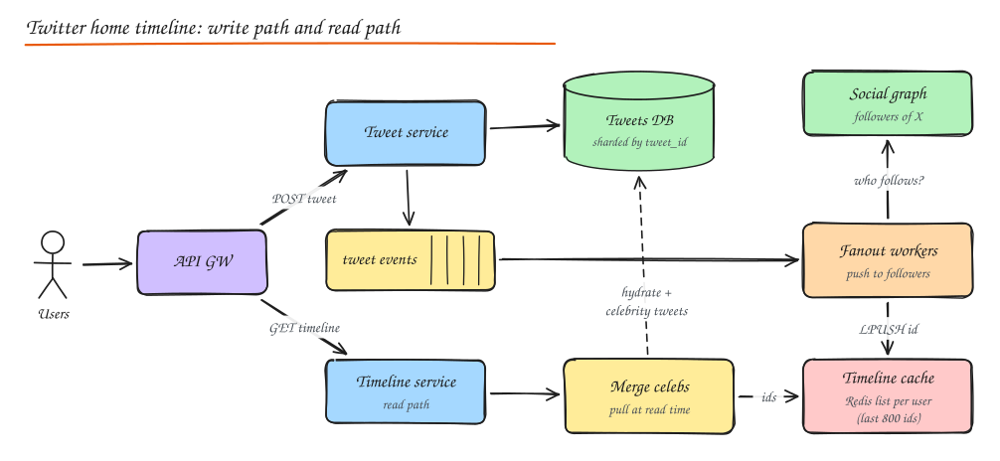
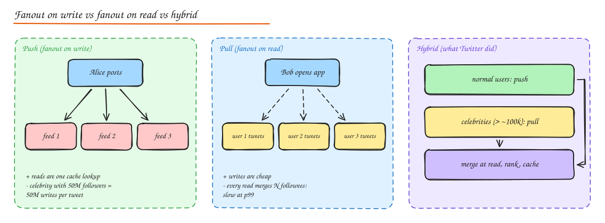

# Design Twitter / X

> **TL;DR**
> - The core problem is fanout: one tweet must appear in millions of timelines while reads stay fast.
> - Push tweet IDs into followers' cached timelines on write; pull celebrities' tweets at read time (hybrid).
> - Cache everything in layers (timeline IDs, tweet bodies, users, counts) so reads skip databases.
> - Shard by user and tweet ID, and decouple writes from fanout with an event stream.

The canonical **read-heavy feed** problem. The core challenge is the **timeline fanout problem**: one write must be visible in millions of feeds, and reads must be fast.

## 1. Requirements

**Functional (core)**

- Post a tweet (text up to 280 chars, optional media).
- Follow/unfollow users.
- Home timeline: tweets from followed accounts, newest first (or ranked).
- User timeline: one user's tweets.
- Like, retweet, quote; notifications.

Out of scope unless asked: DMs, trends, ads, full search (mention briefly).

**Non-functional**

- 300M DAU, read heavy (~100:1 timeline reads vs tweets).
- Home timeline p99 < 200 ms.
- New tweet appears in followers' timelines within a few seconds (eventual consistency OK).
- Highly available; never lose a posted tweet.
- Global users.

## 2. Estimation

| | Value |
|---|---|
| Tweets | 300M DAU x 2 / day = 600M / day ≈ **7k/s** (peak ~20k/s) |
| Timeline reads | 300M x 20 = 6B / day ≈ **70k/s** (peak ~200k/s) |
| Avg followers | ~200, but heavy tail (celebrities with 100M+) |
| Fanout writes (push) | 7k/s x 200 ≈ **1.4M timeline inserts/s** |
| Tweet storage | 600M x ~1 KB (with metadata) ≈ 600 GB/day, ~1 PB over 5 years with replication |
| Media | On object storage + CDN, far larger than text |
| Timeline cache | 300M users x 800 tweet IDs x 8 B ≈ **2 TB** of Redis (only active users cached) |

## 3. API

```http
POST /v1/tweets                 { text, media_ids[], reply_to? }   -> 201 { tweet_id }
GET  /v1/timeline/home?cursor=&limit=20                            -> { tweets[], next_cursor }
GET  /v1/users/{id}/tweets?cursor=
POST /v1/users/{id}/follow      DELETE /v1/users/{id}/follow
POST /v1/tweets/{id}/like       POST /v1/tweets/{id}/retweet
```

## 4. Data model

| Data | Store | Key design |
|---|---|---|
| Tweets | Sharded MySQL / Manhattan (Twitter's KV) / Cassandra | `tweet_id` (Snowflake: time ordered), also index by `(author_id, tweet_id)` for user timelines |
| Users | Sharded SQL | `user_id` |
| Follow graph | Sharded KV / SQL (FlockDB style) | Two tables: `followers(user_id -> follower_ids)` and `following(user_id -> followee_ids)` |
| Home timelines | Redis lists per user | `timeline:{user_id}` -> last ~800 tweet IDs |
| Likes / counts | Counters with write-behind aggregation | `tweet_id -> like_count` |
| Media | Object storage + CDN | URLs in tweet record |

## 5. High level design



**Write path**: client -> API gateway -> Tweet service stores the tweet (durable) -> publishes `TweetCreated` to Kafka -> fanout workers fetch the author's followers from the social graph and push the tweet ID into each follower's timeline cache.

**Read path**: Timeline service reads the user's precomputed ID list from Redis, merges in tweets from celebrities they follow (pulled at read time), ranks, hydrates IDs into full tweets via a tweet cache (multi-get), and returns a page with a cursor.

## 6. Deep dive: fanout models



| | Fanout on write (push) | Fanout on read (pull) |
|---|---|---|
| On tweet | Insert ID into every follower's timeline | Just store the tweet |
| On read | One cache read | Query every followee's recent tweets, merge, sort |
| Read latency | Excellent | Poor for users following hundreds |
| Write cost | Proportional to follower count; celebrities explode it | Constant |
| Wasted work | Pushing to inactive users | None |

**Hybrid** (what Twitter did): push for normal authors; for **celebrities** (followers above a threshold like 100k), skip fanout and **pull their recent tweets at read time** and merge. Also skip pushing to **inactive users**; rebuild their timeline on demand when they come back.

Try the trade-off with numbers in the **Fanout Calculator** lab.

Fanout details:

- Workers partitioned by follower ID ranges; work items batched (e.g. 5k followers per task).
- Timeline lists capped (`LTRIM` to 800) to bound memory.
- Deletes and unfollows: remove lazily at read time (filter out deleted tweets / unfollowed authors during hydration) rather than scanning all timelines.
- A Lady Gaga tweet with pure push would mean ~100M Redis writes; with hybrid it is zero fanout writes plus a cheap merge at read for her followers.

## 7. Deep dive: timeline read path at 200k QPS

1. `LRANGE timeline:{uid} 0 199` from Redis (sharded by user ID, replicated).
2. Fetch recent tweets of followed celebrities (cached per celebrity: `user_tweets:{celeb}`), merge by ID (Snowflake IDs sort by time).
3. **Rank** (if ranked timeline): candidate generation (in-network + out-of-network recommendations), feature lookup, ML model scoring, filtering (blocked, muted, NSFW, already seen), diversity rules.
4. **Hydrate**: multi-get tweet bodies, author info, counts from caches. Missing items from the tweet store.
5. Return 20 items + cursor (last item's ID / rank position).

Cache layers: timeline cache (IDs), tweet cache (bodies), user cache, count cache. Most reads never touch a database.

## 8. Real-time updates

- "New tweets" pill: client long-polls or holds an SSE/WebSocket connection; the fanout path also publishes to a per-user channel when the user is online.
- Push notifications for mentions, replies, likes go through a [notification system](08-notification-system.md).

## 9. Search

Tweets are indexed near real time: tweet events -> indexing pipeline -> Elasticsearch-like inverted index (Twitter built Earlybird on Lucene), partitioned by time (recent tweets index is hot) and by document. Query fans out across partitions and merges top results. See [Object Storage and Search](../02-building-blocks/10-object-storage-and-search.md).

## 10. Likes, counts and hot keys

- Like writes: store `(user_id, tweet_id)` edges (for "did I like this?") and increment counters asynchronously with batching (write-behind) because a viral tweet gets thousands of likes per second.
- Show approximate counts; reconcile periodically.
- Hot tweets: cached at multiple layers, replicated hot keys.

## 11. Global distribution and abuse

- Multiple regions serve reads locally; writes go to the home region of the user (or a globally replicated store) and replicate asynchronously.
- Abuse prevention: rate limits on tweeting/following, spam classifiers on the write path (async, can retract), bot detection, reputation scores, and limiting fanout of flagged content.

## 12. Scalability lessons

- **Precompute** what is read often (timelines).
- **Shard** everything by a key that matches access (user ID for timelines, tweet ID for tweets).
- **Cache hierarchies** (IDs, objects, counts) so reads skip databases.
- **Asynchronous processing** via an event stream decouples the write path from fanout.
- **Treat outliers specially** (celebrities, inactive users).

## Interview questions

<details>
<summary>Why not fanout on write for everyone?</summary>

Write amplification is proportional to follower count. A user with 100M followers would require 100M cache inserts per tweet, taking minutes and huge resources, and delaying other fanout work. Many of those followers are inactive, so most of that work is wasted. The hybrid model pulls celebrity tweets at read time instead.

</details>

<details>
<summary>How do you handle a user unfollowing someone?</summary>

Update the follow graph immediately. Rather than scrubbing the precomputed timeline (expensive), filter at read time: when hydrating, drop tweets whose author is no longer followed. Future tweets will not be fanned out to them. Optionally a background job cleans the cached list.

</details>

<details>
<summary>A user who hasn't logged in for a year returns. What happens?</summary>

Their timeline is not in the cache (we skip fanout to inactive users and evict cold timelines). On first request we rebuild it by pulling recent tweets from followees (fanout on read), merge and cache it, then resume normal push fanout. The first load is slower; show a loading state or a quick partial result.

</details>

<details>
<summary>How would you add a ranked "For You" feed?</summary>

Two-stage recommender: candidate generation from in-network timelines plus out-of-network sources (similar users, trending topics, embeddings), then a ranking model scoring engagement probability with features from a feature store, then filtering and diversity rules. Serve with strict latency budgets and cache ranked results briefly. See [ML System Design](../10-advanced/05-ml-system-design.md).

</details>

## Related

- [Case study: Instagram](03-instagram.md)
- [Caching](../02-building-blocks/03-caching.md)
- [Message Queues](../02-building-blocks/07-message-queues.md)
- [Sharding](../03-data/05-sharding-partitioning.md)
