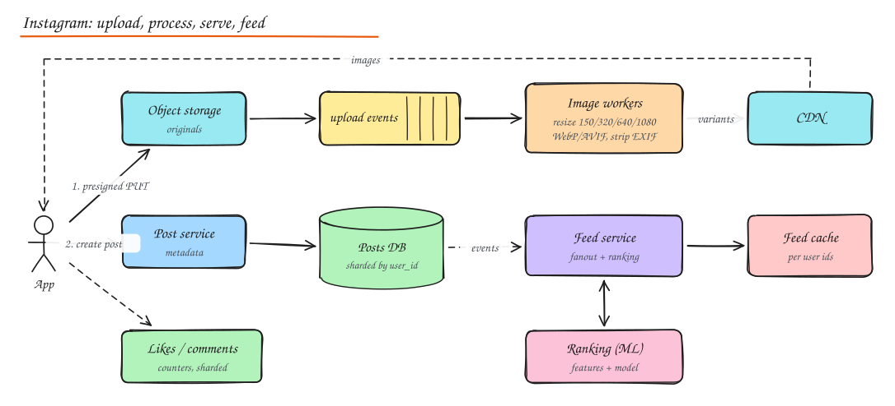

# Design Instagram

> **TL;DR**
> - Two systems in one: a media pipeline (upload, process, CDN) and a ranked social feed.
> - Upload originals directly to object storage, then resize and encode asynchronously into immutable, CDN-cached variants.
> - Feeds combine hybrid fanout with ML ranking; likes use sharded or batched counters to survive viral posts.
> - Stories are short-lived data with TTLs and their own tray.

Instagram combines a **media pipeline** (upload, process, store, deliver images and video) with a **social feed** (like Twitter, but ranked and media heavy).

## 1. Requirements

**Functional**

- Upload photos/videos with captions; view a post.
- Follow users; home feed of followed users' posts (ranked).
- Like and comment; counts visible.
- Stories that disappear after 24 hours.
- Search users/hashtags; explore/discovery; DMs and notifications (briefly).

**Non-functional**

- 500M DAU, read heavy. Feed p99 < 300 ms, images load fast globally.
- Uploads must be durable; processing can take seconds.
- High availability over strong consistency for feeds and counts.

## 2. Estimation

| | Value |
|---|---|
| Posts | 100M / day ≈ 1.2k/s |
| Feed loads | 500M x 15 ≈ 7.5B / day ≈ 90k/s |
| Original photo | ~2 MB; plus 4 resized variants ≈ 0.5 MB total |
| Media storage | 100M x 2.5 MB ≈ **250 TB/day** before replication |
| Egress | Dominated by images/video: the CDN carries > 95% |

## 3. API

```http
POST /v1/media/upload-url         { content_type, size }    -> { upload_url (presigned), media_id }
POST /v1/posts                    { media_ids[], caption, location? } -> { post_id }
GET  /v1/feed?cursor=             -> { posts[], next_cursor }
POST /v1/posts/{id}/likes         DELETE /v1/posts/{id}/likes
POST /v1/posts/{id}/comments      { text }
GET  /v1/posts/{id}/comments?cursor=
POST /v1/stories                  { media_id }               (expires after 24 h)
```

## 4. High level design



### Upload flow

1. Client asks for a **presigned URL**; uploads the original directly to object storage (resumable/multipart for video).
2. Client creates the post referencing `media_id`; post service writes metadata with status `processing`.
3. Storage event -> queue -> **image workers**: validate, strip EXIF location (privacy), generate variants (150 px thumbnail, 320, 640, 1080 widths), encode WebP/AVIF + JPEG fallback, compute blurhash placeholder; for video, transcode to adaptive bitrate renditions.
4. Mark media `ready`; post becomes visible; fanout to followers' feeds.

Why async: processing is CPU heavy and slow; the client should not wait, and workers scale independently.

### Serving images

- All variants are immutable and content-addressed (`/m/{hash}_{w}.webp`), so CDN caching is permanent.
- Client requests the size it needs (`srcset`), progressive loading with blurhash placeholders.
- Popular content stays hot at the edge; long-tail falls back to an origin shield.

## 5. Data model

| Entity | Store | Notes |
|---|---|---|
| Users, follows | Sharded Postgres (Instagram famously sharded Postgres by user ID into thousands of logical shards) | IDs encode the shard (41 bits time + 13 bits shard + 10 bits sequence) |
| Posts | Same shards, keyed by author | `(author_id, post_id)` |
| Feed | Redis / Cassandra list of post IDs per user | Precomputed candidates |
| Likes | Wide-column: `(post_id) -> user_ids` and `(user_id) -> post_ids` | Huge volume |
| Counts | Counter service with write-behind | Approximate in real time |
| Comments | Sharded by `post_id` | Paginated by time |
| Stories | KV with 24 h TTL + media in object storage | Auto expiry |

## 6. Deep dive: feed generation and ranking

- **Candidate generation**: hybrid fanout (push post IDs to active followers' feed lists; pull from high-follower accounts at read time), as in [Twitter](02-twitter-news-feed.md).
- **Ranking**: Instagram moved from chronological to ranked. For each candidate, fetch features (author affinity, past interactions, post engagement velocity, media type, recency) from a feature store; score with an ML model predicting probabilities of like/comment/save/watch time; combine into a value score; apply diversity rules (not 5 posts from one account in a row).
- Cache the ranked first page per user for a short time; rank incrementally as the user scrolls.
- **Explore**: out-of-network recommendations using embeddings and two-tower retrieval models plus the same ranking stack.

## 7. Deep dive: likes and comments at scale

- A viral post can get tens of thousands of likes per second: a single counter row becomes a hot key.
- Store like **edges** idempotently (`(post_id, user_id)` unique) so double taps do not double count.
- Count with **sharded counters** (N sub-counters per post, summed on read) or buffer increments in memory/Redis and flush periodically (write-behind). Show approximate counts ("1.2M likes").
- Comments: append-only, sharded by post, ranked (top comments) with a separate ranking pass; moderation filters run async.

## 8. Stories

- Separate pipeline from posts: short-lived, viewed sequentially, high fanout of "tray" metadata.
- Store story metadata with a **TTL** of 24 h; media in object storage with lifecycle deletion (or keep for "archive" if the user opts in).
- Story tray: list of followed users with active stories, ranked; precomputed and cached.
- Viewers list per story: append-only set, visible to the author.

## 9. Storage optimization

- Store only needed variants; regenerate rare sizes on demand at the edge.
- Modern formats (AVIF/WebP) cut bytes 30 to 50%.
- Tier old media to cheaper storage classes; erasure coding for cold data (Facebook's f4 warm BLOB storage).
- Deduplicate identical uploads by content hash.

## 10. Scalability lessons

- **Eventual consistency** is fine for feeds, counts and comments order.
- **Cache everything immutable** forever at the edge.
- **Async processing** for anything heavy.
- **Shard by user** with shard-encoding IDs so routing needs no lookup.

## Interview questions

<details>
<summary>Why upload directly to object storage instead of through the API servers?</summary>

Media bytes are large; passing them through API servers wastes bandwidth, memory and connections, and makes those servers hard to scale. Presigned URLs let clients upload straight to storage with scoped, expiring credentials, with multipart/resumable support. The API only handles small metadata requests.

</details>

<details>
<summary>How do you show a post immediately to the uploader while processing happens?</summary>

The client displays its local copy optimistically. Server side the post has status `processing`; the author's own profile fetch includes it (read your own writes from the primary), while followers' feeds only receive it once status is `ready`. If processing fails, notify the client to retry.

</details>

<details>
<summary>How would you count views on Reels accurately at huge scale?</summary>

Emit view events from clients (with dedupe keys per user per reel per session), ingest through Kafka, dedupe and aggregate in a stream processor into per-reel counters (exactly-once semantics within the pipeline), serve approximate real-time counts from a cache, and run a batch reconciliation for billing or creator payouts. Filter bots and invalid traffic before counting.

</details>

## Related

- [Twitter News Feed](02-twitter-news-feed.md)
- [CDN](../02-building-blocks/04-cdn.md)
- [Object Storage](../02-building-blocks/10-object-storage-and-search.md)
- [ML System Design](../10-advanced/05-ml-system-design.md)
