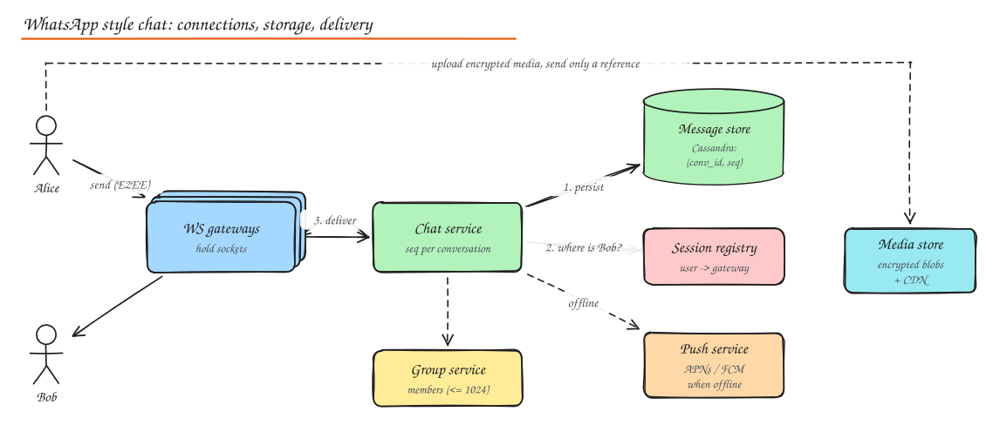
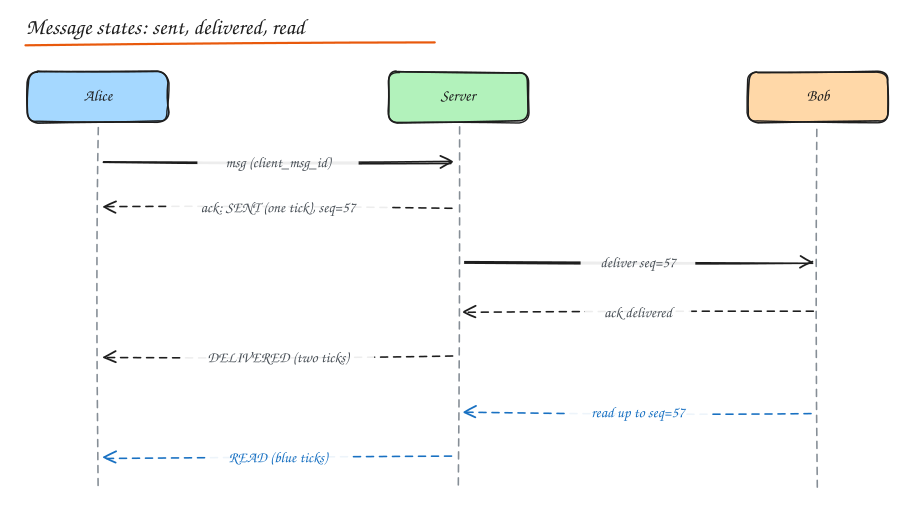

# Design a Chat System (WhatsApp, Slack, Discord)

> **TL;DR**
> - Persistent connections live on gateways; a registry knows which gateway holds each user.
> - Persist before acknowledging, assign per-conversation sequence numbers, and dedupe retries by client message id.
> - Receipts move a message from sent to delivered to read; offline users get push notifications and sync by cursor.
> - Small groups fan out on write; huge channels store once and fan out on read.

## 1. Requirements

**Functional**

- 1:1 and group chats (WhatsApp groups up to ~1,024 members).
- Send text and media; message history; multi-device.
- Delivery status: sent, delivered, read.
- Online presence and "last seen", typing indicators.
- Push notifications when offline.
- Slack/Teams flavour: channels with thousands of members, threads, search, bots/integrations, rich media.

**Non-functional**

- Low latency delivery (< 200 ms when both online).
- **No message loss**; messages in a conversation shown in a consistent order.
- At-least-once delivery with deduplication (effectively exactly once to the user).
- 2B users, ~100B messages/day; mobile networks are flaky.
- End-to-end encryption for consumer messaging.

## 2. Estimation

| | Value |
|---|---|
| Messages | 100B / day ≈ **1.2M/s** average |
| Concurrent connections | Hundreds of millions; at ~500k per gateway box ≈ 1,000+ gateway servers |
| Storage | 100B x 100 B ≈ 10 TB/day of text (WhatsApp historically deleted messages after delivery; Slack/Discord keep history forever) |

## 3. API (over WebSocket, plus REST for history)

```json
// client -> server
{ "type": "send", "client_msg_id": "c-81f2", "conversation_id": "conv_42", "ciphertext": "...", "ts": 1760500000 }
// server -> client
{ "type": "ack", "client_msg_id": "c-81f2", "message_id": "m_9001", "seq": 57 }
{ "type": "message", "conversation_id": "conv_42", "seq": 57, "sender": "alice", "ciphertext": "..." }
{ "type": "receipt", "conversation_id": "conv_42", "up_to_seq": 57, "status": "read", "by": "bob" }
```

```http
GET /v1/conversations/{id}/messages?before_seq=57&limit=50     # history / sync
GET /v1/sync?since=<per-device cursor>                         # catch up after reconnect
```

## 4. High level design



- **WebSocket gateways** hold persistent connections (see [Real Time Communication](../04-networking-apis/04-realtime-communication.md)). They authenticate, heartbeat, and forward frames. No business logic.
- **Session registry** (Redis): `user/device -> gateway`. Updated on connect/disconnect, TTL refreshed by heartbeats.
- **Chat service**: validates membership, assigns the **sequence number**, persists, then routes to recipients' gateways (pub/sub to gateway channels).
- **Message store**: Cassandra/ScyllaDB/HBase partitioned by `conversation_id` (plus time bucket), clustered by `seq`.
- **Group service**: membership lists, admin roles.
- **Push service**: APNs/FCM for offline devices.
- **Media service**: encrypted blobs in object storage; the message carries a pointer and the decryption key (inside the E2EE payload).

## 5. Deep dive: ordering

- Global ordering is unnecessary; **per-conversation ordering** is what users see.
- The chat service (or the partition owner for that conversation) assigns a monotonically increasing `seq` per conversation. Route all messages of a conversation to the same partition (Kafka partition key or consistent-hash owner) so one writer assigns sequence numbers without coordination.
- Clients display by `seq`, not by device clock (clocks are wrong).
- Client-generated `client_msg_id` deduplicates retries: if the client resends after a timeout, the server returns the existing `seq` instead of storing a duplicate.

## 6. Deep dive: delivery guarantees and receipts



1. Sender sends; server **persists first**, then acks (single tick). The message is now safe.
2. Server pushes to recipient devices; each device acks receipt -> server records `delivered_up_to_seq` per device -> tells sender (double tick).
3. When the user views the conversation, the device sends `read up_to seq` -> blue ticks.
4. If the recipient is offline, the message waits in the store (or a per-device inbox queue); a push notification wakes the app; on reconnect the device **syncs from its last acknowledged cursor**.

Receipts are aggregated per conversation (`up_to_seq`) rather than per message to save traffic.

## 7. Group messaging

- **Small groups** (WhatsApp, up to ~1k): fanout on write: the chat service looks up members and delivers to each member's devices. With E2EE, the sender encrypts once using **sender keys** (a group symmetric key distributed pairwise), the server fans out the same ciphertext.
- **Large channels** (Slack channels, Discord servers with 100k+ members): store the message once per channel; online members subscribed to the channel receive it via pub/sub; offline members read from channel history when they open it (fanout on read). Unread counts are computed from per-user read cursors (`last_read_seq` per channel), not per-message flags.
- Discord's approach: each guild (server) is owned by a process (Elixir) that fans out to connected sessions; message history in ScyllaDB partitioned by `(channel_id, bucket)`.

## 8. Presence and typing

- Presence is high churn and ephemeral: heartbeat-based status in Redis with TTL; publish **changes** only, and only to interested users (contacts currently online, or those with the chat open).
- "Last seen": write at disconnect, not on every heartbeat.
- Typing indicators: fire-and-forget, throttled (e.g. at most every 3 s), never stored.
- Large rooms: show approximate presence or skip it.

## 9. Multi-device and sync

- Each device has its own connection, its own cursor and (with E2EE) its own keys. Messages are encrypted per recipient device.
- Sync API returns all messages after the device's cursor across conversations (an inbox log per user is a common design: `user_inbox(user_id, inbox_seq) -> (conversation_id, seq)`).

## 10. End-to-end encryption

- **Signal Protocol**: X3DH key agreement using identity keys and one-time pre-keys published to the server, then the Double Ratchet for per-message keys (forward secrecy and post-compromise security).
- The server stores and routes ciphertext only; it cannot read messages, search them, or moderate content directly.
- Media: encrypted on device with a random key; the blob goes to storage; the key travels inside the encrypted message.
- Backups: encrypted with a user-held key or passphrase (otherwise E2EE is undermined).
- See [Encryption](../07-security/02-encryption-data-network-security.md#end-to-end-encryption-e2ee).

## 11. Slack / Teams specifics

| Feature | Design note |
|---|---|
| Channels and history | Messages stored forever per workspace; sharded by workspace (Slack moved to Vitess-sharded MySQL) |
| Threads | `parent_message_id`; replies stored in the same channel partition, with a thread summary on the parent |
| Search | Index messages per workspace in a search cluster (respecting channel permissions at query time) |
| Rich media and unfurls | Async workers fetch link previews; files in object storage with virus scanning |
| Bots and integrations | Events API (webhooks) and a rate-limited Web API; bots are users with scopes |
| Enterprise | Data retention policies, legal hold, export, data residency |

## 12. Failure handling

- Gateway crash: clients reconnect (jittered backoff) to another gateway, re-register, sync from cursor. No message loss because messages are persisted before ack.
- Chat service crash after persist but before routing: recipients get the message on next sync; a background "undelivered" scanner or the client's periodic sync covers gaps.
- Duplicate sends after retries: deduped by `client_msg_id`.

## Interview questions

<details>
<summary>How do you guarantee messages are not lost if the server crashes right after receiving them?</summary>

Only acknowledge to the sender after the message is durably persisted (replicated write to the message store, or a replicated log like Kafka). Until the ack arrives, the client keeps the message in a local outbox and retries with the same `client_msg_id`, which the server dedupes. Recipients pull anything they missed using their sync cursor.

</details>

<details>
<summary>Why per-conversation sequence numbers instead of timestamps?</summary>

Device and server clocks differ and can go backwards, so timestamps produce inconsistent ordering across participants. A single sequencer per conversation (the partition owner) assigns a strictly increasing number, so every participant sees the same order, gaps are detectable, and sync is simply "give me everything after seq N".

</details>

<details>
<summary>How does a Slack channel with 50,000 members avoid writing 50,000 copies of each message?</summary>

It stores the message once in the channel's history. Online members who have the workspace open are subscribed to the channel via pub/sub and receive the message over their socket; everyone else reads history when they open the channel. Unread state is a per-user `last_read` cursor compared with the channel's latest sequence.

</details>

## Related

- [Real Time Communication](../04-networking-apis/04-realtime-communication.md)
- [Notification System](08-notification-system.md)
- [NoSQL modeling (Cassandra)](../03-data/03-nosql-choosing-a-database.md)
