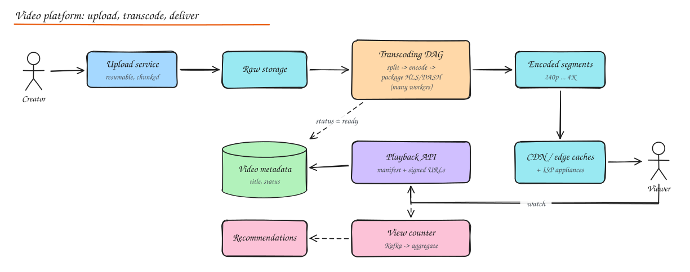

# Design YouTube / Netflix

Two flavours of the same problem:

- **YouTube**: user generated content, huge upload volume, long tail, many viewers per popular video.
- **Netflix**: curated catalog, few uploads, enormous egress concentrated on popular titles, aggressive pre-positioning at the edge.

## 1. Requirements

**Functional**: upload video, process it, watch with adaptive quality on any device, search, recommendations, view counts, likes/comments (YouTube), resume playback.

**Non-functional**: smooth playback (fast start < 2 s, minimal rebuffering), global scale, uploads durable, cost efficient (egress is the dominant cost), high availability of playback.

## 2. Estimation (YouTube-like)

| | Value |
|---|---|
| Uploads | 500 hours of video per minute ≈ 720k hours/day |
| Raw storage | ~1 GB per hour of 1080p upload ≈ 720 TB/day raw; transcoded renditions add ~1.5x |
| Watch time | 1B hours/day; average 3 Mbps ≈ **1.4 TB/s** average egress (CDN mandatory) |
| Metadata | Small: billions of rows, fine for sharded SQL/KV |

## 3. High level design

### Upload

- Resumable, chunked uploads (tus-style or multipart to object storage via presigned URLs), so a dropped connection does not restart a 4 GB upload.
- Upload service records metadata (`status = uploading -> processing -> ready`) and emits an event when the upload completes.

### Transcoding pipeline (the heart of the system)

A **DAG** of tasks orchestrated by a workflow engine:

1. **Validate and inspect** (container, codecs, duration, resolution), virus/content checks.
2. **Split** the source into segments (e.g. GOP-aligned chunks of a few seconds) so encoding runs **in parallel** across many workers.
3. **Encode** each chunk into a ladder of renditions: 144p to 4K at several bitrates, codecs H.264 (compatibility), VP9/AV1/HEVC (efficiency). **Per-title / per-shot encoding** (Netflix) picks bitrate ladders based on content complexity.
4. **Audio** tracks, **subtitles/captions** (auto speech-to-text), **thumbnails** (sprite sheets for scrubbing).
5. **Package** into streaming formats: HLS (`.m3u8` + segments) and DASH (`.mpd`), often CMAF to share segments; apply **DRM** encryption (Widevine, FairPlay, PlayReady) for premium content.
6. **Publish**: write outputs to object storage, update metadata to `ready`, warm CDN caches for expected-popular content.

Workers are stateless, autoscaled on queue depth, often on spot instances (retry failed chunks). Encoding cost is huge, so popular videos may get extra efficient codecs (AV1) later, while long-tail videos get a cheaper ladder.

### Adaptive bitrate streaming (ABR)

- The player downloads a **manifest** listing renditions and their segment URLs.
- It measures throughput and buffer level, then picks the rendition for each next segment (2 to 6 s). Low buffer: drop quality to avoid rebuffering; healthy buffer: step up.
- Segments are plain static files over HTTP, so they cache perfectly at CDNs.
- Start fast with a low rendition, then ramp up.

### Content delivery

- **CDN** with tiered caching; YouTube has Google Global Cache appliances inside ISPs; Netflix **Open Connect** places appliances inside ISP networks and **pre-positions** (pushes) the catalog during off-peak hours based on predicted popularity.
- The playback API returns manifests with **signed, expiring URLs** (or tokens) per user/session to prevent hotlinking and enforce entitlements and geo restrictions.
- Steering: the control plane picks the best edge (health, load, network proximity) for each session.

### Playback flow

1. Client calls `GET /v1/videos/{id}/play` -> auth, entitlement, geo check, returns manifest URL(s) on the chosen CDN, plus DRM license server URL.
2. Player fetches manifest and segments from the edge.
3. Player sends heartbeats/QoE events (startup time, rebuffers, bitrate switches) for analytics and steering.

## 4. Data model

| Data | Store |
|---|---|
| Video metadata (title, owner, status, renditions, durations) | Sharded SQL (Vitess at YouTube) / Cassandra (Netflix) |
| Video files and segments | Object storage + CDN |
| User data: watch history, resume position | Wide-column store keyed by user |
| Comments, likes | Sharded stores with counters |
| Search index | Inverted index over titles, descriptions, captions |

## 5. Deep dives

### View counting

- Every play emits events; a view "counts" after N seconds watched, deduplicated per user/session, filtered for bots.
- Kafka -> stream processing (exactly-once aggregation) -> counters in a fast store; show approximate real-time counts, reconcile with batch for creator payouts.
- Hot videos: sharded counters to avoid hot keys.

### Recommendations

- The biggest driver of watch time. Candidate generation (collaborative filtering, embeddings, two-tower models) then ranking (deep models predicting watch time), with freshness and diversity constraints. Precompute homepage rows offline for Netflix; real time for YouTube. See [ML System Design](../10-advanced/05-ml-system-design.md).

### Viewing analytics

- QoE metrics per session (startup latency, rebuffer ratio, average bitrate, errors) drive CDN steering, encoding ladder decisions and incident detection.
- A/B testing infrastructure for player algorithms, artwork, and recommendations.

### Live streaming (follow-up)

- Ingest via RTMP/SRT/WebRTC to ingest servers, real-time transcoding, short segments (LL-HLS, 1 to 2 s parts) to cut latency, CDN fanout, chat via pub/sub. Trade latency for stability.

## 6. Failure and cost considerations

- Encoding failures: per-chunk retries; idempotent outputs keyed by `(video_id, rendition, chunk)`.
- Region outage: playback served by CDN caches and multi-region control plane; uploads can be queued.
- Cost levers: better codecs (AV1 saves ~30% bandwidth vs H.264), ISP caches, encoding only popular renditions eagerly, storage tiering for cold videos.

## Interview questions

Why split the video into chunks before transcoding?

Encoding a long video sequentially takes hours. Splitting at keyframe boundaries lets hundreds of workers encode chunks in parallel, cutting time-to-publish to minutes, and a failed chunk is retried alone. Chunks are then stitched or packaged directly as streaming segments.

How does adaptive bitrate streaming decide quality?

The player estimates available bandwidth from recent segment download times and watches its buffer level. Buffer-based and hybrid algorithms (BOLA, MPC, Netflix's own) pick the highest rendition that keeps the buffer from draining, switching per segment. They avoid oscillation with smoothing and prefer lower quality over rebuffering.

Netflix vs YouTube: how do their CDN strategies differ and why?

Netflix has a relatively small catalog with predictable popularity, so it proactively pushes content to appliances inside ISPs during off-peak hours, serving almost everything from the edge. YouTube has a massive long tail of user uploads with unpredictable popularity, so it relies more on pull-through caching with tiered caches, pre-warming only for content predicted to go viral.

## Related

- [CDN](../02-building-blocks/04-cdn.md)
- [Object Storage](../02-building-blocks/10-object-storage-and-search.md)
- [Message Queues](../02-building-blocks/07-message-queues.md)
