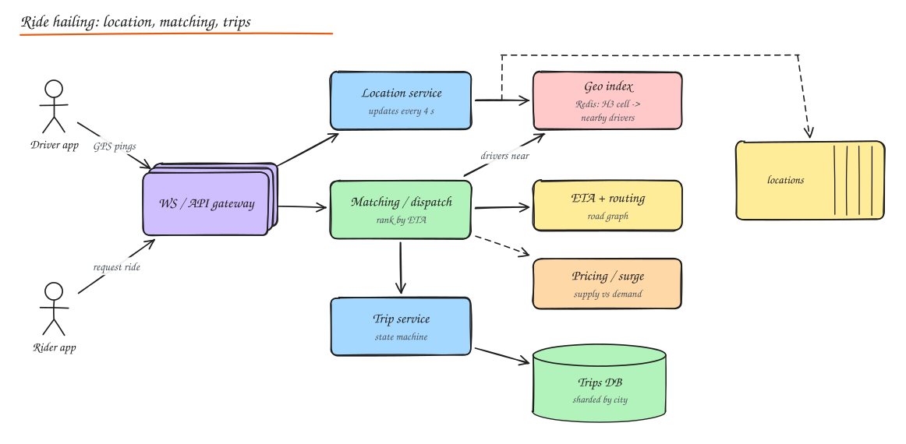

# Design Uber / Lyft

> **TL;DR**
> - Over a million location pings per second belong in memory (a geo index), not in a relational database.
> - Find nearby drivers with geohash, quadtree or H3 cells, then rank by ETA, not straight-line distance.
> - Assigning a driver must be atomic so nobody gets two trips; the trip is a durable state machine.
> - Surge pricing compares supply and demand per area over short windows.

## 1. Requirements

**Functional**

- Drivers go online and stream their location.
- Riders see nearby cars, request a ride, get matched with a driver, see ETA and live tracking.
- Trip lifecycle: requested -> accepted -> arriving -> in progress -> completed / cancelled.
- Pricing with surge, payment after the trip, ratings.
- Rider-driver communication (masked calls, chat).

**Non-functional**

- Matching within seconds; location updates near real time.
- High availability (a down app strands people); per-city isolation.
- Strong consistency for **trip assignment** (a driver must not get two trips at once); eventual consistency is fine for map dots.
- Scale: 5M active drivers globally at peak, 20M trips/day.

## 2. Estimation

| | Value |
|---|---|
| Location updates | 5M drivers / 4 s ≈ **1.25M writes/s** |
| Ride requests | 20M / day ≈ 230/s (peak 10x in a city during events) |
| Location payload | ~100 bytes; mostly ephemeral (keep latest + sampled history for trips) |

The key insight: **location writes dominate**, and they are tiny, frequent and mostly overwrite previous values. They belong in memory, not in a durable DB per update.

## 3. High level design



- **Gateway** (WebSocket/HTTP2 for apps).
- **Location service**: ingests driver pings, updates the in-memory geo index, publishes to a stream (Kafka) for trip tracking, analytics and ETA models.
- **Geo index**: maps cells to available drivers.
- **Matching / dispatch**: finds candidate drivers, ranks, offers the trip, handles accept/decline/timeout.
- **ETA/routing**: road graph routing with live traffic.
- **Pricing**: base fare + surge by cell and time.
- **Trip service**: owns the trip state machine and its durable record.
- **Payments**: charge after trip via the [payment system](10-payment-system.md).

## 4. Deep dive: geospatial indexing

Find drivers within ~2 km of the rider quickly. Options (more in [Geospatial Indexing](../10-advanced/04-geospatial-indexing.md)):

| Index | Idea | Notes |
|---|---|---|
| **Geohash** | Interleave lat/lng bits into a base32 string; nearby points share prefixes | Simple prefix queries; cells distort near poles; query the cell + 8 neighbours |
| **Quadtree** | Recursively split regions with too many points | Adapts to density (Manhattan vs countryside); in-memory tree |
| **Google S2** | Sphere projected onto a cube, Hilbert curve cell IDs | Good locality, used by Google, early Uber |
| **H3** (Uber) | Hierarchical hexagonal grid | Uniform neighbour distances (hexagons), great for surge/supply aggregation |

Implementation:

- Driver ping -> compute H3 cell at resolution ~9 (≈ 0.1 km²) -> `cell -> set(driver_id)` in Redis (or an in-memory sharded service), plus `driver -> (lat, lng, cell, status, ts)`.
- On cell change, move the driver between sets. Expire drivers with stale pings (TTL).
- Query: rider's cell + k-ring of neighbours (expanding rings until enough candidates).
- Shard the index by geography (city/region), which also gives **failure isolation**.
- Redis `GEOADD`/`GEOSEARCH` (geohash under the hood) is a fine interview answer for a city-sized shard.

## 5. Deep dive: matching and dispatch

1. Rider requests: trip created (`REQUESTED`) with an idempotency key.
2. Candidate search: available drivers near pickup, filtered by vehicle type, rating, etc.
3. Rank by **ETA** (road distance, not straight-line), driver acceptance likelihood, fairness.
4. **Offer** to the best driver (or a few sequentially): the driver must accept within ~10 s.
5. On accept, **atomically assign**: conditional update `driver.status = ON_TRIP WHERE status = AVAILABLE` and `trip.driver = X WHERE trip.status = REQUESTED`. Use a single owner per city (dispatch actor) or a transactional store; this is where strong consistency matters.
6. On decline/timeout, offer to the next candidate.

Improvements: **batched matching** (collect requests for a few seconds and solve an assignment problem to minimize total ETA), pre-dispatch to drivers finishing nearby trips, pooled rides (route compatibility).

## 6. ETA

- Road network graph with live speeds from driver traces; routing with contraction hierarchies or similar precomputed speedups.
- ML models correct route ETA using historical patterns (time of day, weather, events).
- Cache ETAs between cells for candidate ranking; compute precise routes only for the chosen driver.

## 7. Surge pricing

- Per H3 cell (aggregated to larger areas), compare demand (requests, app opens) with supply (available drivers) over short windows using stream processing (Flink).
- Multiplier computed by a pricing model, smoothed over time and space, capped by regulation.
- Show and **lock the quoted price** for a few minutes (store the quote with an ID; the trip references it).

## 8. Trip state machine and data

```text
REQUESTED -> DRIVER_ASSIGNED -> DRIVER_ARRIVING -> IN_PROGRESS -> COMPLETED
     |              |                 |
     +---> CANCELLED (rider/driver/timeout, with cancellation fee rules)
```

- Trips stored durably (sharded by city or trip ID), every transition an event (audit, billing, support).
- Live trip tracking: driver location stream for that trip pushed to the rider over WebSocket.
- Sampled GPS trail stored for fare computation and disputes.

## 9. Communication, payments, analytics

- **Masked phone numbers** and in-app chat via a telephony provider; messages through the chat pipeline.
- **Payments**: authorize an estimate at request time, capture the final fare after completion, split payouts to drivers later (ledger). Idempotent by trip ID.
- **Analytics**: location and trip events to Kafka -> data lake/warehouse for supply planning, fraud detection (GPS spoofing), and model training.

## 10. Reliability

- **Cell/city isolation**: a failure in one city's dispatch does not affect others.
- Location index is rebuildable from the next round of pings (4 s), so it can be in-memory.
- Graceful degradation: if ETA service is down, use straight-line estimates; if surge is down, use the last known multiplier.
- Multi-region active-active with each city homed in one region and failover.

## Interview questions

<details>
<summary>Why not store every driver location update in a relational database?</summary>

At over a million updates per second of tiny, constantly overwritten values, a relational DB would spend all its effort on write IO and index maintenance for data that is stale within seconds. Keep the latest location in memory (Redis or an in-memory geo service sharded by region) and stream updates to Kafka for anything that needs history.

</details>

<details>
<summary>How do you prevent a driver from being assigned two trips simultaneously?</summary>

Make assignment an atomic conditional state change on the driver (only if `AVAILABLE`), done by a single owner (dispatch actor per city/driver shard) or with a compare-and-set in a strongly consistent store. The losing trip continues searching. Idempotency keys stop duplicate rider requests from creating two trips.

</details>

<details>
<summary>Why hexagons (H3) instead of squares (geohash)?</summary>

Every hexagon's neighbours are at the same distance from its center, which makes neighbourhood searches, smoothing and aggregations (like supply/demand for surge) more uniform. Square grids have diagonal neighbours farther away than edge neighbours, and geohash cells vary in shape with latitude.

</details>

## Related

- [Geospatial Indexing](../10-advanced/04-geospatial-indexing.md)
- [Real Time Communication](../04-networking-apis/04-realtime-communication.md)
- [Stream Processing](../10-advanced/02-stream-batch-processing.md)
