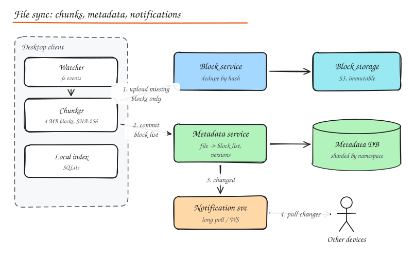

# Design Dropbox / Google Drive

> **TL;DR**
> - Split files into content-hashed blocks: upload only changed blocks and dedupe identical ones.
> - Keep metadata (file to block list, versions) in a consistent database and blocks in object storage.
> - Clients sync from a per-namespace change journal using a cursor, woken by long polling.
> - Concurrent offline edits produce conflicted copies; versions make restores a metadata operation.

## 1. Requirements

**Functional**: upload/download files, automatic sync across devices, file versioning and restore, sharing with permissions (view/edit), offline edits that sync later, web access.

**Non-functional**: durability (never lose files: 11 nines), consistency of the file tree per user, efficient bandwidth (do not re-upload whole files for small changes), scale to hundreds of millions of users and exabytes, reasonable sync latency (seconds).

## 2. Estimation

| | Value |
|---|---|
| Users | 500M, 100M DAU |
| Storage | avg 10 GB per user ≈ 5 EB logical; dedupe and compression reduce physical size substantially |
| File changes | 100M DAU x 20 changes ≈ 2B / day ≈ 23k/s metadata writes |
| Block uploads | Most changes touch one or a few 4 MB blocks |

## 3. Key idea: split files into blocks

- Files are split into fixed-size **blocks** (Dropbox uses 4 MB), each identified by its **SHA-256 hash**.
- A file version = ordered list of block hashes (**blocklist**).
- Upload only blocks the server does not already have: **dedupe** across versions, files and (carefully) users.
- A small edit in a big file changes one block: **delta sync** uploads 4 MB, not 2 GB.
- Content-defined chunking (rolling hash, like rsync/Rabin fingerprints) keeps block boundaries stable when bytes are inserted near the start; fixed-size blocks are simpler and fine for many file types.

## 4. High level design

- **Client**: watcher (filesystem events), chunker/hasher, local index DB (SQLite of files, blocklists, sync cursor), uploader/downloader with resumable transfers.
- **Block service**: `has_blocks(hashes)` -> missing ones; `put_block`, `get_block`; writes to block storage (S3 or a custom store like Dropbox's Magic Pocket) with encryption at rest.
- **Metadata service**: namespaces (a user's root, shared folders), file entries (path, blocklist, size, version, modified time), journal of changes per namespace with a monotonically increasing **cursor**.
- **Metadata DB**: sharded (by namespace ID) relational store; strong consistency per namespace.
- **Notification service**: long-poll or WebSocket telling clients "namespace X changed past cursor C".

### Upload flow

1. Client detects a change, chunks the file, hashes blocks.
2. Calls `commit(path, blocklist, parent_version)`; server responds with the list of **missing blocks**.
3. Client uploads missing blocks (parallel, resumable).
4. Client retries `commit`; server verifies all blocks exist, appends a journal entry, bumps the namespace cursor.
5. Notification service wakes other devices.

### Download / sync flow

1. Device long-polls: "anything after cursor C?"
2. On change, calls `list_changes(cursor)` -> new entries.
3. For each changed file, downloads blocks it does not have locally, assembles the file atomically (write temp then rename).

## 5. Deep dives

### Conflicts

Two devices edit the same file offline. On commit, the server checks `parent_version`; if it is not the latest, the commit is rejected. The client keeps the server's version and saves its own as a **conflicted copy** ("report (Alice's conflicted copy 2026-10-15).docx"). Simple, safe, and users understand it. Real-time co-editing (Docs) needs OT/CRDTs instead, see [Google Docs](09-google-docs.md).

### Versioning and deletes

- Every commit creates a new version entry; old versions keep their blocklists, so restore is a metadata operation.
- Deletes are soft (trash) for a retention window.
- **Garbage collection**: blocks are reference counted (or periodically mark-and-sweep) across all blocklists; only unreferenced blocks past retention are deleted.

### Sharing and permissions

- Shared folder = its own namespace mounted into several users' trees.
- ACL entries per namespace (owner, editor, viewer); link sharing with tokens and expiry.
- Permission checks on every metadata and block access (block access is authorized through a file the user can read; never allow fetching arbitrary hashes, which would leak data via hash guessing).

### Storage efficiency and durability

- Dedupe by hash, compression, erasure coding in the block store across zones.
- Cold blocks moved to cheaper tiers.
- Cross-user dedupe saves space but has privacy implications (confirmation-of-file attacks); many systems dedupe only within a user or namespace, or encrypt with per-user keys.

### Large scale metadata

- Namespace-based sharding keeps each user's tree consistent on one shard.
- Hot shared namespaces (company-wide folders) may need special handling.
- Caching of directory listings; the journal makes incremental sync cheap.

## 6. Bandwidth and client optimizations

- Batch small files; compress blocks; LAN sync between devices on the same network; throttle uploads; pause on metered connections.
- Upload to the nearest region edge, then replicate.

## Interview questions

Why separate metadata from block storage?

They have opposite characteristics: metadata is small, highly relational, needs strong consistency and transactions per namespace, and is queried constantly; blocks are large, immutable, content addressed and best stored in cheap, durable object storage. Separating them lets each scale with the right technology, and makes dedupe and versioning metadata-only operations.

How does a client know what changed without listing the whole tree?

Each namespace has an append-only journal with a monotonically increasing cursor. Clients store the last cursor they processed and ask for changes after it, long-polling a notification service to learn when to ask. This makes sync proportional to the number of changes, not the size of the tree.

A user edits one paragraph in a 1 GB file. What gets uploaded?

Only the blocks whose hashes changed (with fixed 4 MB blocks, typically one or two blocks; with content-defined chunking, even insertions only affect nearby chunks). The client commits a new blocklist referencing mostly existing blocks.

## Related

- [Object Storage](../02-building-blocks/10-object-storage-and-search.md)
- [Google Docs](09-google-docs.md)
- [Sharding](../03-data/05-sharding-partitioning.md)
