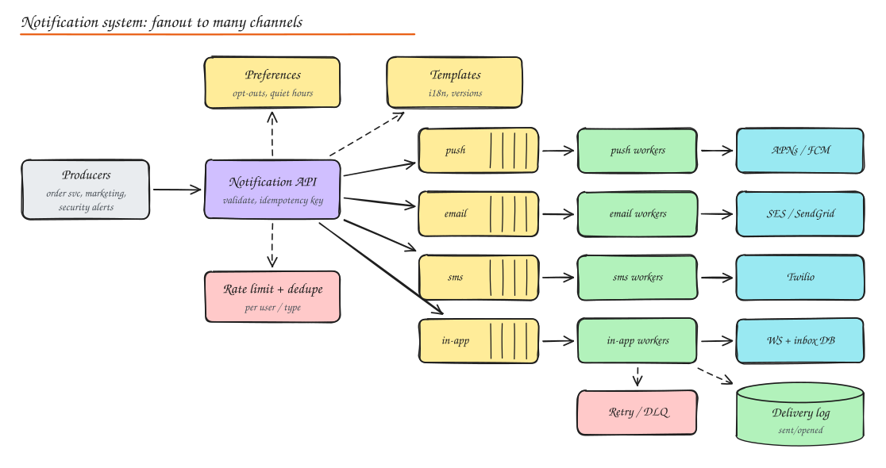

# Design a Notification System

> **TL;DR**
> - One API accepts notifications, applies preferences, quiet hours, templates and dedupe, then fans out per channel.
> - Separate queues per channel and priority so OTPs are never stuck behind marketing campaigns.
> - Idempotency keys and per-channel delivery records prevent duplicate sends; retries and DLQs handle provider failures.
> - Provider rate limits and failover are the real bottlenecks, not your own throughput.

## 1. Requirements

**Functional**

- Internal services send notifications to users via **push** (iOS/Android), **email**, **SMS**, and **in-app** inbox.
- Templates with localization; personalization variables.
- User preferences: opt in/out per channel and category, quiet hours, frequency caps.
- Scheduling (send at 9 am local time) and bulk campaigns.
- Track sent, delivered, opened, clicked; unsubscribe links.

**Non-functional**

- Reliable: critical notifications (OTP, security alerts, payment receipts) must not be lost.
- Timely: transactional within seconds; marketing can be slower.
- No duplicates (users hate double SMS; SMS also costs money).
- Scale: 1B notifications/day, bursts of 10x during campaigns.
- Third-party providers are rate limited and sometimes down.

## 2. Estimation

1B / day ≈ 12k/s average, 100k+/s in campaign bursts. Each message ~1 KB. The bottleneck is usually provider rate limits and cost, not our own throughput.

## 3. API

```http
POST /v1/notifications
Idempotency-Key: order-9001-shipped
{
  "user_id": "u_42",
  "type": "order_shipped",           // maps to category + template
  "priority": "high",
  "data": { "order_id": "9001", "eta": "Oct 17" },
  "channels": ["push", "email"],      // optional override; default from type config
  "send_at": null
}
-> 202 { "notification_id": "n_77" }
```

## 4. High level design



1. **Notification API** validates, checks the idempotency key, persists a notification record, and returns 202.
2. **Processing**: load user preferences and contact info (device tokens, email, phone), apply opt-outs, quiet hours (defer), frequency caps and dedupe, render templates per locale.
3. Enqueue per **channel** (and per priority) topics: separate queues so a slow email provider does not block push, and OTPs do not wait behind a marketing blast.
4. **Channel workers** call providers: APNs/FCM (push), SES/SendGrid (email), Twilio/MSG91 (SMS), and the in-app service (inbox DB + WebSocket push if online).
5. **Delivery tracking**: provider callbacks/webhooks (delivered, bounced, opened) update the delivery log; analytics downstream.
6. Retries with backoff; DLQ for persistent failures; alerts on DLQ growth.

## 5. Data model

```text
notification(id, user_id, type, priority, payload, status, created_at, idempotency_key UNIQUE)
delivery(notification_id, channel, provider, status, attempts, provider_msg_id, updated_at)
user_preferences(user_id, category, channel, enabled, quiet_hours, timezone)
device_tokens(user_id, device_id, platform, token, last_seen)   -- remove invalid tokens on provider feedback
templates(type, channel, locale, version, subject, body)
inbox(user_id, notification_id, read_at)                        -- in-app
```

## 6. Deep dives

### Reliability and exactly-once feel

- Persist before acknowledging (API returns 202 only after the record and outbox event are durable).
- Queues are at-least-once; workers are idempotent: before calling a provider, atomically mark `(notification_id, channel)` as `sending` (conditional update); after success, `sent` with the provider message ID. Pass an idempotency key to providers that support it.
- Crash between provider call and status update can still double send; for SMS/OTP, a short dedupe window keyed on `(user, template, payload hash)` catches it.

### Prioritization

- Separate queues/topics per priority: `critical` (OTP, security), `transactional`, `marketing`.
- Reserve worker capacity and provider throughput for critical traffic (bulkheads).
- Marketing sends are throttled and spread over time.

### Rate limiting and user experience

- Per-user frequency caps (e.g. max 3 marketing pushes/day), collapse similar notifications ("Alice and 5 others liked your post").
- Respect provider rate limits with token buckets per provider/account; back off on 429.
- Quiet hours: compute in the user's timezone, delay non-critical notifications to the next allowed window via a scheduler (delayed queue or time-bucketed table scanned by a scheduler).

### Provider failover

- Health and error-rate monitoring per provider; circuit breakers; route SMS to a secondary provider if the primary fails (and email to a secondary ESP).
- Keep templates provider-agnostic.

### Bulk campaigns

- Campaign service resolves the audience (segment query on the warehouse), then streams batches into the pipeline with pacing.
- Unsubscribe links and compliance (CAN-SPAM, GDPR consent, DND registries for SMS in India, TCPA in the US).

### Push specifics

- Device tokens expire or rotate: delete tokens when APNs/FCM report them invalid.
- Payload limits (4 KB); send data payloads that the app can expand.
- Silent pushes for sync; collapse keys to replace older notifications.

## 7. Observability

Metrics per channel/provider/type: enqueue rate, processing latency, provider latency and error rates, delivery and open rates, DLQ depth, opt-out rate (a spike means you are annoying users).

## Interview questions

<details>
<summary>How do you ensure an OTP SMS is not delayed by a marketing campaign of 50M messages?</summary>

Separate queues and worker pools by priority, with dedicated provider capacity (or a separate provider account/sender ID) for critical traffic. Marketing is throttled and paced. Monitor critical queue latency with tight SLOs and alert immediately.

</details>

<details>
<summary>A service retries the API call after a timeout. How do you avoid a duplicate notification?</summary>

Require an idempotency key (for example `order-9001-shipped`). The API stores it with a unique constraint along with the notification ID; a retry with the same key returns the existing notification ID instead of creating another. Workers are idempotent per `(notification_id, channel)`.

</details>

<details>
<summary>How do you implement "send at 9 am in the user's local time" for 20M users?</summary>

Compute each user's send time in UTC from their timezone and bucket them (e.g. by minute) into a scheduled store (a time-partitioned table or delayed queue). A scheduler scans the current bucket and enqueues into the normal pipeline with pacing, respecting provider limits. Recompute if users change timezone before sending.

</details>

## Related

- [Message Queues](../02-building-blocks/07-message-queues.md)
- [Rate Limiting](../02-building-blocks/08-rate-limiting.md)
- [Distributed Transactions and Idempotency](../03-data/06-distributed-transactions.md)
