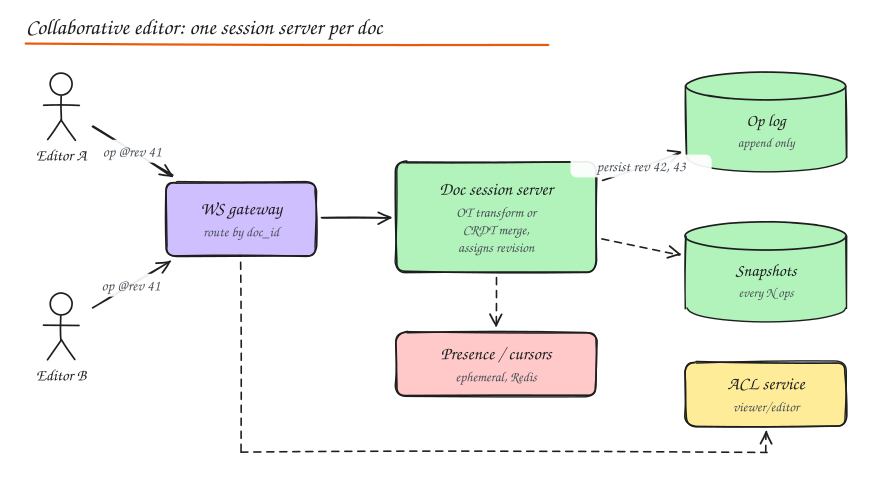

# Design Google Docs / Notion

> **TL;DR**
> - Concurrent edits must converge: Operational Transformation (server-ordered) or CRDTs (merge anywhere).
> - One session server owns each document, orders operations, persists them to an op log and broadcasts.
> - Snapshots plus the op log rebuild any version; history is never rewritten.
> - Presence and cursors are ephemeral and throttled; permissions are checked on connect and re-checked.

## 1. Requirements

**Functional**: create and edit rich-text documents; multiple users edit **simultaneously** and see each other's changes and cursors in real time; comments and suggestions; version history and restore; sharing with view/comment/edit permissions; offline editing that syncs later.

**Non-functional**: edits visible to collaborators in < 100 to 200 ms; **all replicas converge** to the same document; no lost edits; documents up to MBs with long histories; millions of documents, but each document has few concurrent editors (typically < 50, hard limit ~100 to 200 for active editors).

## 2. The core problem: concurrent edits

Document: `"cat"`. Alice inserts `"s"` at index 3, producing `"cats"`. At the same moment Bob deletes index 0, producing `"at"`.

- Alice receives Bob's `delete(0)` and applies it: `"cats"` becomes `"ats"`. Correct.
- Bob receives Alice's `insert("s", 3)` and applies it to `"at"`, which only has length 2: the index is out of range (or, with a different example, the character lands in the wrong place).

Applying remote operations naively by index makes replicas **diverge**. We need a way to make concurrent operations commute.

### Operational Transformation (OT)

- Operations (insert/delete/format at position) are **transformed** against concurrent operations so intent is preserved: Bob's delete at 0 shifts Alice's insert from 3 to 2.
- Practical OT (Google Docs, Jupiter/Wave lineage) uses a **central server** that defines a single total order of operations: clients send ops tagged with the revision they were based on; the server transforms each incoming op against ops committed since that revision, assigns the next revision number, and broadcasts.
- Clients keep pending (unacknowledged) ops and transform incoming server ops against them.
- Pros: compact, mature, document stays a plain sequence. Cons: transformation functions are subtle (especially for rich text and tree structures); relies on the central server for ordering.

### CRDTs (Conflict-free Replicated Data Types)

- Each character (or element) gets a **unique, ordered identifier** (e.g. `(lamport_counter, site_id)` with position relative to neighbours, as in RGA, YATA used by Yjs, Automerge, Fugue).
- Inserts reference identifiers, not indices, so they commute; deletes mark tombstones.
- Any replica can merge any other's operations in any order and converge, **without a central server** (peer-to-peer and offline-first friendly).
- Cons: metadata overhead (IDs per character, tombstones; modern implementations compress well), garbage collection of tombstones, and intent preservation for complex rich-text cases needs care.
- Used by Figma (custom CRDT-inspired with server authority), Notion (block-level), Linear, Apple Notes, Zed, and many local-first apps.

| | OT | CRDT |
|---|---|---|
| Ordering | Central server assigns order | No central order needed |
| Offline / P2P | Harder | Natural |
| Complexity | Transform functions | Data structure design, metadata |
| Server role | Required, authoritative | Optional relay/storage |
| Typical | Google Docs, Etherpad, Office Online | Yjs/Automerge apps, Figma-like, Notion blocks |

Interview stance: either is acceptable if you explain it. With a server in the loop (typical web app), **server-ordered OT or server-relayed CRDT** both work; choose CRDT if offline editing is a first-class requirement.

## 3. High level design

- **WebSocket gateway**: routes connections for `doc_id` to the **document session server** that owns that document (consistent hashing on `doc_id`, or a lease in a coordination service so exactly one owner exists).
- **Session server** keeps the live document state in memory, applies/transforms/merges ops, assigns revisions, broadcasts to all connected editors, and persists ops.
- **Op log** (append-only, per document, keyed by `(doc_id, revision)`): the source of truth for recent history. Durable before broadcast acknowledgement.
- **Snapshots** every N ops or minutes: loading a doc = latest snapshot + replay ops after it.
- **Presence service**: cursors, selections, who's viewing (ephemeral, Redis/pub-sub, throttled updates).
- **ACL service**: permission checks at connect time and on sensitive operations.
- **Version history**: named versions and periodic checkpoints derived from snapshots; restore = new op that sets content (history is never rewritten).

### Edit flow

1. Client applies the edit locally (instant feedback), sends `op @ base_revision 41`.
2. Session server transforms against revisions 42..N if needed (OT) or merges (CRDT), assigns revision N+1, appends to op log, acknowledges to the sender, broadcasts to others.
3. Other clients transform against their pending local ops and apply.

### Loading a document

Fetch latest snapshot + ops since snapshot; the session server is spun up on first open (cold start) and evicts the doc from memory after everyone leaves.

## 4. Deep dives

- **Single owner per document**: ownership via a lease (etcd/ZooKeeper) with **fencing tokens** so a paused old owner cannot write ops after a new owner took over. On owner failure, a new owner loads snapshot + op log and clients reconnect and resend pending ops.
- **Offline edits**: client queues ops with its base revision; on reconnect, sends them; the server transforms them (OT) or merges (CRDT). Very long divergence is where CRDTs shine.
- **Large documents**: chunk by blocks/sections (Notion models documents as trees of blocks, each a separate record), lazy-load parts, paginate history.
- **Rich text**: ops carry formatting attributes (bold ranges) and structural elements (lists, tables); models like ProseMirror/Quill Delta define ops on a structured document.
- **Comments and suggestions**: anchored to ranges that move with edits (anchors use the same position transformation or CRDT IDs).
- **Hot documents** (a viral doc with 1,000s of viewers): editors limited; viewers receive a throttled read-only stream or periodic snapshots via a fanout tier.
- **Search**: index document text asynchronously from snapshots.

## 5. Access control

- Roles: owner, editor, commenter, viewer; link sharing (anyone with link, domain-restricted); inherited permissions from folders/workspaces (ReBAC style, e.g. Zanzibar).
- Check on connect and periodically re-check (revoked access must disconnect active sessions).

## Interview questions

Why not just lock the document (or paragraph) while someone edits?

Locks make collaboration feel slow and blocking, fail badly with flaky networks (stale locks), and do not support offline editing. OT and CRDTs allow everyone to edit concurrently with immediate local feedback and guarantee convergence.

What happens if the document session server crashes?

Acknowledged ops are already in the durable op log. A new owner acquires the lease (with a higher fencing token), loads the latest snapshot and replays the op log, and clients reconnect, compare their last acknowledged revision, and resend pending ops, which are transformed/merged normally. Users see a brief reconnecting indicator.

How would you implement version history efficiently?

Keep the op log as the fine-grained history and periodic snapshots as checkpoints. To show version at time T, load the nearest snapshot before T and replay ops up to T. Collapse runs of small ops by the same author into readable "versions" for the UI. Restoring creates a new revision whose content equals the old version, so history remains append-only.

## Related

- [Replication (CRDTs, conflict resolution)](../03-data/04-replication.md)
- [Real Time Communication](../04-networking-apis/04-realtime-communication.md)
- [Consensus and Clocks](../10-advanced/01-consensus-and-clocks.md)
