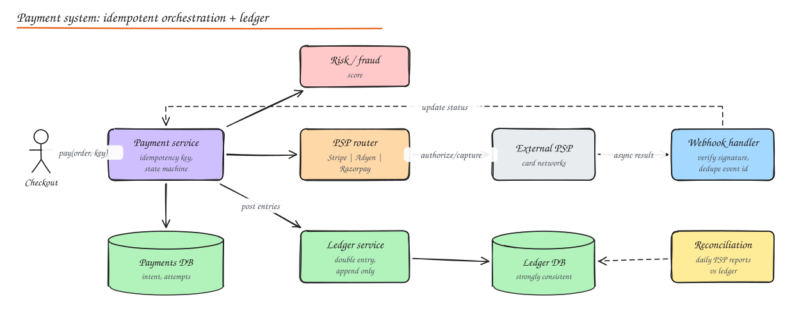

# Design a Payment System

Payments are the canonical **correctness over everything** problem. Latency matters, but losing or duplicating money is unacceptable.

## 1. Requirements

**Functional**

- Pay for an order with card, UPI, wallet, net banking via external **payment service providers (PSPs)**.
- Authorize, capture (immediately or later), refund (full/partial), handle chargebacks.
- Payouts to sellers/drivers (marketplace).
- Wallet balance (optional).
- Notify the order system of results; receipts.

**Non-functional**

- **No double charges, no lost payments.** Every state transition auditable.
- High availability for checkout (retry safely), p99 latency of a few seconds (PSP bound).
- Strong consistency for balances and ledger.
- Security and compliance: PCI DSS, encryption, fraud prevention.

## 2. Key concepts

- **Payment intent / order**: our record of "customer X wants to pay Y for order Z", with a state machine.
- **Authorization**: the issuer reserves funds. **Capture**: actually move them (often at shipping). **Void**: cancel an authorization. **Refund**: return captured funds.
- **PSP**: Stripe, Adyen, Razorpay, Braintree; they talk to card networks and banks.
- **Ledger**: immutable double-entry record of every money movement; the financial source of truth.

## 3. High level design



1. Checkout calls `POST /payments` with an **idempotency key** (derived from order ID + attempt).
2. Payment service creates a payment intent (`CREATED`), runs **risk/fraud** scoring.
3. **PSP router** picks a provider (method, cost, success rate, availability) and calls authorize/capture with **our** idempotency key passed through.
4. Card data never touches our servers: the client tokenizes card details directly with the PSP (hosted fields/SDK), so we handle only tokens (minimal PCI scope).
5. PSP responds synchronously or asynchronously (3DS challenges, UPI collect requests): final status often arrives via **webhook**.
6. On success, payment service transitions to `SUCCEEDED`, writes **ledger entries**, emits `PaymentSucceeded` (outbox) for the order service.
7. **Reconciliation** jobs compare our ledger with PSP settlement reports daily.

## 4. Payment state machine

```text
CREATED -> RISK_CHECKED -> AUTHORIZING -> AUTHORIZED -> CAPTURING -> SUCCEEDED
                  |               |             |                        |
                  v               v             v                        v
               BLOCKED         FAILED        VOIDED            PARTIALLY_REFUNDED / REFUNDED
                                  ^
                        (timeout -> UNKNOWN -> resolve via PSP status query / webhook)
```

- Transitions are conditional updates (`WHERE state = 'AUTHORIZING'`), so concurrent webhook and retry paths cannot both apply.
- **Unknown outcomes** (timeout talking to the PSP) are the dangerous case: never blindly retry with a new request. Query the PSP by our idempotency key or wait for the webhook; a background resolver handles stuck payments.

## 5. Idempotency (the most important deep dive)

- Client to us: `Idempotency-Key` header; we store `(key, request_hash, response, status)` with a unique constraint. Same key returns the stored result; a key in progress returns 409; a key reused with a different body returns 422.
- Us to PSP: pass a deterministic key (`payment_id + operation + attempt`) so PSP-side retries are deduplicated too.
- Webhooks: dedupe by the PSP's event ID; verify signatures; process idempotently (state machine conditions).
- Consumers of `PaymentSucceeded`: idempotent by `payment_id`.

See [Distributed Transactions and Idempotency](../03-data/06-distributed-transactions.md).

## 6. Double-entry ledger

Every movement is recorded as balanced entries: total debits = total credits.

```text
Customer pays 100 for an order (marketplace takes 10% fee):

entry_id | txn_id | account                    | debit | credit
---------+--------+----------------------------+-------+-------
1        | t_77   | customer_payments_clearing |  100  |
2        | t_77   | seller_payable:s_9         |       |  90
3        | t_77   | platform_revenue           |       |  10
```

- **Append only**: corrections are new reversing entries, never updates or deletes.
- Balances are derived (sum of entries) and cached/materialized with versioning.
- Strongly consistent store (Postgres with serializable transactions per transaction group, or a purpose-built ledger like TigerBeetle); partition by account when needed, with care for hot accounts (platform revenue) via sub-accounts.
- Invariants checked continuously (every transaction balances; no negative balances where disallowed).

## 7. Reconciliation

- Daily (or more frequent) PSP **settlement files** list every captured/refunded/charged-back transaction and fees.
- Reconciliation jobs match them with our ledger by references: matched, missing on our side (webhook lost?), missing on PSP side (stuck?), amount mismatch.
- Mismatches create alerts and tickets; automated fixes for known patterns.
- This is the safety net that catches everything the real-time path missed.

## 8. Other features

- **Refunds**: new payment operation referencing the original, idempotent, partial amounts tracked against captured total.
- **Chargebacks/disputes**: webhook-driven workflow with evidence submission, ledger entries for held funds.
- **Payouts**: batch job aggregates seller payables, calls payout APIs (bank transfers), ledger entries per payout, retries and reconciliation.
- **Wallets**: balance = ledger-derived; debits with atomic conditional checks; topups via the same payment flow.
- **Currency**: store amounts as integers in minor units (paise/cents) with currency code; never floats.
- **Fraud**: rules + ML scoring (velocity checks, device fingerprint, geo mismatch), 3DS challenges for risky payments.
- **PSP routing and failover**: route by success rate and cost; circuit-break unhealthy providers; retry declines only when the decline code is retryable (soft declines).

## 9. Security and compliance

- Tokenization via PSP keeps PCI scope minimal (SAQ A / A-EP).
- Encrypt sensitive fields, strict access controls, audit logs, secrets in a vault, segmentation of payment services.
- See [Security](../07-security/02-encryption-data-network-security.md).

## Interview questions

<details>
<summary>The PSP call times out. Did the customer get charged?</summary>

Unknown. Mark the payment `UNKNOWN`, do not issue a fresh charge. Query the PSP using the same idempotency key or payment reference, or wait for the webhook. A resolver job retries status queries with backoff. If still unknown after a window, reconcile with settlement reports. Retrying the original request with the same idempotency key is safe because the PSP deduplicates.

</details>

<details>
<summary>Why a double-entry ledger instead of a balance column?</summary>

A single balance column loses history and makes errors invisible: you cannot explain how a balance came to be, and a bug that updates it twice leaves no trace. Double-entry records every movement as balanced, immutable entries, so the books always sum to zero, every balance is explainable and auditable, corrections are explicit reversals, and reconciliation with external reports is possible.

</details>

<details>
<summary>How do you avoid charging a customer twice when they double-click "Pay"?</summary>

The client generates one idempotency key per checkout attempt (or the server derives it from the order ID) and reuses it on retries and double submissions. The payment service stores the key with a unique constraint and returns the existing payment for duplicates. The PSP call also carries a deterministic idempotency key. The order itself can only transition to paid once (conditional state update).

</details>

## Related

- [Distributed Transactions, Sagas, Idempotency](../03-data/06-distributed-transactions.md)
- [E-commerce Flash Sale](11-ecommerce-flash-sale.md)
- [Security and Compliance](../07-security/02-encryption-data-network-security.md)
