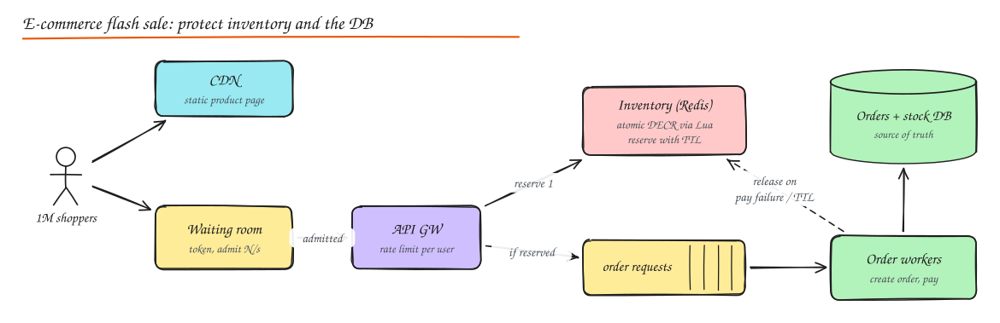

# Design an E-commerce Platform (and a Flash Sale)

> **TL;DR**
> - Catalog and search can be eventually consistent; inventory reservation and payments must be strongly consistent.
> - Prevent overselling with atomic conditional decrements and reservations with expiry.
> - Survive flash sales with a static CDN page, a waiting room, a Redis stock gate and queued order creation.
> - Carts favour availability; checkout favours correctness, using sagas with compensations.

## 1. Requirements

**Functional**: browse and search a product catalog; product detail pages with price and availability; cart; checkout (address, payment); order tracking; inventory management across warehouses; recommendations; reviews. **Flash sale**: limited stock (e.g. 10,000 phones) released at a fixed time to millions of users.

**Non-functional**: catalog and search fast and highly available (eventual consistency OK); **no overselling** and no lost orders (strong correctness for inventory and payments); survive 100x traffic spikes; global CDN delivery of images.

## 2. Services and data

| Service | Responsibility | Store |
|---|---|---|
| Catalog | Products, variants, attributes, images | Document DB / Postgres JSONB + CDN for images |
| Search | Full text, facets, ranking | Elasticsearch fed by CDC from catalog |
| Pricing | Prices, promotions, coupons | SQL + cache |
| Cart | Per user cart | Redis / DynamoDB (high availability, user-keyed) |
| Inventory | Stock per SKU per warehouse, reservations | SQL with row-level atomic updates; Redis for hot SKUs |
| Order | Order lifecycle (saga orchestrator) | SQL, sharded by customer |
| Payment | See [Payment System](10-payment-system.md) | SQL + ledger |
| Fulfilment | Picking, shipping, tracking | SQL + events |
| Recommendations | "Customers also bought", personalized ranking | Offline models + feature store + online serving |
| Reviews | Ratings, text | Sharded by product, cached aggregates |

## 3. Core flows

### Browse and search

Static assets and product images via CDN; product pages cached (short TTL) with price and availability fetched separately (they change more often). Search queries Elasticsearch with facets (brand, price range), sorted by relevance, popularity and personalization.

### Cart

- Keyed by user (or anonymous session, merged on login). Highly available (Amazon's Dynamo paper was literally motivated by the shopping cart: "add to cart" must always work, merge conflicting versions).
- Cart stores SKU and quantity, not price; price and availability are re-validated at checkout.

### Checkout and order saga

1. Create order `PENDING` (idempotency key from cart + attempt).
2. **Reserve inventory** (with TTL, e.g. 10 minutes).
3. **Authorize payment**.
4. Confirm order, convert reservation into a committed deduction, emit `OrderConfirmed` -> fulfilment, notifications, analytics.
5. Failure at any step -> compensations: release reservation, void authorization, mark order cancelled. See [Sagas](../03-data/06-distributed-transactions.md#sagas).

### Inventory correctness

- Atomic conditional decrement: `UPDATE stock SET available = available - :q WHERE sku = :s AND warehouse = :w AND available >= :q` and check affected rows.
- Reservations table with expiry; a sweeper releases expired holds.
- Multi-warehouse: an allocation service picks the warehouse (proximity, stock, cost); availability shown to users is an aggregated, slightly stale number ("only 3 left" with caching of a few seconds).

## 4. Flash sale deep dive

The problem: 1M users hit "Buy" at 12:00:00 for 10k units. Naively, the DB row for that SKU receives a million concurrent updates; lock contention melts it, and pages time out.

Layers of defense:

1. **CDN and static pages**: the product page (and even a countdown) is fully static; no origin hits for browsing.
2. **Waiting room / virtual queue**: users get a queue token at sale start; the system admits users at the rate the backend can handle (e.g. 5k/s). Fairness and protection in one (Cloudflare Waiting Room, Queue-it, or a custom token service).
3. **Rate limiting and bot defense**: per user/device limits, CAPTCHA, purchase limit per account, pre-registration.
4. **Inventory in Redis**: preload `stock:sku = 10000`; each admitted request runs a Lua script: if stock > 0 and the user has not bought, decrement and record the user, all atomically. Redis handles ~100k ops/s on a hot key; for more, split stock into N sub-buckets (`stock:sku:0..9`) and pick one at random.
5. **Async order creation**: successful reservations enqueue an order request to Kafka; workers create orders and payments at a steady rate the DB can sustain. The user sees "you got it, complete payment in 10 minutes".
6. **Reservation expiry**: unpaid reservations expire and stock returns to the pool (and can be offered to waiting users).
7. **Reconciliation**: Redis counter is the fast gate; the DB is the source of truth; a reconciliation job ensures `sold + reserved + available = initial` and fixes drift.

What to say about correctness: Redis gating guarantees we never admit more than 10k reservations even if some later fail payment (they are returned). The DB order creation uses idempotent keys; if Redis fails over and loses recent decrements, a conservative approach is to under-sell rather than oversell (persist reservations with AOF fsync every write or use a replicated store with WAIT for the hot path).

## 5. Recommendations (briefly)

Offline: item-item collaborative filtering from co-purchase/co-view data, embedding models; online: retrieve candidates by user history, rank with a model using real-time features (session clicks), filter out-of-stock. See [ML System Design](../10-advanced/05-ml-system-design.md).

## 6. Consistency map

| Data | Consistency |
|---|---|
| Product details, reviews, search results | Eventual (seconds to minutes) |
| Displayed stock counts | Eventual, approximate |
| Inventory reservation at checkout | Strong (atomic conditional updates) |
| Orders and payments | Strong, idempotent, auditable |
| Cart | Highly available, merge on conflict |

## Interview questions

How do you prevent overselling the last item when two customers check out simultaneously?

Make the decrement conditional and atomic in the inventory store (`... WHERE available >= qty`), or use a reservation with a unique constraint per unit. Only one update succeeds when one unit remains; the other gets "out of stock" at checkout. The displayed stock may be stale, but the reservation step is authoritative.

Why put a queue between the reservation and order creation in a flash sale?

Order creation touches several slow systems (DB writes, payment, notifications). A queue decouples the instantaneous spike from the steady capacity of those systems (queue-based load leveling): users get an immediate answer from the fast Redis gate, while orders are created at a rate the DB can handle, with retries and no lost requests.

How is a cart different from inventory in consistency needs?

The cart is the user's intent and must always accept writes even during partial outages; merging conflicting versions (union of items) is acceptable, so an AP store fits. Inventory is a shared scarce resource with an invariant (never below zero), so reservation must be strongly consistent and atomic.

## Related

- [Payment System](10-payment-system.md)
- [Distributed Transactions](../03-data/06-distributed-transactions.md)
- [Rate Limiting](../02-building-blocks/08-rate-limiting.md)
- [Caching](../02-building-blocks/03-caching.md)
