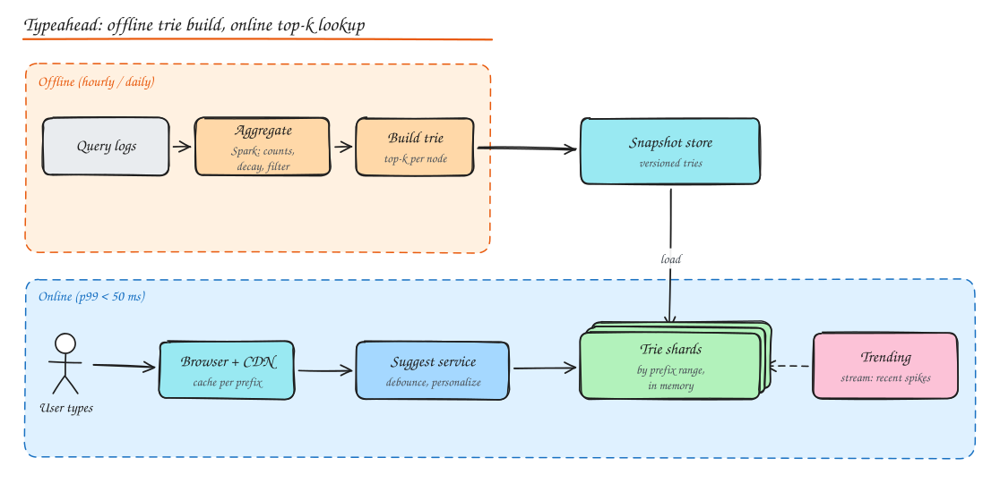

# Design Search Autocomplete (and the Search Engine Behind It)

## 1. Requirements

**Functional**: as the user types, show the top 5 to 10 suggestions for the prefix, ranked by popularity (and optionally freshness and personalization). Suggestions update as query trends change.

**Non-functional**: **very low latency** (p99 < 50 to 100 ms end to end, since it fires on every keystroke), high availability, read heavy (10B suggestion requests/day), freshness within an hour is acceptable (trending can be faster), filter offensive suggestions.

## 2. Estimation

10B requests/day ≈ 115k/s average, peak ~400k/s. Each response ~1 KB. Unique queries in the corpus: billions, but the useful suggestion set (frequent queries) is maybe 100M strings: fits in memory across a modest cluster.

## 3. Data structure: trie with cached top-k

- A **trie** (prefix tree) where each node is a character; the path from the root spells a prefix.
- Naive lookup: walk to the prefix node, then traverse the whole subtree to find the most popular completions. Too slow for short prefixes ("a" has millions of descendants).
- **Optimization**: store the **top-k completions at every node** (precomputed). Lookup becomes O(length of prefix) + O(1) to read the list.
- Memory trade-off: k entries per node. Mitigate by limiting max prefix length (e.g. 20 chars), storing references/IDs rather than full strings, and pruning rare queries.
- Alternatives: sorted array of queries + binary search for the prefix range with a precomputed top-k per prefix in a KV store (`prefix -> [suggestions]`): very simple to shard and cache. Many production systems do exactly this.

## 4. High level design

### Offline pipeline (data gathering)

1. Log every **completed search query** (not every keystroke) with timestamp, locale.
2. Batch job (Spark, hourly/daily) aggregates counts with **time decay** (recent queries weigh more), filters spam, offensive and PII-containing queries, normalizes text.
3. Build the trie (or prefix -> top-k table) per locale; version it; write snapshots to object storage.
4. Serving nodes load new snapshots and atomically swap.

### Online serving

1. Client debounces keystrokes (e.g. 100 to 150 ms), caches responses per prefix locally, and cancels stale requests.
2. CDN/edge caches popular prefixes (responses are identical for everyone if not personalized). Short prefixes have the highest hit rates.
3. Suggest service routes the prefix to the right **trie shard**, merges **trending** suggestions and (optionally) personalized ones (user's recent searches), filters, returns top k.

### Sharding

- **By prefix range**: shard 1 holds `a..c`, shard 2 `d..f` and so on. Uneven (many words start with "s"), so split ranges by measured load, not alphabet.
- **By hash of prefix** for a prefix -> top-k KV store: even distribution, each lookup touches one shard.
- Replicate shards for read throughput and availability.

### Trending and freshness

A streaming job (Kafka + Flink) counts queries over sliding windows (last 5 to 15 minutes) and detects spikes vs baseline (e.g. a breaking news name); injects them into a small "trending" overlay merged at query time, so you do not need to rebuild the whole trie every minute.

## 5. Ranking signals

Popularity with decay, freshness/trending, locale and language, personalization (user history, location), business rules, and safety filters. Learning-to-rank models for large systems.

## 6. From autocomplete to a search engine

A full web or product search engine adds:

- **Crawling / ingestion** (see [Web Crawler](14-web-crawler.md)) or CDC from product databases.
- **Indexing**: analyze documents into terms, build **inverted indexes** (term -> posting list of doc IDs with positions), partitioned by document (each shard indexes a subset of docs) and replicated.
- **Query processing**: parse, spell-correct, expand synonyms, retrieve candidates from every shard (scatter-gather), score with BM25 plus hundreds of signals (PageRank-like authority, freshness, click-through), then a learned re-ranker on the top results (increasingly neural / vector retrieval for semantic matching).
- **Serving**: tiered indexes (hot recent/popular docs in memory), result caching, and strict latency budgets with partial results from slow shards.

See [Object Storage and Search](../02-building-blocks/10-object-storage-and-search.md).

## Interview questions

Why store top-k at every trie node instead of computing it at query time?

Computing top-k for a short prefix means traversing a huge subtree (millions of nodes for "s"), which cannot meet a 50 ms budget at 100k+ QPS. Precomputing moves the cost offline: each lookup is a walk of a few nodes plus reading a ready list. The price is extra memory and rebuild work when counts change.

How do you update suggestions without rebuilding the trie on every search?

Separate the slow-moving base from fast signals: rebuild the main trie periodically (hourly/daily) from aggregated logs with decay, and merge a small real-time trending layer computed by a streaming job at query time. Swap new base snapshots atomically (blue-green on the serving nodes).

How do you reduce load from users typing quickly?

Client-side debouncing and request cancellation, client-side caching of prefix responses (and reusing the response for "ap" to filter results for "app" while waiting), CDN caching of non-personalized popular prefixes, and only sending requests after 1 to 2 characters.

## Related

- [Object Storage and Search](../02-building-blocks/10-object-storage-and-search.md)
- [Stream and Batch Processing](../10-advanced/02-stream-batch-processing.md)
- [Caching](../02-building-blocks/03-caching.md)
