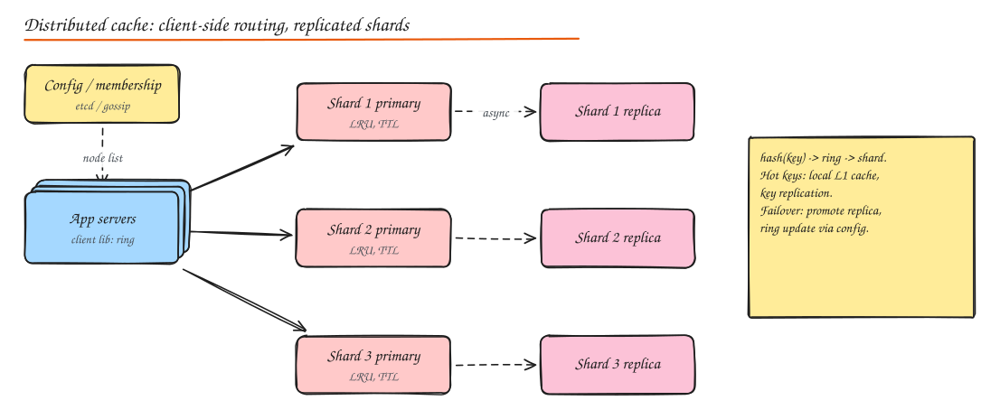

# Design a Distributed Cache

> **TL;DR**
> - A single node is a hash map with eviction (LRU/LFU) and TTLs; the distributed design adds partitioning and replication.
> - Route keys with consistent hashing or hash slots, via smart clients or a proxy.
> - Replicas give failover; async replication can lose a little data, which is acceptable for a cache.
> - Handle hot keys, big values, stampedes and cold starts explicitly.

## 1. Requirements

**Functional**: `get(key)`, `set(key, value, ttl)`, `delete(key)`; values up to ~1 MB; eviction when full; TTL expiry. Optionally counters, data structures, pub/sub.

**Non-functional**: sub-millisecond latency (p99 < 1 to 2 ms within a datacenter), millions of ops/s total, horizontally scalable to TBs of memory, highly available (losing a node should not take the service down), acceptable to lose some cached data (it is a cache, not the source of truth).

## 2. Single node design

- **Hash table** for O(1) key lookup.
- **Eviction**: LRU via a doubly linked list threaded through entries (move to head on access, evict from tail); approximate LRU (Redis samples a few keys and evicts the oldest) avoids list overhead; LFU or W-TinyLFU for better hit rates. Build one: [LRU Cache](../11-builds/01-lru-cache.md).
- **TTL**: lazy expiry on access + periodic background sampling of keys with TTLs (Redis approach), or a timing wheel / min-heap.
- **Memory management**: slab allocation (Memcached: size classes to avoid fragmentation), or jemalloc with active defragmentation (Redis).
- **Concurrency**: single-threaded event loop (Redis: no locks, very predictable, scale by running more shards) or multi-threaded with striped locks (Memcached).
- **Networking**: epoll-based non-blocking IO, pipelining, compact binary or RESP protocol.

## 3. Distributed design

### Partitioning

- **Consistent hashing with virtual nodes** (client-side, Memcached style): adding/removing a node remaps only ~1/N of keys. See [Consistent Hashing](../02-building-blocks/06-consistent-hashing.md).
- **Fixed hash slots** (Redis Cluster: 16,384 slots via `CRC16(key) mod 16384`, slots assigned to nodes): rebalancing moves slots; clients get `MOVED`/`ASK` redirects and cache the slot map.
- **Hash tags** (`{user:42}:profile`, `{user:42}:settings`) force related keys onto the same shard so multi-key operations work.

### Routing options

| Option | How | Pros | Cons |
|---|---|---|---|
| Smart client | Client library knows the ring/slot map | One hop, fastest | Every language needs a library; map updates to many clients |
| Proxy | Twemproxy, Envoy, mcrouter (Meta) in front | Simple clients, central control | Extra hop, proxy capacity |
| Server-side redirect | Any node answers or redirects | No extra infra | Extra round trip on misroutes |

### Replication and failover

- Each shard has a primary and 1+ replicas (async replication).
- Failure detection via gossip (Redis Cluster) or a coordinator (Sentinel, etcd); a replica is promoted, the slot map updated.
- Async replication means acknowledged writes may be lost on failover: acceptable for a cache.
- Replicas can also serve reads for hot keys (at the cost of slightly stale data).

### Membership and configuration

A config service or gossip protocol tracks live nodes and the partition map; clients subscribe for changes. Changes are versioned (epochs) to avoid conflicting maps.

## 4. Deep dives

### Hot keys

One key (a celebrity profile) gets 1M reads/s and saturates its shard.

- Client-side **L1 cache** with short TTL (1 to 5 s) for detected hot keys.
- **Key replication**: store N copies (`key#0..key#N-1`), read a random one, write all.
- Read from replicas.
- Detect via sampling (Redis `--hotkeys`, client metrics).

### Big keys

Large values (MB-sized lists) block a single-threaded node and saturate network. Split, compress, or store in object storage and cache a reference.

### Consistency with the database

Cache-aside with delete-on-write, TTL as a safety net, versioned writes for races, CDC-based invalidation for multi-writer systems. Details in [Caching](../02-building-blocks/03-caching.md#invalidation).

### Thundering herd and cold start

Request coalescing, locks on recompute, stale-while-revalidate, warm-up from replicas or snapshots before taking traffic, gradual traffic ramp for new nodes.

### Persistence (if asked)

Redis RDB snapshots (fork + copy-on-write) and AOF (append-only log with fsync policy) allow warm restarts; not a substitute for a real database.

### Multi-region

Usually independent caches per region (each fronting local replicas), with invalidation events replicated cross-region (Meta's mcsqueal reads the MySQL binlog to invalidate memcache in every region).

## 5. Capacity planning

Memory per node (say 64 GB usable) vs total hot set (e.g. 2 TB) -> ~32 primaries + replicas. Throughput per node (100k+ ops/s for Redis) vs peak QPS. Network bandwidth per node (value size x QPS) is often the real limit.

## Interview questions

How does Redis Cluster decide which node holds a key?

It computes `CRC16(key) mod 16384` to get a hash slot (only the part inside `{}` if a hash tag is present). Each node owns a set of slots; clients cache the slot-to-node map and get a `MOVED` redirect if it is outdated. Resharding moves slots between nodes with `ASK` redirects during migration.

A cache node dies. What happens to traffic and the database?

With replicas, a replica is promoted and serves the slots (small window of errors and some lost recent writes). Without replicas, keys on that node become misses; with consistent hashing only ~1/N of keys are affected, but that slice of traffic falls on the database. Protect the DB with request coalescing, rate limiting, and spare DB capacity for at least one cache node's worth of misses.

Why is Redis single-threaded for commands, and how does it scale?

A single thread avoids lock contention and context switches and makes every command atomic, which gives very predictable sub-ms latency; most operations are memory-bound and network-bound rather than CPU-bound. It scales horizontally by running many shards (one per core or per instance), and newer versions use extra threads for network IO.

## Related

- [Caching](../02-building-blocks/03-caching.md)
- [Consistent Hashing](../02-building-blocks/06-consistent-hashing.md)
- Build it: [LRU Cache](../11-builds/01-lru-cache.md)
