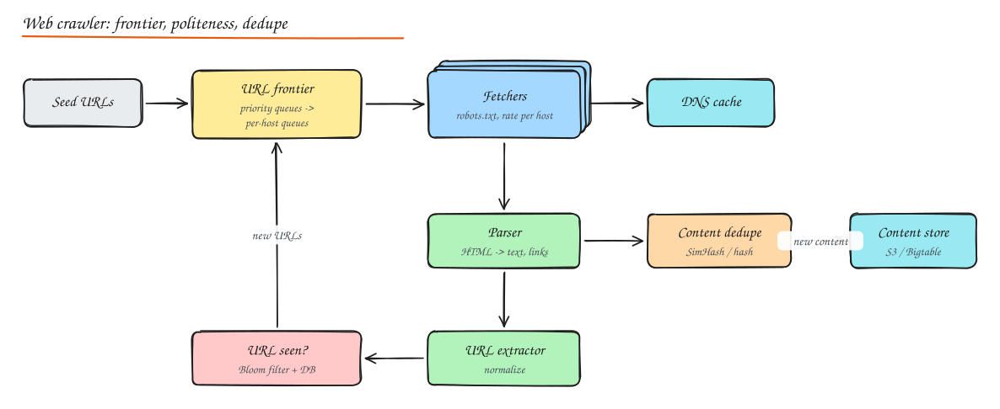

# Design a Web Crawler

> **TL;DR**
> - The URL frontier balances priority (important pages first) with politeness (one host at a time, with delays).
> - Bloom filters answer "seen this URL?" cheaply; SimHash finds near-duplicate pages.
> - Normalize URLs, respect robots.txt, cache DNS, and defend against spider traps.
> - Recrawl pages according to how often they change.

## 1. Requirements

**Functional**: given seed URLs, download web pages, extract links, and keep crawling; store page content for indexing; recrawl pages based on how often they change.

**Non-functional**:

- **Scale**: billions of pages (say 1B pages/month).
- **Politeness**: never overload a website; obey `robots.txt`.
- **Robustness**: survive malformed HTML, slow servers, spider traps, crashes.
- **Extensibility**: new content types (PDFs, images) and processing steps.
- **Freshness**: important pages recrawled often.

## 2. Estimation

1B pages/month ≈ 400 pages/s average, peak ~1,000/s. Avg page 500 KB (with resources) -> stored compressed HTML ~100 KB -> ~100 TB/month. Bandwidth ~400 x 500 KB = 200 MB/s.

## 3. High level design

Loop: frontier -> fetch -> parse -> dedupe -> extract links -> filter seen URLs -> frontier.

### URL frontier (the heart)

Two concerns: **priority** and **politeness**.

- **Front queues (priority)**: a prioritizer assigns each URL a priority (PageRank-like importance, change frequency, domain quality) and puts it into one of F priority queues. A selector biases toward high priority.
- **Back queues (politeness)**: one queue per host (or per host group); each back queue is served by one worker thread at a time with a **minimum delay between requests to the same host** (e.g. 1 s, or per `Crawl-delay`). A heap keyed by "next allowed fetch time" picks the next host.
- The frontier is too large for memory: keep hot parts in memory, spill to disk/DB (or Kafka/RocksDB-backed queues), partition across crawler nodes **by host hash** so politeness is enforced locally.

### Fetchers

- Many async HTTP workers; timeouts, max page size, redirect limits, compression.
- **robots.txt**: fetch per host, cache with TTL, check every URL before fetching.
- **DNS resolver cache**: DNS lookups are slow and repeated; run a local caching resolver.
- Respect `Retry-After` and back off on errors (5xx, 429).

### Parser and extractor

- Parse HTML (tolerant parsers), extract text, metadata, canonical URL, links.
- **Normalize URLs**: lowercase host, remove default ports, resolve relative links, strip fragments and tracking params, follow `rel=canonical`.
- Filter by content type, domain blocklists, URL patterns.

## 4. Deep dives

### URL dedupe ("have we seen this URL?")

Billions of URLs: a set of hashes in a DB is expensive to query per link. Use a **Bloom filter** in memory (a few bits per URL, e.g. ~10 bits per element for 1% false positives: 10B URLs ≈ 12.5 GB), backed by a persistent store for exactness when needed. A false positive means occasionally skipping a new URL, which is acceptable. See [Probabilistic Data Structures](../10-advanced/03-probabilistic-data-structures.md).

### Content dedupe

~30% of the web is duplicate or near-duplicate (mirrors, session IDs in URLs, boilerplate).

- Exact duplicates: hash the normalized content (SHA-256).
- Near duplicates: **SimHash** (Google) produces a 64-bit fingerprint where similar documents differ in few bits; compare fingerprints with Hamming distance (≤ 3 bits) using permuted tables for fast lookup. MinHash/LSH is an alternative.

### Spider traps and junk

Infinite calendars, session IDs, endlessly deep paths. Mitigate with max URL length and depth, per-host page budgets, pattern detection (repeating path segments), and limiting query parameter combinations.

### Freshness and recrawl

Estimate each page's change rate from history (did content hash change since last crawl?) and schedule recrawls accordingly (news homepages every few minutes, static pages monthly). Use conditional requests (`If-Modified-Since`, `ETag`) to save bandwidth. Sitemaps help discover and prioritize.

### Storage

- Raw content in a compressed store (WARC files in object storage, or Bigtable keyed by reversed URL `com.example.www/path` so pages from the same site cluster together).
- Metadata (URL, status, last crawl, content hash, next crawl time) in a sharded KV store.
- Downstream: indexing pipeline consumes new content events.

### Distribution and fault tolerance

- Partition URL space by host hash across crawler nodes (consistent hashing; on node loss, its hosts move to others).
- Checkpoint frontier state; idempotent processing keyed by URL + crawl epoch.
- Geographic distribution: crawl sites from nearby regions to reduce latency.

## Interview questions

How do you make sure the crawler does not overload a small website?

Route all URLs of a host to one back queue owned by one worker at a time, enforce a minimum delay between fetches per host (respecting `Crawl-delay` and adapting to response times and errors), cap concurrent connections per host/IP, obey robots.txt, and back off on 429/5xx. Partitioning by host across crawler nodes keeps the politeness state local.

Why a Bloom filter for seen URLs, and what does a false positive cost?

It answers "possibly seen / definitely not seen" using a few bits per URL in memory, avoiding a database lookup for every extracted link (tens of thousands per second). A false positive makes us skip a URL we have not actually crawled; with a 1% rate this loses a little coverage, which is acceptable, and important URLs are rediscovered via other links or sitemaps.

How would you detect near-duplicate pages?

Compute a SimHash of each page's shingles (weighted features), giving a 64-bit fingerprint where similar pages have small Hamming distance. Store fingerprints in several tables keyed by different bit blocks so candidates within a distance of 3 bits can be found quickly; mark near-duplicates and keep the canonical version.

## Related

- [Probabilistic Data Structures](../10-advanced/03-probabilistic-data-structures.md)
- [Typeahead and Search](12-typeahead-autocomplete.md)
- [Message Queues](../02-building-blocks/07-message-queues.md)
