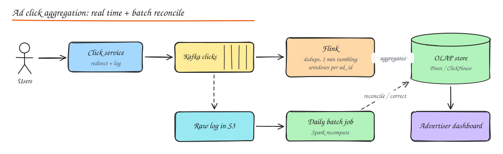

# Design an Ad Click Aggregator (and Top-K)

> **TL;DR**
> - Clicks are money: ingest into Kafka, dedupe, aggregate in time windows, and serve from an OLAP store.
> - Aggregate by event time with watermarks so late or replayed events land in the right window.
> - Exactly-once results need dedup keys, checkpoints and idempotent sinks, plus a batch recompute for billing.
> - Top-k uses heaps over partial counts or Count-Min sketches at huge cardinality.

Advertisers pay per click, so click counts are **money**. The system must ingest a firehose of events, aggregate them quickly for dashboards, and be **accurate** for billing.

## 1. Requirements

**Functional**

- Record ad clicks (and impressions), redirect the user to the advertiser.
- Advertisers query clicks per ad / campaign over time ranges with 1-minute granularity and filters (country, device).
- Top-K most clicked ads in the last N minutes (a common follow-up).

**Non-functional**

- 10B clicks/day, peaks 500k/s.
- Dashboard freshness within ~1 minute.
- **Accuracy**: no double counting, no lost clicks for billing; fraud filtering.
- Queries over long ranges fast (sub-second for dashboards).

## 2. High level design

1. **Click service**: receives the click (`/click?ad=..&imp=..`), validates the signed impression ID, logs the event to Kafka, and redirects (302) immediately. Logging must not block the redirect for long, but must be durable (local disk buffer if Kafka is unavailable).
2. **Kafka**: partitioned by `ad_id` (keeps an ad's events together for aggregation), retained for days for replay.
3. **Stream processor (Flink)**: dedupe, filter fraud, aggregate into 1-minute tumbling windows per `(ad_id, minute, dims)`, write results to an OLAP store.
4. **OLAP store** (Pinot, Druid, ClickHouse): serves dashboard queries with rollups (minute -> hour -> day).
5. **Raw events to object storage** (S3/Parquet) for a daily **batch recomputation** (Spark) that produces the authoritative billing numbers and corrects the streaming results if they disagree (Lambda-style reconciliation).

## 3. Deep dives

### Exactly-once counting

- **Duplicates** come from client retries, redirects followed twice, Kafka producer retries, and consumer restarts.
- Assign each click a unique `click_id` (from the signed impression + timestamp + nonce). Dedupe in Flink using keyed state with TTL (e.g. remember click IDs for 1 hour), or a Bloom filter per window for memory efficiency (tiny false positive rate acceptable for dashboards, not for billing, which the batch layer recomputes exactly).
- Flink **checkpoints** (consistent snapshots of operator state and Kafka offsets) plus **transactional/idempotent sinks** (two-phase commit sink to Kafka, or upserts keyed by `(ad_id, window)` into the OLAP store) give end-to-end exactly-once results.

### Windows, event time and late events

- Aggregate by **event time** (when the click happened), not processing time, so delays and replays produce the same answer.
- **Watermarks** track event-time progress ("we believe all events up to 12:04 have arrived"); a window closes when the watermark passes its end.
- **Late events**: allow lateness (e.g. 5 minutes) and emit updated results; later stragglers go to a side output and are caught by the batch job.

### Hot ads

A viral ad sends a huge share of clicks to one Kafka partition / one Flink key. Pre-aggregate with **two-phase aggregation**: add a random salt to the key (`ad_id#0..9`), aggregate partially, then combine. Or local pre-aggregation in the click service before producing.

### Fraud and invalid traffic

Filter bots (user agent, IP reputation, click rate per IP/device), impossible patterns (click without impression, click too soon after impression), and duplicate clicks within a window. Flag rather than drop where possible, so billing can apply rules consistently.

### Query serving

OLAP stores keep columnar segments per time bucket, pre-aggregated rollups and indexes on dimensions, so "clicks per ad per hour last 30 days" scans small data. Cache common dashboard queries.

## 4. Top-K heavy hitters

"Top 100 ads by clicks in the last 5 minutes":

- **Exact**: per-window counts in Flink, then a global top-k operator (keep a min-heap of size K over per-key counts). Works if the key space per window fits in state.
- **Approximate**: **Count-Min Sketch** for frequency estimates + a heap of candidates (memory independent of key cardinality), or Space-Saving / Misra-Gries algorithms. Error bounds are tunable. See [Probabilistic Data Structures](../10-advanced/03-probabilistic-data-structures.md).
- Sliding windows (last 5 minutes updated every minute) are computed by combining five 1-minute tumbling results.

## 5. Lambda vs Kappa

- **Lambda**: streaming layer for speed + batch layer for accuracy, merged at serving. Two code paths to maintain.
- **Kappa**: one streaming pipeline; to fix bugs, replay Kafka from the start into a new version. Simpler if the stream processor is exactly-once and Kafka retention is long enough.
- For billing-grade accuracy many companies still keep a batch reconciliation. See [Stream and Batch Processing](../10-advanced/02-stream-batch-processing.md).

## Interview questions

Why aggregate by event time rather than processing time?

Processing time depends on when events reach the processor, so network delays, backlogs or a replay would put clicks into the wrong minute and results would change with every rerun. Event time attributes each click to when it happened, making results deterministic and correct even with late or replayed data; watermarks decide when a window is complete.

How do you guarantee clicks are counted exactly once end to end?

Unique click IDs with deduplication state in the stream processor, Kafka with idempotent producers, Flink checkpointing that atomically snapshots state and consumer offsets, and sinks that are transactional or idempotent (upsert by `(ad_id, window)`). Plus a batch recomputation from the immutable raw log as the final source of truth for billing.

How would you find the top 10 ads per minute when there are 100M distinct ads?

Keep counts keyed by ad in the stream processor (partitioned so each node holds a subset), compute a local top-k per partition with a min-heap, then merge the partial top-k lists in a single downstream operator. If state is too large, use a Count-Min Sketch with a candidate heap for an approximate answer with bounded error.

## Related

- [Stream and Batch Processing](../10-advanced/02-stream-batch-processing.md)
- [Probabilistic Data Structures](../10-advanced/03-probabilistic-data-structures.md)
- [Data Warehousing and Analytics](../03-data/07-data-warehousing-analytics.md)
