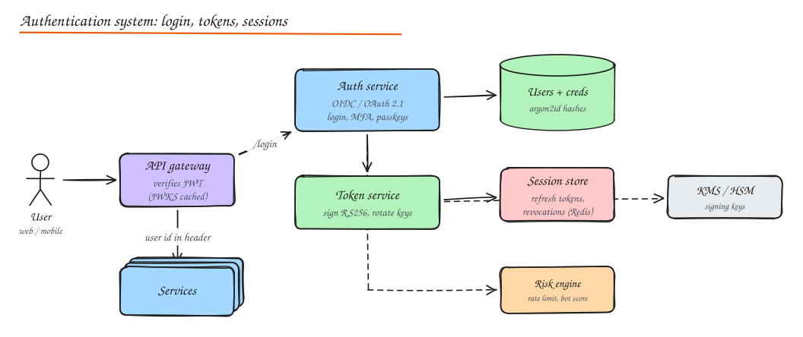

# Design an Authentication System

> **TL;DR**
> - A central **auth service** (identity provider) verifies credentials and issues tokens; every other service only **verifies** tokens.
> - Use **short-lived access tokens** (JWT, 5 to 15 min) plus **rotating refresh tokens** stored server side, so you get stateless verification and real revocation.
> - Store passwords with **argon2id**, offer MFA and **passkeys**, and defend login with rate limits, breached-password checks and risk scoring.
> - Sign tokens with keys in a KMS/HSM, publish public keys via **JWKS**, rotate them.

## 1. Requirements

**Functional**

- Sign up, verify email, log in with password; MFA (TOTP, push) and passkeys (WebAuthn).
- Social login and enterprise SSO (OIDC, SAML).
- Issue tokens for web, mobile and third-party apps (OAuth 2.1 + OIDC).
- Sessions per device; "log out everywhere"; password reset; account lockout and recovery.

**Non-functional**

- Login p99 < 300 ms (excluding deliberate hashing cost), token verification < 1 ms at every service.
- Very high availability (if auth is down, everything is down) and security: no credential leaks, auditable.
- Scale: 100M users, 50k logins/min at peak, every API request carries a token (millions of verifications/s, all local).

## 2. High level design



- **Auth service** (identity provider): login UI and API, MFA, passkeys, OAuth/OIDC endpoints (`/authorize`, `/token`, `/userinfo`, `/.well-known/openid-configuration`, `/jwks.json`).
- **User and credential store**: users, password hashes, MFA secrets (encrypted), WebAuthn public keys, linked identities.
- **Token service**: signs access and ID tokens (RS256/ES256) with keys held in a **KMS/HSM**; issues refresh tokens.
- **Session store** (Redis + durable DB): refresh tokens (hashed), device sessions, revocation markers.
- **Risk engine**: rate limits per IP/user/device, bot detection, impossible travel, breached password checks.
- **API gateway and services**: verify JWT signatures locally with cached JWKS; no call to the auth service per request.

## 3. Data model

```text
users(id, email UNIQUE, email_verified, status, created_at)
credentials(user_id, type[password|totp|webauthn], secret_or_hash, created_at, last_used_at)
identities(user_id, provider[google|okta|saml:acme], subject, UNIQUE(provider, subject))
sessions(id, user_id, device, ip, created_at, last_seen_at, revoked_at)
refresh_tokens(token_hash PK, session_id, family_id, expires_at, used_at)
signing_keys(kid, alg, public_key, status[active|next|retired])   -- private keys live in KMS
audit_log(ts, user_id, event, ip, result)
```

## 4. Deep dives

### Password storage and login

- Hash with **argon2id** (or bcrypt/scrypt) with per-user salt; tune to ~100 to 300 ms. Optional pepper from KMS.
- Compare in constant time; return the same error for "no such user" and "wrong password" (no user enumeration).
- On login: rate limit per IP and per account, check against breached-password lists, require MFA based on risk.
- Upgrade hashes transparently when you raise the cost factor (rehash on successful login).

### MFA and passkeys

- **TOTP**: shared secret (encrypted at rest), 30 s codes, allow small clock skew, rate limit attempts.
- **Push approval**: number matching to stop push fatigue attacks.
- **Passkeys (WebAuthn)**: the device holds a private key bound to your domain; you store the public key. Phishing resistant, no shared secret to leak. Offer as the primary login where possible.
- Recovery codes and a careful, audited account recovery flow (the weakest link in most systems).

### Tokens: access, refresh, ID

| Token | Format | Lifetime | Verified by |
|---|---|---|---|
| Access token | JWT signed RS256/ES256 with `sub`, `aud`, `scope`, `exp`, `kid` | 5 to 15 min | Every service, locally via JWKS |
| ID token (OIDC) | JWT about the user | Minutes | The client app only |
| Refresh token | Opaque random string, stored hashed | Days to weeks, sliding | Auth service only |

**Refresh token rotation**: each refresh returns a new refresh token and invalidates the old one. If an old token is reused, it was stolen: revoke the whole token family and the session.

For browsers, keep tokens out of JavaScript: a backend-for-frontend holds tokens and gives the browser an `HttpOnly; Secure; SameSite` session cookie.

### Revocation

JWTs cannot be un-issued, so:

- Keep access tokens short-lived; revoking the session/refresh token stops renewal within minutes.
- For immediate revocation (account compromise), publish a per-user "tokens issued before T are invalid" marker or a `jti` denylist to the gateways (small, cached, pushed via pub/sub).
- "Log out everywhere" = revoke all sessions for the user.

### Key management and rotation

- Private signing keys live in a KMS/HSM; the token service asks it to sign (or holds short-lived derived keys).
- JWKS publishes the **current and next** public keys with `kid`s; services cache JWKS and refresh on unknown `kid`.
- Rotate regularly: introduce the next key, start signing with it after caches refresh, retire the old one after the longest token lifetime.

### Scaling and availability

- Token verification is local, so the auth service only handles logins, refreshes and SSO, a small fraction of traffic.
- Run the auth service multi-AZ (and multi-region for global apps); the user store is replicated; sessions in Redis with a durable backing store.
- If the auth service is degraded, existing access tokens keep working until expiry, buying time.

### Defense against attacks

| Attack | Defense |
|---|---|
| Credential stuffing | Rate limits per IP/account/device, bot detection, breached password checks, MFA |
| Brute force | Exponential backoff per account, lockout with safe unlock, CAPTCHAs on risk |
| Phishing | Passkeys, WebAuthn, number matching |
| Token theft | Short lifetimes, refresh rotation with reuse detection, binding tokens to clients (DPoP/mTLS) |
| Session fixation / CSRF | New session id on login, SameSite cookies, CSRF tokens for cookie flows |
| User enumeration | Uniform responses and timing for login and reset |

### Enterprise SSO

Each customer configures their IdP (Okta, Azure AD) via **SAML** or **OIDC**; map their users to your accounts by verified domain; support **SCIM** for provisioning and deprovisioning; enforce SSO-only login for that domain.

## 5. APIs (abridged)

```http
POST /v1/signup                 { email, password }            -> 201 (send verification email)
POST /v1/login                  { email, password }            -> 200 { mfa_required, challenge_id } or tokens
POST /v1/login/mfa              { challenge_id, code }         -> 200 { access_token, refresh_token }
POST /oauth/token               grant_type=refresh_token        -> 200 { access_token, refresh_token }
POST /v1/sessions/{id}/revoke                                   -> 204
GET  /.well-known/jwks.json                                     -> public keys
```

## Interview questions

<details>
<summary>Why not make every service call the auth service to validate tokens?</summary>

It would put the auth service on the critical path of every request (latency and a single point of failure) and require enormous capacity. Signed JWTs let each service verify locally with cached public keys; the auth service is only involved at login and refresh.

</details>

<details>
<summary>How do you log a user out of all devices immediately if access tokens are stateless?</summary>

Revoke all their sessions and refresh tokens (stops renewal), and push a revocation marker ("tokens for user X issued before T are invalid") to the gateways via pub/sub so even unexpired access tokens are rejected. Short access token lifetimes bound the exposure if a gateway misses the update.

</details>

<details>
<summary>How do you detect a stolen refresh token?</summary>

Rotation with reuse detection: every refresh issues a new token and marks the old one used. If a used token is presented again, either the client or an attacker replayed it; revoke the entire token family and session and force re-authentication.

</details>

## Related

- [Authentication and Authorization](../07-security/01-authn-authz.md)
- [Encryption and Security](../07-security/02-encryption-data-network-security.md)
- [Rate Limiting](../02-building-blocks/08-rate-limiting.md)
