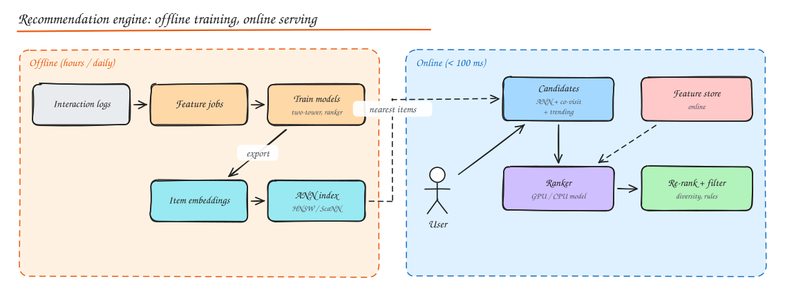

# Design a Recommendation Engine

> **TL;DR**
> - Recommenders are **funnels**: retrieve ~1,000 candidates from millions cheaply, rank them with a heavy model, then re-rank for diversity and business rules.
> - The **offline** side trains models and builds embeddings and ANN indexes; the **online** side serves in under ~100 ms with features from an online feature store.
> - Log impressions and the features used at serving time, so training data matches serving (no skew).
> - Handle cold start with popularity and content features, and measure everything with A/B tests.

## 1. Requirements

**Functional**: personalized "for you" feed or "recommended for you" rows (videos, products, posts), "similar items", "people you may know". Exclude items already consumed or blocked. Refresh as the user interacts.

**Non-functional**: p99 < 100 to 200 ms per request, 100M users, catalog of 10M to 1B items, new items recommendable within minutes to hours, cost-efficient model serving.

## 2. High level design

See also the [funnel diagram](../10-advanced/05-ml-system-design.md#recommendation-engines).

### Offline (batch, hours to daily)

1. **Collect interactions**: impressions, clicks, watch time, purchases, likes, skips, hides, with context (time, device). Event stream to the data lake.
2. **Feature pipelines**: user features (history, aggregates), item features (category, text/image embeddings, popularity), cross features.
3. **Train models**:
   - **Retrieval**: two-tower model (a user tower and an item tower that output embeddings; similarity = dot product), or matrix factorization / item-item co-occurrence.
   - **Ranking**: a heavier model (gradient boosted trees, deep models like DLRM/transformers over the user's sequence) predicting engagement objectives.
4. **Export** item embeddings into an **ANN index** (HNSW, ScaNN, FAISS IVF-PQ); publish models to a registry.

### Online (per request)

1. **Candidate generation** (~1,000 items) from several sources in parallel: ANN search with the user embedding, co-visitation ("people who watched X watched Y"), followed creators, trending, recent searches.
2. **Feature lookup** from the online feature store (user and item features, real-time counters).
3. **Ranking**: score candidates with the ranking model on CPU/GPU model servers; combine predicted objectives into one value score.
4. **Re-ranking and filtering**: remove seen/blocked/out-of-stock, enforce diversity (no 5 items from one creator in a row), freshness boosts, business rules, fairness constraints.
5. **Log** impressions with the features and model version used.

### Near real time

Stream processors update short-term features (what the user clicked 30 seconds ago) and item popularity counters so recommendations react within a session.

## 3. Deep dives

### Approximate nearest neighbour (ANN) search

Exact nearest neighbour over 100M vectors is too slow. ANN indexes trade a little recall for huge speedups:

- **HNSW**: layered proximity graph; very fast, high recall, memory heavy.
- **IVF-PQ**: cluster vectors (inverted file) and compress them (product quantization); memory efficient, used at billion scale.
- Shard the index by item id; query all shards in parallel and merge top-k.

### Feature store and training/serving skew

The same feature definitions feed offline training (point-in-time correct joins) and online serving (latest values). Logging the exact features used at serving time and training on them removes skew. See [ML System Design](../10-advanced/05-ml-system-design.md).

### Cold start

- **New users**: popularity by region and time, onboarding choices, contextual signals (device, referrer), then quickly personalize from the first interactions (session-based models).
- **New items**: content embeddings (text, image), creator history, exploration traffic (bandits reserve a small share of slots to learn about new items).

### Objectives and feedback loops

- Optimize for long-term value (watch time, retention, satisfaction surveys), not only clicks (clickbait).
- Recommenders shape their own training data (popular items get more exposure). Counter with exploration, debiasing (inverse propensity weighting), and diversity.

### Serving latency budget (example)

| Stage | Budget |
|---|---|
| Candidate generation (parallel sources) | 20 ms |
| Feature fetch (batched) | 15 ms |
| Ranking (batched inference) | 30 ms |
| Re-rank + filter + hydrate | 15 ms |
| Network and overhead | 20 ms |

Cache ranked results per user for a short time; precompute for inactive users; degrade to popular items if the ranker is unavailable.

### Evaluation

- **Offline**: recall@k for retrieval, AUC/NDCG for ranking, on time-split data.
- **Online A/B tests**: engagement, retention, diversity, guardrails (latency, complaints). Offline gains do not always transfer, so online tests decide.

## Interview questions

Why split recommendation into retrieval and ranking instead of scoring every item with the best model?

Scoring millions of items per request with a heavy model is far too slow and expensive. Retrieval uses cheap methods (ANN on embeddings, co-occurrence) to cut millions to about a thousand plausible candidates in milliseconds; the heavy ranker then spends its budget only where it matters.

How do you make recommendations react to what the user just did in this session?

Stream interaction events into real-time features (last N items, recent categories) in the online feature store, use a session-aware model or include those features in ranking, and recompute candidates per request instead of serving a stale precomputed list. Short TTL caches keep cost under control.

How do you recommend a video uploaded five minutes ago?

Compute its content embedding at upload (from title, thumbnail, audio/visual models) so it enters the ANN index immediately, use the creator's audience as an initial candidate source, and give it a small exploration share of impressions; as engagement data arrives, real-time counters and the next model refresh incorporate it.

## Related

- [ML System Design](../10-advanced/05-ml-system-design.md)
- [Case study: Instagram (feed ranking)](03-instagram.md)
- [Case study: YouTube / Netflix](05-youtube-netflix.md)
- [NoSQL (vector databases)](../03-data/03-nosql-choosing-a-database.md)
