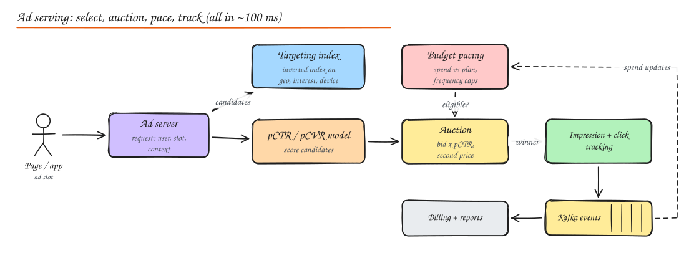

# Design an Ad Server

> **TL;DR**
> - For every ad slot: find eligible ads (targeting index), predict how likely each is to be clicked or convert, run an **auction** on bid x quality, check **budget pacing** and **frequency caps**, return the winner, all within ~100 ms.
> - Spend must never exceed budgets by much: pacing uses near-real-time spend counters fed by the event stream.
> - Impression and click tracking is the money pipeline: dedupe, filter fraud, aggregate exactly once, reconcile in batch.

## 1. Requirements

**Functional**: advertisers create campaigns (budget, bid, targeting, creatives, schedule); the platform fills ad slots on pages/apps with the best eligible ad; track impressions, clicks and conversions; enforce budgets and frequency caps; report spend.

**Non-functional**: p99 ad decision < 100 ms (the page waits), 1M ad requests/s at peak, budgets respected within a small tolerance, accurate billing, high availability (no ad = lost revenue but the page still renders).

## 2. High level design

1. **Ad request** arrives with slot, user id/segments, context (page, device, geo).
2. **Candidate selection**: query an in-memory **targeting index** (an inverted index from targeting attributes to ad ids: `geo=IN`, `interest=cricket`, `device=android`), intersect and filter by schedule and status. Thousands of candidates.
3. **Pacing and caps**: drop ads whose campaign is over its pacing plan or that this user has seen too often.
4. **Prediction**: models estimate pCTR (click probability) and pCVR (conversion) per candidate with user, ad and context features.
5. **Auction**: rank by expected value, e.g. `bid x pCTR x quality` for cost-per-click ads; pick the winner and compute the price.
6. **Response**: creative URL plus signed tracking URLs (impression pixel, click redirect).
7. **Tracking**: impression and click events go to Kafka; stream processors dedupe, filter fraud, aggregate spend; pacing and billing consume the aggregates.

## 3. Deep dives

### Auctions

| Type | Winner pays | Notes |
|---|---|---|
| **Second price (Vickrey)** | Second-highest bid (plus a cent) | Truthful bidding is optimal; classic search ads (GSP variant) |
| **First price** | Own bid | Common in programmatic display now; bidders shade bids |
| **Quality-weighted** | Rank by bid x pCTR x quality | Users see relevant ads; advertisers pay based on rank |

Reserve prices set a floor; the house can run its own ads when no bid clears.

### Budget pacing

Spend a daily budget smoothly instead of exhausting it at 9 am:

- Track spend per campaign in near real time (stream aggregation into Redis counters).
- A pacing controller compares actual spend to the plan curve (based on expected traffic through the day) and sets a **throttle rate** (probability of participating) or bid multiplier per campaign.
- Ad servers cache pacing state and refresh every few seconds; slight overspend is reconciled (advertisers are not charged above budget).

### Frequency capping

"Show this ad at most 3 times per user per day": keep per-(user, campaign) counters with TTL in a fast KV store (or approximate with sketches at huge scale), checked during candidate filtering and updated from impression events.

### Prediction at serving time

- Features from an online feature store (user segments, historical CTR of the ad, context).
- Lightweight models (logistic regression with hashed features, GBDT, small neural nets) for thousands of candidates per request; heavier models only on a shortlist.
- Calibration matters: auctions multiply bids by pCTR, so predicted probabilities must be accurate, not just well ranked.

### Tracking, fraud and billing

- Signed, unique impression ids prevent forged or duplicate events.
- Fraud filters: bot user agents, data-center IPs, click bursts, clicks without impressions, impossible timing.
- Exactly-once aggregation for billing (dedupe by event id, Flink checkpoints, idempotent sinks), plus a daily batch recomputation from raw logs as the source of truth. See [Ad Click Aggregator](15-ad-click-aggregator.md).

### Latency and availability

- Everything on the hot path is in memory: targeting index, campaign metadata, pacing state, models. Rebuilt from the campaign DB and pushed every few seconds.
- Parallelize candidate retrieval and feature fetches; hard deadline with a fallback (house ad or no ad) so the page is never blocked.

## Interview questions

Why rank by bid x pCTR instead of by bid alone?

For cost-per-click ads the platform earns only when users click. Ranking by expected revenue per impression (bid x click probability) maximizes revenue and also shows users more relevant ads; a high bid on an ad nobody clicks earns nothing.

How do you stop a campaign from spending its whole daily budget in the first hour?

Budget pacing: track spend in near real time, compare it with a target spend curve shaped by expected traffic, and throttle the campaign's participation rate or bid multiplier when it runs ahead. Ad servers pull pacing state every few seconds and drop throttled campaigns from auctions.

The tracking pipeline is delayed by 10 minutes. What breaks?

Pacing and frequency caps act on stale spend and impression counts, so campaigns can overspend and users see an ad too often. Mitigate with conservative throttling when data is stale (detect lag), local per-server spend estimates, and reconciliation so advertisers are never billed over budget.

## Related

- [Ad Click Aggregator](15-ad-click-aggregator.md)
- [Recommendation Engine](17-recommendation-engine.md)
- [ML System Design](../10-advanced/05-ml-system-design.md)
- [Probabilistic Data Structures](../10-advanced/03-probabilistic-data-structures.md)
