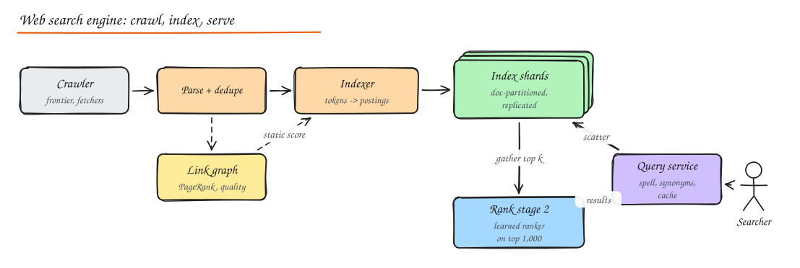

# Design a Web Search Engine

> **TL;DR**
> - Three systems: **crawl** the web, **index** documents into an inverted index, **serve** queries in ~200 ms.
> - Partition the index by **document** across many shards; every query fans out to all shards and merges the top results.
> - Rank in stages: cheap scoring (BM25 + static quality like PageRank) over many docs, then a learned ranker over the top ~1,000.
> - Freshness comes from a small, fast-updating "recent" index next to the big base index; popular queries are cached.

## 1. Requirements

**Functional**: given a text query, return the 10 most relevant web pages with titles and snippets; support pagination, spelling suggestions and basic operators (quotes, site:).

**Non-functional**: p99 < 300 ms, 100k queries/s, tens of billions of documents, new pages searchable within minutes (news) to days (long tail), highly available.

## 2. High level design

### Crawling

The [Web Crawler](14-web-crawler.md) fetches pages politely, deduplicates content (SimHash), and stores raw documents. A recrawl scheduler prioritizes by importance and change rate.

### Indexing pipeline

1. **Parse**: extract text, title, headings, links, language, metadata; drop boilerplate.
2. **Analyze**: tokenize, normalize case, stem/lemmatize, handle synonyms and multiple languages.
3. **Build the inverted index**: `term -> posting list [(doc_id, term frequency, positions)]`, sorted by doc id, compressed (delta + variable-byte or bit-packing).
4. **Forward index / document store**: `doc_id -> url, title, snippet text, static scores` for building results.
5. **Link analysis**: compute **PageRank** (importance from the link graph, iterative MapReduce/Spark job) and other quality signals (spam scores, freshness).
6. **Ship** new index segments to serving shards (immutable segments, merged in the background).

### Serving

1. **Query service**: parse, spell-correct ("did you mean"), expand synonyms, detect intent; check the **results cache** (popular queries are a big share of traffic).
2. **Scatter**: send the query to every index shard (each holds a slice of documents) and to the recent-docs index.
3. Each shard intersects posting lists and scores matches with a cheap function (BM25 + static score), returning its local top-k.
4. **Gather and rank stage 2**: merge shard results, apply a learned ranking model (hundreds of features, click signals) to the top ~1,000, pick the top 10.
5. **Build results**: fetch titles and generate query-dependent snippets from the document store.

## 3. Deep dives

### Index partitioning

| Partition by | Query cost | Update cost | Notes |
|---|---|---|---|
| **Document** (each shard has all terms for its docs) | Every query hits every shard | Local per document | Standard approach; easy to add documents; tail latency of fanout is the challenge |
| **Term** (each shard owns some terms' posting lists) | Only shards for query terms | Updates touch many shards | Long posting lists for common terms create hot shards |

Mitigate fanout tail latency with replicas per shard, hedged requests, and partial results if a shard is slow (see [The Tail at Scale](../01-fundamentals/03-scalability-performance.md#percentiles-and-tail-latency)).

### Query processing efficiency

- Process posting lists in doc id order with skip pointers; stop early with **WAND/MaxScore** (skip docs that cannot make the top-k).
- **Tiered indexes**: a small tier of high-quality documents is searched first; the full index only if needed.
- Champion lists: precomputed top documents per term.

### Freshness

- A **real-time index** for documents crawled in the last hours (in memory, frequently rebuilt), merged with the base index at query time.
- Base index rebuilt or merged incrementally on a longer cycle.

### Ranking signals

Text relevance (BM25, proximity, title/anchor text matches), static quality (PageRank, spam, site authority), freshness, user engagement (click-through and dwell time, debiased), personalization and location, and increasingly semantic retrieval (dense embeddings) blended with lexical matching.

### Caching

Query results cache (short TTL), posting list cache for frequent terms, document cache for snippets. Query popularity follows a heavy-tailed distribution, so caches absorb a large fraction of traffic.

### Scale estimates

- 50B docs x ~10 KB of text = 500 TB raw; inverted index after compression a fraction of that, spread over thousands of shards with replicas.
- 100k QPS x fanout to 1,000 shards = 100M shard requests/s, which is why caching, tiering and early termination matter.

## Interview questions

Why partition the index by document rather than by term?

Document partitioning keeps all postings for a document on one shard, so indexing and updates are local and shards are evenly sized. Term partitioning makes queries touch fewer shards but creates hot shards for common terms and makes updates touch many shards. Most engines partition by document and accept fanout, controlling tail latency with replicas and hedging.

How does PageRank work in one paragraph?

A page's importance is the probability that a random surfer ends up on it: each page distributes its score across its outgoing links, with a damping factor (about 0.85) modelling random jumps. Scores are computed iteratively over the link graph until they converge, as a large batch job, and used as a static quality signal in ranking.

How do you make breaking news searchable within minutes?

Crawl news sources and sitemaps at high frequency, push new documents through a fast indexing path into a small real-time index that is rebuilt every few minutes, and merge its results with the base index at query time, with a freshness boost for time-sensitive queries.

## Related

- [Web Crawler](14-web-crawler.md)
- [Typeahead](12-typeahead-autocomplete.md)
- [Object Storage and Search (inverted index)](../02-building-blocks/10-object-storage-and-search.md)
- [Stream and Batch Processing](../10-advanced/02-stream-batch-processing.md)
