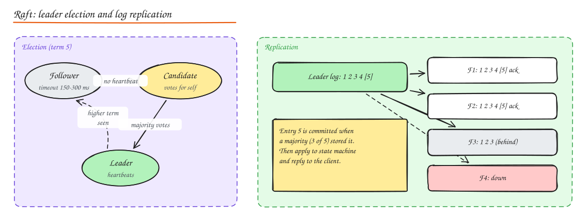
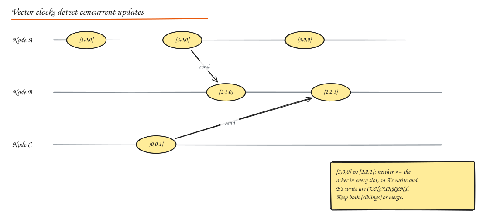

# Consensus, Leader Election and Clocks

> **TL;DR**
> - Consensus (Raft, Paxos) lets a majority of nodes agree on an ordered log despite failures.
> - Leader election uses leases in a consensus store, with fencing tokens to stop zombie leaders.
> - Physical clocks drift; logical clocks (Lamport, vector) capture causality; vector clocks detect concurrent writes.
> - Spanner's TrueTime waits out clock uncertainty to give globally consistent timestamps.

## Why consensus

Many problems reduce to getting several machines to **agree on a value or an ordered log** despite failures:

- Who is the leader (exactly one primary database, one scheduler)?
- What is the committed order of writes (replicated state machines)?
- Is this lock held? What is the current configuration/membership?

**Consensus** guarantees: **agreement** (all correct nodes decide the same value), **validity** (the value was proposed by someone), **termination** (eventually decide).

### Failure models

- **Crash-stop / crash-recovery**: nodes stop (and maybe restart with durable state). Most datacenter systems assume this.
- **Omission / network partitions**: messages are lost or delayed arbitrarily.
- **Byzantine**: nodes may lie or behave maliciously (blockchains, some aerospace systems).

### FLP impossibility

In a fully **asynchronous** network (no bound on message delay), no deterministic algorithm can guarantee consensus if even one node may crash. Practical algorithms sidestep this with **timeouts** (partial synchrony): they are always **safe** (never decide two different values) and are **live** when the network behaves well enough.

## Paxos (in one paragraph)

Proposers pick a unique, increasing proposal number and ask a majority of acceptors to **promise** not to accept lower numbers (phase 1, prepare/promise; acceptors report any value they already accepted). The proposer then asks the majority to **accept** its value, which must be the highest-numbered previously accepted value if any (phase 2, accept/accepted). A value is chosen once a majority accepts it. **Multi-Paxos** elects a stable leader to skip phase 1 for a sequence of log slots. Correct but notoriously hard to understand and implement fully; used in Chubby, Spanner (Paxos groups), Megastore.

## Raft

Designed for understandability; equivalent in power to Multi-Paxos. Used in etcd, Consul, CockroachDB, TiKV, YugabyteDB, Kafka KRaft, RethinkDB, MongoDB's replication protocol is Raft-like.

**Roles**: follower, candidate, leader. Time is divided into **terms** (monotonically increasing integers).

**Leader election**

1. Followers expect heartbeats from the leader. If none arrives within a **randomized election timeout** (e.g. 150 to 300 ms), a follower becomes a candidate, increments the term, votes for itself, and requests votes.
2. A node grants its vote to at most one candidate per term, and only if the candidate's log is **at least as up to date** as its own.
3. A candidate with votes from a **majority** becomes leader and starts sending heartbeats. Randomized timeouts make split votes rare.

**Log replication**

1. The leader appends a client command to its log and sends `AppendEntries` to followers.
2. When a **majority** has stored the entry, it is **committed**; the leader applies it to its state machine and replies to the client; followers apply it once they learn the commit index.
3. Followers with divergent logs are repaired: the leader finds the last matching index and overwrites conflicting entries.

**Safety rules**: a leader never overwrites its own log; only entries from the current term are committed by counting replicas; the election restriction guarantees new leaders have all committed entries.

Practicalities: snapshots + log compaction, membership changes (joint consensus or one-at-a-time), linearizable reads (read index or leader leases), and cluster sizes of **3 or 5** (tolerate 1 or 2 failures; more nodes means slower writes).

## Quorum systems

- With N voters, a majority quorum is `floor(N/2) + 1`. Any two majorities intersect, which is why majority-based protocols cannot commit conflicting decisions.
- N = 3 tolerates 1 failure; N = 5 tolerates 2. An even N adds cost without extra tolerance.
- Flexible quorums (Flexible Paxos): only the leader-election quorum and the replication quorum need to intersect, enabling faster writes with smaller replication quorums.
- Leaderless quorum replication (R + W > N) is a weaker cousin used by Dynamo-style stores: see [Replication](../03-data/04-replication.md).

## Leader election in practice

You rarely implement Raft yourself. Instead:

- Use a coordination service (**etcd, ZooKeeper, Consul**) to hold a **lease/lock** with TTL: the holder is the leader; it renews the lease; if it dies, the lease expires and another node takes it. Kubernetes uses Lease objects for controller leader election.
- **Fencing tokens**: every new lease grant returns an increasing token (etcd revision, ZooKeeper zxid). The leader includes the token with every write to storage; storage rejects writes with an older token. This protects against a "zombie" leader that was paused (GC, VM freeze) and still thinks it holds the lease.
- Bully and ring algorithms are classic textbook election algorithms; mention them, but production systems use consensus-backed leases.

### Distributed locks: a warning

A lock from Redis (`SET key value NX PX 30000`) is fine for **efficiency** (avoid duplicate work). For **correctness** (two holders would corrupt data), you need a consensus-backed lock **and** fencing tokens checked by the resource. Redlock's safety under clock drift and pauses is debated (Kleppmann vs antirez); prefer etcd/ZooKeeper for correctness locks.

### Distributed deadlock detection

Locks held across nodes can form cycles that no single node sees. Approaches: build a global **wait-for graph** (central detector or edge-chasing probes like Chandy-Misra-Haas) and abort a victim; or avoid deadlocks with timeouts, lock ordering, and wound-wait/wait-die schemes based on transaction timestamps (used by Spanner).

## Byzantine fault tolerance (BFT)

When nodes may be malicious, you need `N >= 3f + 1` nodes to tolerate f Byzantine nodes, and more message rounds (PBFT, Tendermint, HotStuff). Used in permissioned blockchains and high-assurance systems; overkill inside a trusted datacenter. See [Blockchain Basics](06-blockchain-basics.md).

## Time and ordering

### Physical clocks

- Machines' clocks drift (quartz drift ~ tens of ppm) and are corrected by **NTP** (accuracy ~1 to 10 ms on a LAN, worse across the internet) or **PTP** (sub-microsecond with hardware support).
- **Clock skew issues**: last-write-wins with timestamps can drop the actually-later write; TTLs and leases expire early/late; logs from different machines appear out of order; "now" can jump backwards after an NTP step.
- **Atomic clocks and GPS**: Google Spanner's **TrueTime** API returns an interval `[earliest, latest]` with bounded uncertainty (a few ms) using GPS receivers and atomic clocks in every datacenter. Spanner **waits out the uncertainty** before committing (commit wait), giving externally consistent (linearizable) transactions with real timestamps.
- **Hybrid logical clocks (HLC)**: combine physical time with a logical counter (CockroachDB, MongoDB), giving timestamps close to wall time that still respect causality.

Rule: **never use wall-clock timestamps from different machines to decide order** when correctness matters.

### Logical clocks

**Happens-before (→)** (Lamport 1978): a → b if a and b are on the same node and a came first, or a is sending a message and b is receiving it, or transitively. If neither a → b nor b → a, they are **concurrent**.

**Lamport timestamps**: each node keeps a counter; increment on each event; send the counter with messages; on receive set `counter = max(local, received) + 1`. Guarantees `a → b ⇒ L(a) < L(b)` (the reverse is not true). Ties broken by node ID give a total order consistent with causality.

**Vector clocks**: each node keeps a vector of counters, one per node. Increment your own slot on each event; on receive take the element-wise max then increment your slot.

Compare two vectors V1 and V2:

- V1 ≤ V2 in every slot (and not equal): V1 happened before V2.
- Neither dominates: **concurrent**, so this is a conflict to resolve (Dynamo shopping cart siblings, Riak).

Cost: vector size grows with the number of writers; use version vectors per replica (not per client) and prune.

## Eventual consistency guarantees (session guarantees)

Pure eventual consistency only promises convergence "eventually". Useful additional guarantees:

| Guarantee | Meaning | Typical implementation |
|---|---|---|
| **Read your writes** | You see your own updates | Sticky routing to leader/replica after write, version tokens |
| **Monotonic reads** | You never see older data after newer | Pin client to a replica, or track last seen version |
| **Monotonic writes** | Your writes apply in order | Per-session sequence numbers |
| **Writes follow reads** | A write made after reading X is ordered after X | Carry causal dependencies |
| **Causal consistency** | Causally related operations seen in order by everyone | Vector clocks / dependency tracking (COPS, Bolt-on) |

See [CAP and Consistency Models](../01-fundamentals/02-cap-pacelc.md).

## Interview questions

Why do Raft and Paxos clusters use an odd number of nodes?

They need a majority to make progress. With 4 nodes the majority is 3, so you tolerate only 1 failure, the same as with 3 nodes, while paying for an extra node and slower quorums. 5 nodes tolerate 2 failures. Odd sizes maximize fault tolerance per node.

What is a fencing token and why is a lease alone not enough?

A lease says "you are leader until time T", but the holder can be paused (GC, VM migration) past T without knowing, then resume and act as leader while a new leader exists. A fencing token is a monotonically increasing number issued with each lease; the protected resource remembers the highest token seen and rejects requests with older tokens, so the zombie's writes are refused.

How do vector clocks detect a conflict that Lamport timestamps cannot?

Lamport timestamps give a total order consistent with causality but cannot tell whether two events were concurrent or causally related (a smaller timestamp does not imply happened-before). Vector clocks capture each node's knowledge; if neither vector dominates the other element-wise, the events are concurrent, which signals a write conflict that needs resolution.

How does Spanner provide globally consistent timestamps?

TrueTime exposes the current time as an uncertainty interval bounded by GPS and atomic clock references in every datacenter. A transaction picks a commit timestamp at the latest bound and then waits until that timestamp is guaranteed to have passed everywhere (commit wait, a few ms) before making the commit visible. Thus timestamp order matches real-time order across the globe.

## Related

- [Replication](../03-data/04-replication.md)
- [CAP and PACELC](../01-fundamentals/02-cap-pacelc.md)
- [Unique ID Generation (clock skew)](../02-building-blocks/09-unique-id-generation.md)
