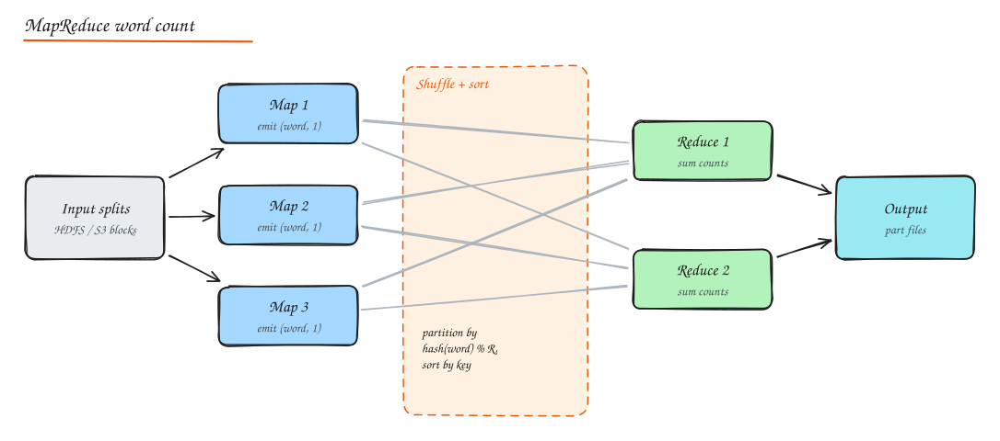
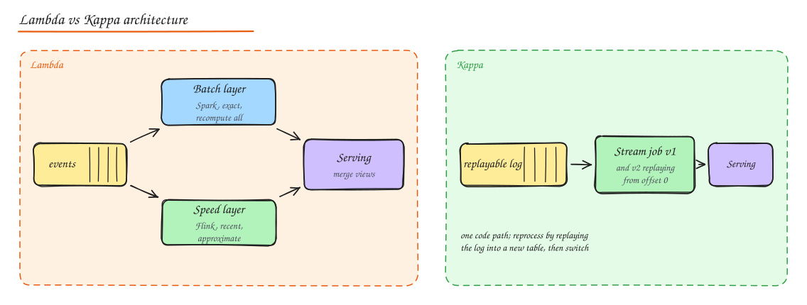

# Big Data, Batch and Stream Processing

- **Batch**: process a bounded dataset (yesterday's logs) all at once. High throughput, latency of minutes to hours.
- **Stream**: process an unbounded sequence of events continuously. Low latency (ms to seconds), more complex state and correctness handling.

## Batch processing

### MapReduce

1. **Map**: each mapper reads an input split and emits key/value pairs (`("cat", 1)`).
2. **Shuffle and sort**: pairs are partitioned by key (`hash(key) % R`), transferred to reducers, sorted by key.
3. **Reduce**: each reducer processes all values for a key (`sum`) and writes output.

Ideas that still matter: move computation to the data (data locality), a simple programming model hides distribution, deterministic tasks can simply be **re-executed** on failure, stragglers handled by speculative execution, and **combiners** pre-aggregate on the map side to shrink the shuffle.

### Hadoop

HDFS (distributed file system with large blocks replicated 3x, a NameNode for metadata) + YARN (resource management) + MapReduce. Largely superseded for compute by Spark and for storage by object storage (S3) + open table formats, but the concepts persist.

### Spark

- In-memory, DAG-based engine: chains of transformations (`map`, `filter`, `join`, `groupBy`) are planned as stages separated by shuffles; intermediate data kept in memory where possible (10 to 100x faster than disk-based MapReduce for iterative work).
- APIs: RDDs (low level), DataFrames/Datasets and Spark SQL (optimized by the Catalyst planner), MLlib, GraphX, Structured Streaming.
- Fault tolerance via **lineage**: lost partitions are recomputed from their inputs.
- Common pitfalls: **data skew** (one key with most data makes one task slow; salt keys or use skew join hints), too many small files, wide shuffles, collecting large data to the driver.

## Stream processing

### Kafka as the backbone

Durable, partitioned, replayable logs (see [Message Queues](../02-building-blocks/07-message-queues.md)). Producers write events; stream processors consume, transform and write results to other topics or stores. Kafka Streams and ksqlDB process directly on Kafka.

### Engines

| Engine | Model | Notes |
|---|---|---|
| **Apache Flink** | True streaming, event-time first, rich state, exactly-once via checkpoints | Industry standard for stateful streaming (Uber, Alibaba, Netflix) |
| **Spark Structured Streaming** | Micro-batches (or continuous mode), same API as batch | Easy if you already use Spark; latency ~100 ms to seconds |
| **Kafka Streams** | Library inside your app, state in RocksDB + changelog topics | No separate cluster; scales with app instances |
| **Apache Storm** | Early record-at-a-time engine (Twitter) | Mostly legacy; at-least-once by default |
| **Google Dataflow / Apache Beam** | Unified batch + stream model, runs on Flink/Spark/Dataflow | Beam defined many of the windowing concepts |

### Core streaming concepts

- **Event time vs processing time**: aggregate by when the event happened, not when it arrived, to get correct and reproducible results.
- **Windows**:
  - **Tumbling**: fixed, non-overlapping (every 1 minute).
  - **Sliding/hopping**: fixed size, overlapping (last 5 minutes, every 1 minute).
  - **Session**: grouped by activity with a gap timeout (user sessions).
  - **Global** with custom triggers.
- **Watermarks**: the engine's estimate that no more events older than time T will arrive; windows fire when the watermark passes their end. Allowed lateness updates results for stragglers; very late data goes to a side output.
- **State**: per-key aggregates, joins, dedupe sets stored in the engine (Flink keeps state in RocksDB) and snapshotted.
- **Exactly-once**: Flink's **checkpoints** (Chandy-Lamport style barriers) snapshot state and source offsets consistently; on failure, restore and replay from the checkpointed offsets. End-to-end exactly-once also needs transactional or idempotent sinks.
- **Backpressure**: slow operators slow the sources (credit-based flow control) instead of dropping data.
- **Stream joins**: stream-stream within time bounds (clicks with impressions within 1 hour), stream-table (enrich events with the latest user profile from a changelog).

## Lambda vs Kappa

| | Lambda | Kappa |
|---|---|---|
| Idea | Batch layer (accurate, slow) + speed layer (fast, approximate), merged at serving | One streaming pipeline; reprocess by replaying the log |
| Pros | Batch recomputation fixes everything; mature tools | Single code path, simpler |
| Cons | Two codebases computing the same thing, merge complexity | Needs long log retention and an exactly-once stream engine; replays of huge history are heavy |
| Today | Billing/financial reconciliation still often Lambda-ish | Default for most new real-time pipelines |

## Data pipelines and orchestration

- **Orchestrators** schedule and monitor DAGs of tasks with retries, dependencies, backfills and SLAs:
  - **Airflow**: Python DAGs, huge ecosystem, the de facto standard.
  - **Prefect**: Pythonic, dynamic flows, easier local dev.
  - **Dagster**: asset-oriented (data assets as first-class), strong typing and lineage.
- **dbt**: SQL-based transformations inside the warehouse with dependency graphs, tests (unique, not null, relationships), documentation and lineage. The "T" in ELT.
- **ETL orchestration best practices**: idempotent tasks (re-running a day overwrites the same partition), partitioned outputs by date, data quality checks (Great Expectations, dbt tests) gating downstream steps, backfill support, and alerting on freshness SLAs.

See [Data Warehousing](../03-data/07-data-warehousing-analytics.md).

## Interview questions

Why does event time matter in stream processing?

Events arrive late and out of order (mobile devices offline, network delays, replays). Aggregating by processing time assigns events to the wrong windows and gives different answers on every run. Event time with watermarks produces correct, reproducible results, with explicit policies for late data.

How does Flink achieve exactly-once state updates?

It periodically injects checkpoint barriers into the streams; when an operator receives barriers from all inputs it snapshots its state, producing a consistent global snapshot together with the source offsets. On failure, the job restores the last snapshot and rewinds sources to the stored offsets, so each event affects state exactly once. Sinks must be transactional (two-phase commit) or idempotent for end-to-end exactly-once output.

A Spark job has 199 tasks finishing in 2 minutes and 1 task taking 2 hours. What is going on?

Data skew: one partition (usually one hot key in a join or groupBy) holds a disproportionate amount of data. Fixes: salt the hot key (append random suffixes and aggregate in two phases), broadcast the smaller side of a join, use adaptive query execution skew handling, or filter/handle the hot key separately.

## Related

- [Case study: Ad Click Aggregator](../09-case-studies/15-ad-click-aggregator.md)
- [Message Queues and Kafka](../02-building-blocks/07-message-queues.md)
- [Data Warehousing](../03-data/07-data-warehousing-analytics.md)
