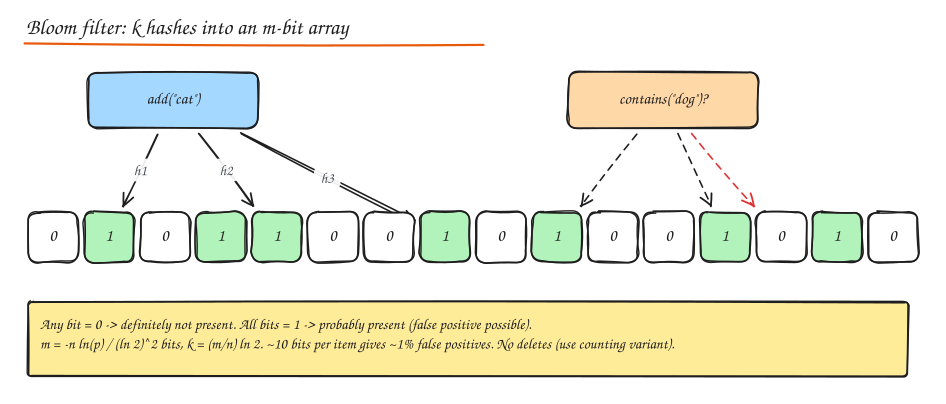
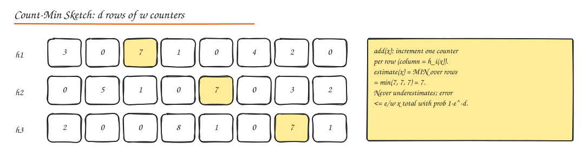

# Probabilistic Data Structures

When exact answers would need memory proportional to the data (billions of IDs), these structures give **approximate answers with bounded error in tiny, fixed memory**, and they are usually **mergeable** across machines, which is exactly what distributed systems need.

## Bloom filter: "have I seen this?"

- An array of m bits and k hash functions. **Add**: set the k bits. **Query**: if any of the k bits is 0, the item is **definitely not** present; if all are 1, it is **probably** present.
- **No false negatives**, tunable false positive rate p.
- Sizing: `m = -n ln(p) / (ln 2)^2`, optimal `k = (m / n) ln 2`. Rule of thumb: ~10 bits per item for 1%, ~14.4 bits for 0.1%.
- 1 billion items at 1% ≈ 1.2 GB. A hash set of the same items would be tens of GB.
- No deletion (clearing a bit could remove other items). **Counting Bloom filters** use small counters instead of bits; **cuckoo filters** support deletes with similar space.
- Uses: skip disk reads for absent keys in LSM trees (Cassandra, RocksDB, HBase), web crawler seen-URL sets, cache penetration protection, "username probably taken", weak-password checks, CDN "one-hit wonder" filtering (only cache on second request), Medium's "already recommended" filtering.

Build one: [Bloom Filter from scratch](../11-builds/04-bloom-filter.md).

## HyperLogLog: "how many distinct?"

- Counts distinct elements (cardinality) with ~**1.04 / sqrt(m)** relative error using m registers. Redis uses 16,384 registers in **12 KB** for ~0.81% error, regardless of whether you count a thousand or a billion items.
- Idea: hash each item; the position of the leftmost 1-bit (number of leading zeros) indicates how rare that hash is; track the maximum per register bucket; combine with a harmonic mean and bias corrections.
- **Mergeable**: union of two HLLs = element-wise max of registers. Count unique visitors per hour, then merge hours into days without double counting.
- Uses: unique visitors/users per page/campaign, distinct search queries, distinct IPs in a DDoS analysis. Redis `PFADD`/`PFCOUNT`/`PFMERGE`; BigQuery `APPROX_COUNT_DISTINCT`; Presto `approx_distinct`.

## Count-Min Sketch: "how often?"

- d rows x w counters, one hash per row. **Add x**: increment `row_i[h_i(x)]` for each row. **Estimate x**: minimum across rows.
- **Never underestimates**; overestimate error ≤ `ε x N` with probability `1 - δ`, where `w = ⌈e/ε⌉` and `d = ⌈ln(1/δ)⌉`.
- Combine with a min-heap of candidates to find **top-k / heavy hitters** in a stream with bounded memory.
- Mergeable by adding counters element-wise.
- Uses: trending hashtags, top-k most viewed items, rate limiting by approximate counts, network traffic heavy hitters, frequency features for ML.
- Alternatives for top-k: Space-Saving / Misra-Gries (deterministic error bounds, keep k counters).

## t-digest and quantile sketches: "what is p99?"

- You cannot average percentiles across hosts, and storing every latency sample is expensive.
- **t-digest** clusters samples into centroids, keeping more precision at the tails (p99, p99.9) where it matters; **mergeable** across hosts and time windows.
- Alternatives: **HDR Histogram** (fixed buckets with configurable precision, very fast), **DDSketch** (relative-error guarantees, used by Datadog), **KLL** sketches.
- Uses: latency monitoring dashboards, SLO computation across a fleet, analytics `approx_percentile`.

## MinHash and SimHash: "how similar?"

- **MinHash** estimates Jaccard similarity between sets (shingles of documents): apply many hash functions, keep the minimum hash per function; the fraction of matching minimums ≈ Jaccard similarity. With **Locality-Sensitive Hashing** (banding), find near-duplicate candidates without comparing all pairs. Uses: near-duplicate documents, plagiarism detection, similar items.
- **SimHash** produces a single fingerprint (e.g. 64 bits) where similar documents differ in few bits; compare with Hamming distance. Google used it for near-duplicate web page detection. See [Web Crawler](../09-case-studies/14-web-crawler.md).

## Others worth naming

- **Skip lists**: probabilistic balanced ordered structure (Redis sorted sets, LevelDB/RocksDB memtables).
- **Reservoir sampling**: uniform sample of k items from a stream of unknown length.
- **Quotient filters / XOR filters**: Bloom alternatives with better cache behaviour or space.

## Choosing

| Question | Structure |
|---|---|
| Is X in the set? (false positives OK) | Bloom / cuckoo filter |
| How many distinct X? | HyperLogLog |
| How many times did X occur? Top-k? | Count-Min Sketch (+ heap), Space-Saving |
| Percentiles over a distributed stream | t-digest, HDR Histogram, DDSketch |
| Are these documents similar? | MinHash + LSH, SimHash |

## Interview questions

How would you count unique daily visitors per page for 100M pages?

Keep a HyperLogLog per page per day (12 KB each in Redis, or a few KB with sparse encoding for small counts). Add visitor IDs as they arrive; read with PFCOUNT. Weekly or monthly uniques are computed by merging the daily HLLs. Error is under 1%, memory is bounded, and merges avoid double counting.

Your Bloom filter's false positive rate has crept up to 20%. Why?

More items were inserted than it was sized for, so most bits are now 1. False positive rate grows quickly beyond capacity. Fix by resizing (build a new, larger filter), using scalable Bloom filters (add new layers as they fill), or rotating filters by time window.

Why can't you average p99 latencies from 50 servers?

Percentiles are not linear: the mean of per-server p99s is not the p99 of the combined distribution (a few slow servers or uneven traffic skew it). Instead, merge mergeable summaries (histograms with shared buckets, t-digests, DDSketches) from all servers and compute the percentile on the merged result.

## Related

- [Caching (cache penetration)](../02-building-blocks/03-caching.md)
- [Indexes and Storage Engines (LSM Bloom filters)](../03-data/02-indexes-storage-engines.md)
- [Case study: Ad Click Aggregator (top-k)](../09-case-studies/15-ad-click-aggregator.md)
