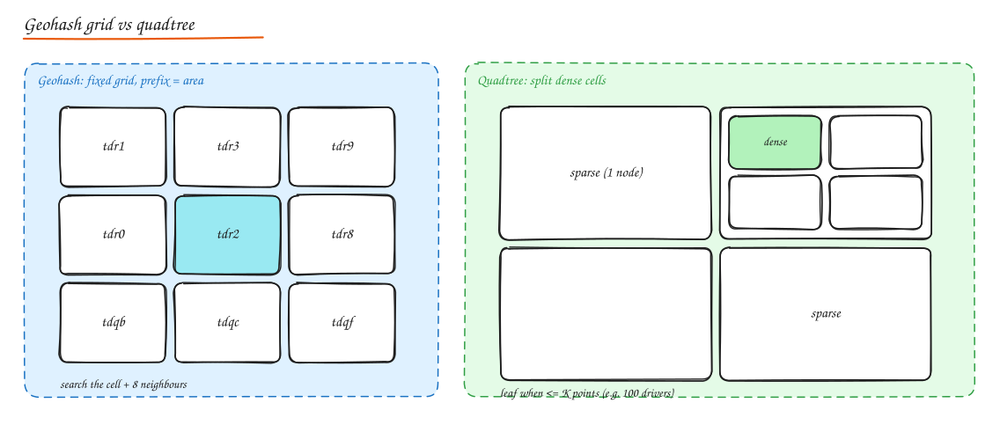

# Geospatial Indexing

> **TL;DR**
> - Plain latitude and longitude indexes cannot answer "what is nearby?" efficiently; map 2D space to cells.
> - Geohash prefixes are simple (search the cell plus 8 neighbours); quadtrees adapt to density.
> - S2 and H3 offer better cell shapes; H3 hexagons suit aggregation and ride hailing.
> - Keep fast-moving points (drivers) in memory and static places (restaurants) in an index.

"Find restaurants within 2 km", "nearest 10 drivers", "which delivery zone is this address in" all need **proximity queries**. A B-tree index on `latitude` and another on `longitude` does not help much: each one-dimensional range matches a huge strip of the planet, and intersecting them is expensive. We need to map 2D space to something indexable.

## Geohash

- Recursively split the world into halves by longitude, then latitude, alternating, producing a bit string; encode it in base32.
- Longer strings mean smaller cells: precision 5 ≈ 4.9 km x 4.9 km, 6 ≈ 1.2 km x 0.6 km, 7 ≈ 153 m x 153 m.
- **Shared prefix ≈ nearby**, so a normal string index (B-tree, Redis sorted set) supports prefix range queries.
- **Edge problem**: two points can be close but on opposite sides of a cell boundary with different prefixes. Fix: query the target cell **plus its 8 neighbours**, then filter by exact distance.
- Cells get skinnier toward the poles (distortion).
- Redis `GEOADD`/`GEOSEARCH` store geohash-like 52-bit scores in a sorted set.

## Quadtree

- Start with the whole map; **split a cell into four** whenever it has more than K points (e.g. 100 businesses). Dense areas (Manhattan) get deep, small cells; sparse areas (desert) stay large.
- Query: walk down to the leaf containing the target, then expand to neighbouring leaves until enough results.
- Typically an **in-memory** structure rebuilt periodically (Yelp-style business data changes slowly); a few GB for hundreds of millions of points.
- Updates for moving objects (drivers) are costly if points move between cells often; fixed grids are easier for high-churn data.

## R-tree

Balanced tree of bounding rectangles, great for **shapes** (polygons, lines) and range/intersection queries. Used by PostGIS (via GiST), SQLite R*Tree, many GIS systems.

## Google S2

- Projects the sphere onto the 6 faces of a cube, subdivides each face as a quadtree, and orders cells along a **Hilbert curve**, so cell IDs (64-bit integers) preserve locality well.
- Covers arbitrary regions (circles, polygons) with a small set of cells at mixed levels ("region coverer"), turning geo queries into a handful of integer range scans.
- Used by Google Maps, Foursquare, MongoDB 2dsphere internals, early Uber.

## Uber H3

- Hierarchical **hexagonal** grid with 16 resolutions (res 9 ≈ 0.1 km² cells).
- Hexagons have **uniform neighbour distances** (all 6 neighbours equidistant), ideal for smoothing, aggregation and movement analysis (surge pricing, supply/demand heatmaps, ETA features).
- `k-ring` queries return all cells within k steps.
- Not perfectly hierarchical (children do not exactly tile the parent), which is fine for analytics.

## Comparison

| | Geohash | Quadtree | S2 | H3 |
|---|---|---|---|---|
| Shape | Rectangles | Squares, adaptive | Quads on a cube, Hilbert order | Hexagons |
| Storage | String / int in any DB | In-memory tree | 64-bit ints in any DB | 64-bit ints |
| Adapts to density | No (choose precision) | Yes | Mixed-level coverings | No (choose resolution) |
| Best for | Simple proximity with existing DBs | Static points, uneven density (Yelp) | Region coverings, global accuracy | Aggregations, mobility, ride hailing |

## Design pattern: proximity service (Yelp / "nearby")

1. **Write path** (businesses rarely change): store business data in a DB; maintain a geo index table `(geohash_6, business_id)` or an in-memory quadtree built from snapshots.
2. **Read path**: compute the user's cell, fetch candidates from the cell and its neighbours (expanding precision/rings until enough results), compute exact distances (haversine), filter (open now, category), rank (distance, rating, relevance), paginate.
3. **Scale**: read heavy and cache friendly (popular areas); shard by region; replicate read replicas; data fits in memory per region.

For moving objects (drivers, couriers), keep **latest positions in memory** keyed by cell (Redis/H3) and expire stale entries; see [Uber](../09-case-studies/06-uber-ride-hailing.md).

## Interview questions

Why must you search neighbouring geohash cells?

Geohash cells have hard boundaries: a user near a cell's edge can be meters away from a restaurant whose geohash prefix differs entirely. Searching the user's cell plus the 8 surrounding cells (at an appropriate precision) and then filtering by exact distance guarantees no nearby results are missed.

Quadtree or geohash for a "nearby restaurants" service?

Both work. A quadtree adapts to density (small cells downtown, large in rural areas), so each query examines a similar number of candidates; it fits in memory and suits relatively static data. Geohash is simpler to store in an existing database or Redis and to shard, but needs a precision choice (or multiple precisions) and neighbour handling. For a straightforward design, geohash in a DB or Redis is a strong answer; mention quadtrees for uneven density.

## Related

- [Case study: Uber](../09-case-studies/06-uber-ride-hailing.md)
- [Indexes](../03-data/02-indexes-storage-engines.md)
- [Sharding](../03-data/05-sharding-partitioning.md)
