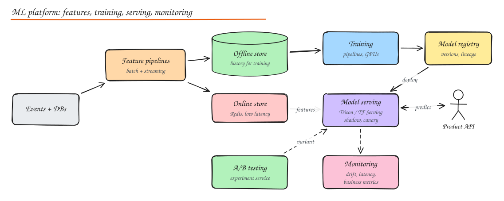
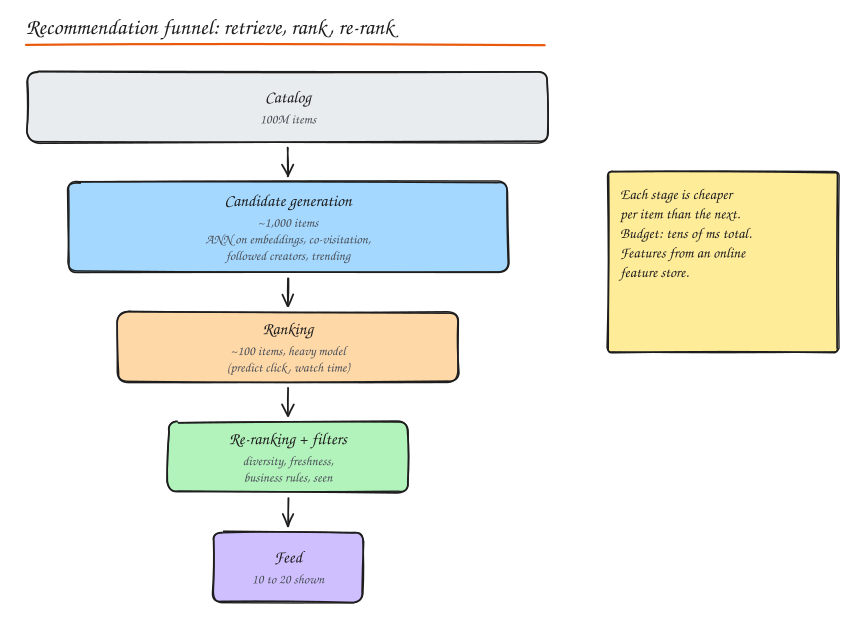

# Machine Learning in System Design and MLOps

Product companies increasingly ask "design the recommendation system" or "how would you serve this model". The ML model is a small box; the system around it is the interview.

## ML infrastructure components

| Component | Role | Tools |
|---|---|---|
| Data collection and labeling | Events, logs, human labels | Kafka, data lake, labeling tools |
| **Feature pipelines** | Compute features in batch and streaming | Spark, Flink, dbt |
| **Feature store** | One definition of features for training (offline) and serving (online), point-in-time correctness | Feast, Tecton, Databricks, SageMaker FS |
| **Training pipelines** | Reproducible training with versioned data and code, distributed training on GPUs | Kubeflow, Airflow, Ray, SageMaker, Vertex |
| **Experiment tracking** | Parameters, metrics, artifacts per run | MLflow, Weights & Biases |
| **Model registry** | Versioned models with lineage and stage (staging, production) | MLflow registry, SageMaker |
| **Model serving** | Low-latency inference APIs or batch scoring | Triton, TF Serving, TorchServe, KServe, BentoML, vLLM for LLMs |
| **Monitoring** | Latency, errors, data drift, prediction drift, business metrics | Evidently, Arize, WhyLabs, Prometheus |
| **Experimentation** | A/B tests and gradual rollouts | In-house experiment platforms, Optimizely, Statsig |

### Feature stores in detail

- **Offline store** (warehouse/lake): historical feature values for training, with **point-in-time joins** so training rows only see feature values available at that time (prevents **label leakage**).
- **Online store** (Redis, DynamoDB, Cassandra): latest feature values per entity for millisecond lookups at inference.
- Same feature definitions feed both, avoiding **training/serving skew** (features computed differently in training vs production, a top cause of silent model failure).

## Model serving

| Mode | When | Design |
|---|---|---|
| **Real-time (online) prediction** | Fraud check at payment, ranking a feed, search | Model server behind an API; feature lookup from online store; p99 budget of tens of ms; autoscaling; GPU batching for big models |
| **Batch prediction** | Daily churn scores, precomputed recommendations, email targeting | Spark job scores all entities, writes to a KV store for lookup |
| **Streaming prediction** | Real-time anomaly detection on events | Model inside a Flink job or called per event |
| **On-device** | Keyboard suggestions, image filters | Quantized models shipped to clients |

Serving techniques:

- **Model versioning**: every prediction logs the model version; easy rollback.
- **Shadow deployment**: new model scores live traffic without affecting users; compare offline.
- **Canary / A/B** rollout of models.
- **Dynamic batching** on GPUs (collect requests for a few ms to batch), quantization, distillation, caching frequent predictions.
- LLM serving specifics: continuous batching, KV cache management (PagedAttention), streaming tokens over SSE, rate limiting by tokens.

## Recommendation engines

### Approaches

- **Collaborative filtering**: users who liked similar items like similar things. User-user, item-item (co-occurrence: "customers who bought X also bought Y"), or **matrix factorization** learning user and item embeddings from the interaction matrix.
- **Content-based filtering**: recommend items similar in features (genre, text embeddings, image embeddings) to what the user engaged with. Solves item cold start.
- **Hybrid approaches**: combine both, plus context (time, device, location) in a learned model. Almost every production system is hybrid.
- **Deep learning recsys**: two-tower retrieval models (user tower and item tower producing embeddings for ANN search), then ranking models (wide and deep, DLRM, transformers over sequences of user actions).

### Multi-stage architecture

1. **Candidate generation** (retrieval): reduce millions of items to ~1,000 using cheap methods: ANN search over embeddings (FAISS, ScaNN, HNSW-based vector DBs), co-visitation lists, followed creators, trending, rules.
2. **Ranking**: a heavier model scores ~1,000 candidates with rich features, predicting objectives (click, like, watch time, purchase), combined into a value score.
3. **Re-ranking and filtering**: diversity, freshness, deduplication, business rules, remove seen/blocked/out-of-stock, fairness.
4. **Serving and logging**: log impressions and the features used (for training the next model).

### Cold start

New users: popular/trending items, onboarding preferences, contextual signals. New items: content-based features, exploration traffic (bandits).

## A/B testing infrastructure

- **Assignment**: deterministic hashing of `user_id + experiment_id` into buckets; consistent across sessions; mutually exclusive layers for experiments that might interact.
- **Exposure logging**: log when a user actually experiences the variant.
- **Metrics pipeline**: compute primary metrics, guardrail metrics (latency, crashes, revenue) and statistical significance (t-tests, CUPED variance reduction, sequential testing to allow peeking safely).
- **Pitfalls**: sample ratio mismatch (assignment bug), novelty effects, network effects in social products (use cluster randomization), too many simultaneous metrics (false positives).
- **Experiment management**: registry of experiments, owners, hypotheses, start/stop dates, decision logs.

## MLOps lifecycle

1. **Model training pipeline**: data validation -> feature generation -> training -> evaluation against baselines and slices -> registration.
2. **Model deployment**: CI/CD for models: automated checks, shadow, canary, then full rollout.
3. **Model monitoring**:
   - Operational: latency, throughput, errors, resource use.
   - **Data quality**: missing values, schema changes, out-of-range features.
   - **Data drift**: input distribution shifts (PSI, KL divergence).
   - **Concept drift / model drift**: the relationship between inputs and labels changes (fraud patterns evolve); detected via delayed labels and performance decay.
   - Business KPIs.
4. **Retraining**: scheduled or triggered by drift; champion/challenger comparison.
5. **Governance**: lineage of data, code and model versions; reproducibility; fairness and explainability checks; access control for sensitive features.

## Vector search and RAG (common in 2024+ interviews)

- Embed documents into vectors; store in a vector index (HNSW in pgvector, Qdrant, Weaviate, Milvus, Pinecone, OpenSearch).
- At query time, embed the question, retrieve top-k similar chunks (often hybrid with BM25 and metadata filters), re-rank with a cross-encoder, and pass to an LLM with the retrieved context.
- System concerns: chunking strategy, embedding versioning (re-embedding on model change), index freshness via CDC, ACL filtering per user, latency and cost budgets, caching, evaluation of retrieval quality.

## Interview questions

What is training/serving skew and how does a feature store prevent it?

Skew happens when features at inference are computed differently (different code, freshness, defaults) than in training, so the model sees inputs unlike what it learned from and degrades silently. A feature store defines each feature once, materializes it both to an offline store (with point-in-time correct history for training) and an online store (latest values for serving), so both paths use the same logic.

Design the serving path for a "people you may know" recommendation within 100 ms.

Precompute candidates offline (friends-of-friends, shared schools/workplaces, contact uploads, embedding neighbours) into a KV store per user, refreshed daily plus streaming updates for new connections. At request time fetch ~500 candidates, look up online features, score with a ranking model on a low-latency model server, filter (blocked, already connected, dismissed), apply diversity, return the top 20, and log impressions for training. Cache results briefly per user.

How do you detect that a fraud model is getting worse when labels arrive weeks later?

Monitor proxies immediately: input feature drift, prediction score distribution shifts, rate of flagged transactions, and early partial labels (chargebacks reported quickly, manual review outcomes). When delayed labels arrive, compute precision/recall by cohort over time. Use champion/challenger with a shadow model trained on recent data to catch decay early.

## Related

- [Case study: Instagram (ranking)](../09-case-studies/03-instagram.md)
- [Stream and Batch Processing](02-stream-batch-processing.md)
- [NoSQL: Vector databases](../03-data/03-nosql-choosing-a-database.md)
