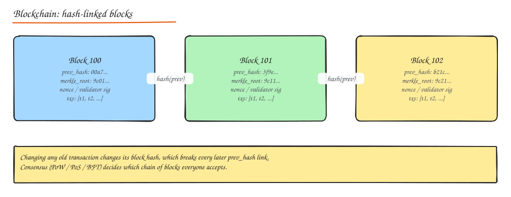

# Blockchain and Distributed Ledgers

Rarely a core interview topic for product companies, but worth understanding as an extreme point in the distributed systems design space: **consensus among mutually distrusting parties**.

## Architecture

- A **ledger** is an append-only sequence of **blocks**; each block contains transactions, a timestamp, a **Merkle root** of its transactions, and the **hash of the previous block**.
- Changing any historical transaction changes that block's hash and invalidates every later block: tamper evidence.
- **Merkle trees** let a light client verify that a transaction is included in a block with a logarithmic-size proof, without downloading the whole block.
- Nodes gossip transactions and blocks over a peer-to-peer network; each full node validates everything independently.

## Consensus mechanisms

| Mechanism | How the next block is chosen | Trade-offs |
|---|---|---|
| **Proof of Work (PoW)** (Bitcoin) | Miners race to find a nonce so the block hash is below a target; longest (most-work) chain wins | Very robust and permissionless; enormous energy use; ~7 tx/s; probabilistic finality (wait ~6 blocks) |
| **Proof of Stake (PoS)** (Ethereum since 2022) | Validators lock up stake; chosen to propose/attest; misbehaviour is **slashed** | ~99.9% less energy; faster finality; wealth concentration concerns |
| **Delegated PoS (DPoS)** | Token holders elect a small set of block producers | High throughput; more centralized |
| **BFT-style** (Tendermint, HotStuff, PBFT) | Known validator set votes in rounds; tolerates f faulty of 3f + 1 | Instant finality; limited validator count; used in permissioned and some public chains |

Compare with Raft/Paxos: those assume crash faults among trusted nodes and need only a majority; blockchains tolerate Byzantine (malicious) participants and open membership, at a large cost in throughput and latency. See [Consensus](01-consensus-and-clocks.md).

## Smart contracts

Programs stored on chain (Ethereum's EVM, Solana programs) executed deterministically by every validator. Users pay **gas** for computation and storage. Immutable once deployed (upgradeability via proxy patterns), so bugs are expensive (reentrancy attacks like The DAO). Use cases: tokens (ERC-20), NFTs (ERC-721), decentralized exchanges, lending.

## Cryptocurrency transactions

- **UTXO model** (Bitcoin): coins are unspent outputs; a transaction consumes outputs and creates new ones; signatures prove ownership.
- **Account model** (Ethereum): balances per account with a nonce to prevent replay.
- Double spending is prevented by consensus on transaction order.

## Scalability solutions

The "blockchain trilemma": decentralization, security, scalability; improving one tends to cost another.

- **Layer 2**: move most activity off the main chain and settle periodically.
  - **Payment channels** (Lightning Network): parties transact off chain, settle net result on chain.
  - **Rollups**: batch thousands of transactions off chain and post compressed data plus proofs on chain. **Optimistic rollups** assume validity and allow fraud proofs during a challenge window; **ZK rollups** post validity proofs (zero-knowledge) for fast finality.
- **Sharding**: split state and transaction processing across groups of validators (Ethereum's danksharding focuses on data availability for rollups).
- Sidechains, larger blocks, faster block times (each with trade-offs).

## When not to use a blockchain

If participants trust a single operator (or a consortium can agree on one), a conventional replicated database with audit logs is cheaper, faster and simpler. Blockchains make sense when parties do not trust each other and no one should control the ledger.

## Interview questions

Why is Bitcoin's throughput so low compared with a database?

Every full node must validate and store every transaction, blocks are limited in size (about 1 MB base) and produced every ~10 minutes to keep orphan rates low over a global P2P network, and PoW deliberately makes block production expensive for security. Those choices favour decentralization and security over throughput.

How is a blockchain different from an append-only audit log in a database?

An audit log is controlled by one operator, who can alter it (with hash chaining you can detect tampering but not prevent it). A blockchain replicates the log across many independent parties and uses consensus so no single party can rewrite history or censor transactions without controlling a majority of work/stake.

## Related

- [Consensus and Clocks](01-consensus-and-clocks.md)
- [Encryption and Hashing](../07-security/02-encryption-data-network-security.md)
