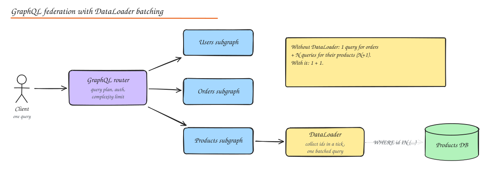

# GraphQL Deep Dive

> **TL;DR**
> - Model the schema around **client needs and the domain**, not database tables; use connections for pagination and input types for mutations.
> - Resolvers run per field, so naive code causes **N+1 queries**; **DataLoader** batches and caches them per request.
> - Protect the server with depth/complexity limits, timeouts and **persisted queries**.
> - Caching works at several layers (persisted GET queries on a CDN, response cache, entity cache, DataLoader).
> - **Federation** lets each team own a subgraph while a router composes one graph for clients.

Basics (queries, mutations, subscriptions, REST vs GraphQL vs gRPC) are in [API Design](../04-networking-apis/03-api-design.md#graphql).

## Schema design

```graphql
type Query {
  me: User
  product(id: ID!): Product
  products(filter: ProductFilter, first: Int = 20, after: String): ProductConnection!
}

type Product implements Node {
  id: ID!
  title: String!
  price: Money!
  reviews(first: Int = 5, after: String): ReviewConnection!
  "Deprecated fields stay until clients migrate."
  priceCents: Int @deprecated(reason: "Use price")
}

type ProductConnection { edges: [ProductEdge!]!  pageInfo: PageInfo! }
type ProductEdge { cursor: String!  node: Product! }

input PlaceOrderInput { items: [OrderItemInput!]!  idempotencyKey: String! }
type PlaceOrderPayload { order: Order  errors: [UserError!]! }

type Mutation { placeOrder(input: PlaceOrderInput!): PlaceOrderPayload! }
```

Guidelines:

- Name types after domain concepts; hide storage details.
- Use **Relay-style connections** (`edges`, `node`, `cursor`, `pageInfo`) for lists that grow.
- Nullability is a contract: non-null (`!`) only when you can always return it; a failing non-null field nulls its parent.
- Mutations take one `input` object and return a payload with domain errors (`UserError`) next to the result.
- Evolve by adding fields and deprecating old ones; avoid versioned endpoints.

## Query optimization

### The N+1 problem and DataLoader

```graphql
{ orders(first: 50) { edges { node { id product { title } } } } }
```

Naive resolvers run 1 query for orders and 50 queries for products. **DataLoader** collects every `product(id)` requested during one tick of the event loop, issues one batched query, and caches results for the rest of the request.



```javascript
const productLoader = new DataLoader(async (ids) => {
  const rows = await db.query("SELECT * FROM products WHERE id = ANY($1)", [ids]);
  const byId = new Map(rows.map(r => [r.id, r]));
  return ids.map(id => byId.get(id) ?? null);        // same order as requested ids
});

const resolvers = {
  Order: { product: (order, _, ctx) => ctx.loaders.product.load(order.productId) },
};
// create loaders per request so caches never leak between users
```

### Query planning and lookahead

Resolvers can inspect the selection set (lookahead) to fetch exactly the needed columns or join children in one query. Tools like Hasura, PostGraphile and Join Monster compile whole GraphQL queries into efficient SQL.

### Cost limits

Clients can write expensive queries (deeply nested friends of friends). Protect with: maximum depth, **complexity scoring** (each field has a cost; lists multiply by `first`), pagination limits, per-client rate limits by cost, timeouts, and **persisted queries** (only pre-registered query hashes are allowed in production).

## Subscriptions and real-time updates

- Transport: WebSockets (`graphql-ws` protocol) or SSE.
- Implementation: a subscription resolver subscribes to a pub/sub channel (Redis, Kafka, NATS); mutations publish events; the server filters per subscriber and pushes results.
- Scaling: same as any WebSocket fleet (gateways, connection registry, pub/sub fanout). See [WebSocket Deep Dive](08-websocket-deep-dive.md).
- Use subscriptions for small, frequent updates (new comment, order status); prefer refetching or polling for large, rare changes.

## Caching strategies

| Layer | How |
|---|---|
| **HTTP/CDN** | Persisted queries sent as `GET /graphql?hash=...&variables=...`, cacheable at the CDN with `Cache-Control` for public data |
| **Response cache** | Cache full responses at the router keyed by query hash + variables + auth scope, with `@cacheControl(maxAge)` hints per field |
| **Entity cache** | Cache objects by type and id (`Product:42`) in Redis; invalidate on mutation |
| **DataLoader** | Per-request deduplication and batching |
| **Client** | Normalized caches (Apollo, Relay) store entities by id and update the UI from mutation results |

Personalized fields lower cacheability; split public and private parts of a page into separate queries.

## Federation and composition

Large organizations split the graph by domain:

- Each team runs a **subgraph** (users, orders, products) with its own schema and service.
- Entities are shared with keys: the orders subgraph can extend `Product @key(fields: "id")` and add `Product.purchaseCount`.
- A **router/gateway** (Apollo Router, Cosmo, Hive Gateway, GraphQL Mesh) composes subgraph schemas into a supergraph, builds a **query plan** for each request (which subgraphs, in what order), executes it and merges results.
- Schema checks in CI catch breaking changes across subgraphs.

Alternatives: schema stitching (older), or a single BFF graph that calls REST/gRPC services underneath.

## Gateway implementation concerns

Authentication at the router (validate JWT, pass identity to subgraphs), authorization in subgraphs (object-level checks), query cost limits, persisted query allow-lists, tracing per resolver and per subgraph call, and timeouts with partial results (GraphQL can return `data` plus `errors`).

## Interview questions

<details>
<summary>How does DataLoader actually batch requests?</summary>

Each `load(id)` call returns a promise and records the id. DataLoader schedules a dispatch at the end of the current event-loop tick; by then all resolvers at that level of the query have called `load`, so it sends one batch function call with all ids and resolves each promise with its result. It also memoizes ids per request so the same entity is fetched once.

</details>

<details>
<summary>How do you stop a client from sending a query that takes down your database?</summary>

Limit depth and compute a complexity score before execution (reject above a budget), enforce maximum page sizes, apply per-client cost-based rate limits and timeouts, and in production only accept persisted (pre-approved) queries from first-party clients.

</details>

<details>
<summary>Why is caching harder with GraphQL than REST, and how do you get it back?</summary>

GraphQL typically uses POST to one URL with arbitrary query shapes, so HTTP caches and CDNs cannot key on the URL. Persisted queries turn queries into stable hashes sent via GET (CDN-cacheable for public data); field-level cache hints drive response caching at the router; entity caches and normalized client caches work by type and id.

</details>

## Related

- [API Design](../04-networking-apis/03-api-design.md)
- [API Gateway and BFF](../02-building-blocks/05-proxies-api-gateway.md)
- [WebSocket Deep Dive](08-websocket-deep-dive.md)
