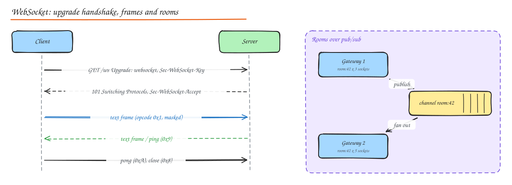

# WebSocket Deep Dive

> **TL;DR**
> - A WebSocket starts as an HTTP request with `Upgrade: websocket`; after `101 Switching Protocols` both sides exchange small **frames** over one TCP connection.
> - Production needs heartbeats, reconnection with backoff, resume from a cursor, auth on connect, and backpressure.
> - **Rooms** are just pub/sub channels: gateways subscribe to the rooms their sockets joined and fan messages out locally.
> - Scale with stateless gateways holding sockets, a connection registry, and a pub/sub backbone; drain gateways gently on deploys.

Comparison with polling, long polling and SSE: [Real Time Communication](../04-networking-apis/04-realtime-communication.md).

## The protocol



### Handshake

```http
GET /ws HTTP/1.1
Host: chat.example.com
Upgrade: websocket
Connection: Upgrade
Sec-WebSocket-Key: dGhlIHNhbXBsZSBub25jZQ==
Sec-WebSocket-Version: 13
Sec-WebSocket-Protocol: chat.v2

HTTP/1.1 101 Switching Protocols
Upgrade: websocket
Connection: Upgrade
Sec-WebSocket-Accept: s3pPLMBiTxaQ9kYGzzhZRbK+xOo=
```

The server proves it understood the WebSocket handshake by hashing the key with a fixed GUID (`Sec-WebSocket-Accept`). Subprotocols (`Sec-WebSocket-Protocol`) let you version your message format. Validate the `Origin` header to prevent cross-site WebSocket hijacking.

### Frames

| Field | Meaning |
|---|---|
| FIN | Last fragment of a message |
| Opcode | `0x1` text, `0x2` binary, `0x0` continuation, `0x8` close, `0x9` ping, `0xA` pong |
| MASK | Client-to-server frames must be masked (protects proxies from cache poisoning) |
| Payload length | 7 bits, or 16 / 64 bits extended |
| Payload | Your message (often JSON or protobuf) |

Overhead is 2 to 14 bytes per frame, versus hundreds of bytes of headers per HTTP request. The `permessage-deflate` extension compresses payloads.

## Connection management

- **Authentication**: validate a token on the upgrade request (cookie or `Sec-WebSocket-Protocol`/query token with care, since URLs get logged) or in the first message; disconnect when the token expires unless refreshed.
- **Heartbeats**: ping/pong every 20 to 60 s to detect dead peers (mobile networks drop silently) and keep NAT/load balancer idle timers alive.
- **Reconnection**: clients reconnect with exponential backoff and jitter; send a resume token or last-seen sequence number so the server replays missed messages.
- **Backpressure**: track each socket's send buffer; for slow clients, drop or coalesce low-value updates (latest presence state) and disconnect if the buffer exceeds a limit.
- **Graceful shutdown**: on deploy, stop accepting new connections, send a close frame with a "reconnect" code, spread disconnects over minutes to avoid a reconnect storm.

## Broadcasting and room management

A **room** (channel, topic) is a named group of sockets: `chat:42`, `doc:abc`, `game:7`.

- **Joining**: the client asks to join; the server checks authorization, adds the socket to a local room map, and subscribes the gateway to the pub/sub channel for that room (once per gateway).
- **Broadcasting**: a service publishes to `room:42`; every gateway subscribed to that channel delivers to its local sockets in the room.
- **Leaving**: on leave or disconnect, remove from the local map; unsubscribe the gateway from the channel when its last local member leaves.
- **Presence**: room membership counts and "who is here" kept in Redis with TTLs refreshed by heartbeats; broadcast only changes, throttled.

```python
# gateway (sketch): local rooms + one pub/sub subscription per active room
rooms: dict[str, set[Socket]] = defaultdict(set)

async def join(sock, room):
    if not await authz.can_join(sock.user, room):
        return await sock.send_error("forbidden")
    if not rooms[room]:
        await pubsub.subscribe(room, on_message=lambda msg: fanout(room, msg))
    rooms[room].add(sock)

async def fanout(room, msg):
    for s in list(rooms[room]):
        if s.buffered_bytes() > LIMIT:
            await s.close(code=1013)       # try again later: slow consumer
        else:
            s.send_nowait(msg)
```

Very large rooms (a livestream chat with 1M viewers) need hierarchical fanout, sampling, or batching (send a digest every 200 ms) rather than per-message delivery to everyone.

## Fallback mechanisms

Some networks and proxies break WebSockets. Fallback order:

1. WebSocket (over TLS on 443, which passes most proxies).
2. **Server-Sent Events** for server-to-client streams (plain HTTP).
3. **Long polling** as a last resort.

Libraries like Socket.IO and SignalR negotiate this automatically.

## Scaling WebSocket connections

- **Horizontal scaling**: many gateway instances behind an L4 or WebSocket-aware L7 load balancer; each holds ~100k to 1M mostly idle connections (tune file descriptors, kernel buffers, memory per connection).
- **Sticky sessions**: a WebSocket is naturally sticky for its lifetime; only the initial HTTP handshake needs routing. Use least-connections balancing so new gateways fill up.
- **Message broadcasting across gateways**: pub/sub backbone (Redis pub/sub or streams, NATS, Kafka for durable fanout) plus a connection registry (user to gateway) for direct messages. See [WhatsApp case study](../09-case-studies/04-whatsapp-chat.md).
- **Capacity math**: 10M concurrent users / 500k per gateway = 20 gateways, plus N+2 spare for failures and deploys.

## Socket.IO vs native WebSocket

| | Native WebSocket | Socket.IO |
|---|---|---|
| Protocol | Standard (RFC 6455), any client | Own protocol on top (clients must use Socket.IO) |
| Features | Raw frames only | Rooms, namespaces, acknowledgements, auto-reconnect, fallbacks, broadcasting helpers |
| Scaling | Build your own pub/sub layer | Adapters (Redis, etc.) for multi-node broadcasting |
| Overhead | Minimal | Slightly more per message |
| Choose when | You control both ends, need interoperability, mobile/native clients, or maximum efficiency | Fast development of a browser-centric real-time app |

## Interview questions

<details>
<summary>Why must client frames be masked?</summary>

To stop malicious pages from crafting bytes that look like valid HTTP to intermediaries (transparent proxies) and poisoning their caches. A random per-frame mask chosen by the browser makes the bytes on the wire unpredictable to the page's script.

</details>

<details>
<summary>How do you deliver a message to everyone in a room when members are connected to different servers?</summary>

Each gateway keeps a local map of room to sockets and subscribes to the room's pub/sub channel while it has at least one member. The sender publishes once to the channel; every subscribed gateway forwards to its local members. A connection registry handles direct user-to-user messages.

</details>

<details>
<summary>How do you deploy a new version of a WebSocket gateway without a reconnect storm?</summary>

Drain gradually: take one gateway (or a small batch) out of the load balancer, ask its clients to reconnect over a randomized window (close frames with a reconnect code and jitter), keep spare capacity so the remaining gateways absorb the connections, and use resume tokens so reconnects are cheap and nothing is lost.

</details>

## Related

- [Real Time Communication](../04-networking-apis/04-realtime-communication.md)
- [Case study: Chat](../09-case-studies/04-whatsapp-chat.md)
- [Case study: Google Docs](../09-case-studies/09-google-docs.md)
- [GraphQL Deep Dive (subscriptions)](07-graphql-deep-dive.md)
