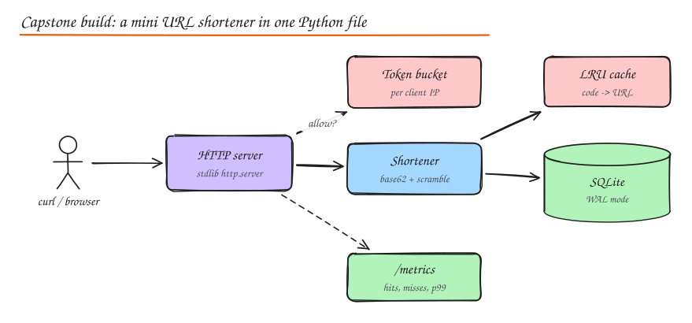

# Build: Mini URL Shortener (End-to-End Capstone)

> **TL;DR**
> - One runnable file shows a whole system working together: HTTP API, database, cache, rate limiter, id generation, validation and metrics.
> - Run `python3 builds/mini_shortener.py` for the self-test, or `--serve 8080` and try it with curl.
> - Then read the "taking it to production" section: that list is exactly what a system design interview probes.

This is the practical counterpart to the [URL Shortener case study](../09-case-studies/01-url-shortener.md). It reuses the [LRU cache](01-lru-cache.md) and [rate limiter](02-rate-limiters.md) builds.



## Try it

```bash
python3 builds/mini_shortener.py --serve 8080

curl -s -XPOST localhost:8080/api/urls -d '{"url": "https://example.com/some/very/long/path"}'
# {"code": "CjINSl5", "short_url": "http://localhost:8080/CjINSl5"}

curl -si localhost:8080/CjINSl5 | head -3
# HTTP/1.0 302 Found
# Location: https://example.com/some/very/long/path

curl -s localhost:8080/metrics
# {"requests": {...}, "p50_ms": 0.21, "p99_ms": 0.9, "cache_hit_ratio": 0.5}
```

## How the pieces fit

| Concern | Implementation here | Production equivalent |
|---|---|---|
| API | `http.server` with JSON, 201/302/400/404/422/429 | FastAPI/Go behind a load balancer |
| Storage | SQLite in WAL mode, one connection per thread | Postgres or DynamoDB, replicas, backups |
| IDs | Autoincrement id, multiplied by a constant coprime with 62^7, base62 encoded | Range allocation per server + the same scrambling |
| Cache | In-process LRU with TTL | Redis cluster + small local cache for hot codes |
| Rate limiting | Token bucket per client IP, in memory | Redis Lua token bucket at the API gateway |
| Validation | Only absolute http(s) URLs under 2,048 chars | Plus malware/phishing checks, blocked domains |
| Observability | `/metrics` JSON with counts and percentiles | Prometheus histograms, tracing, structured logs |

## Code

Runnable file: [`builds/mini_shortener.py`](../../builds/mini_shortener.py).

<!-- code: builds/mini_shortener.py -->
```python
"""Capstone: a mini URL shortener service, end to end, standard library only.

Pieces from the other builds come together here:
  - SQLite (WAL mode) as the durable store
  - an LRU cache in front of it (builds/lru_cache.py)
  - a per-client token bucket rate limiter (builds/rate_limiters.py)
  - scrambled counter ids encoded in base62 (no collisions, not guessable)
  - /metrics with request counts, cache hit ratio and latency percentiles

Run the self-test:      python3 builds/mini_shortener.py
Run a real server:      python3 builds/mini_shortener.py --serve 8080
  curl -s -XPOST localhost:8080/api/urls -d '{"url": "https://example.com/very/long"}'
  curl -si localhost:8080/<code>
"""

import http.client
import json
import os
import sqlite3
import sys
import tempfile
import threading
import time
from http.server import BaseHTTPRequestHandler, ThreadingHTTPServer
from urllib.parse import urlparse

sys.path.insert(0, os.path.dirname(os.path.abspath(__file__)))
from lru_cache import LRUCache            # noqa: E402
from rate_limiters import TokenBucket     # noqa: E402

ALPHABET = "0123456789abcdefghijklmnopqrstuvwxyzABCDEFGHIJKLMNOPQRSTUVWXYZ"
SPACE = 62 ** 7
MULT = 2_176_477_521_739       # near 0.618 x 62^7, odd, not divisible by 31: a bijection that spreads ids


def encode(n: int) -> str:
    n = (n * MULT) % SPACE                # scramble so consecutive ids do not look sequential
    out = []
    for _ in range(7):
        n, r = divmod(n, 62)
        out.append(ALPHABET[r])
    return "".join(reversed(out))


class Store:
    def __init__(self, path):
        self.local = threading.local()
        self.path = path
        db = self._db()
        db.execute("PRAGMA journal_mode=WAL")
        db.execute("""CREATE TABLE IF NOT EXISTS urls (
                        id INTEGER PRIMARY KEY AUTOINCREMENT,
                        code TEXT UNIQUE,
                        long_url TEXT NOT NULL,
                        created_at REAL NOT NULL)""")
        db.commit()

    def _db(self):
        if not hasattr(self.local, "db"):                 # one connection per thread
            self.local.db = sqlite3.connect(self.path, timeout=5)
        return self.local.db

    def create(self, long_url: str) -> str:
        db = self._db()
        cur = db.execute("INSERT INTO urls (long_url, created_at) VALUES (?, ?)", (long_url, time.time()))
        code = encode(cur.lastrowid)
        db.execute("UPDATE urls SET code = ? WHERE id = ?", (code, cur.lastrowid))
        db.commit()
        return code

    def get(self, code: str):
        row = self._db().execute("SELECT long_url FROM urls WHERE code = ?", (code,)).fetchone()
        return row[0] if row else None


class Metrics:
    def __init__(self):
        self.lock = threading.Lock()
        self.counts = {}
        self.latencies = []

    def observe(self, route: str, status: int, seconds: float):
        with self.lock:
            key = "%s %d" % (route, status)
            self.counts[key] = self.counts.get(key, 0) + 1
            self.latencies.append(seconds)
            if len(self.latencies) > 10_000:
                self.latencies = self.latencies[-5_000:]

    def snapshot(self, cache: LRUCache):
        with self.lock:
            lat = sorted(self.latencies)
            pct = lambda p: round(lat[min(len(lat) - 1, int(len(lat) * p))] * 1000, 2) if lat else 0
            lookups = cache.hits + cache.misses
            return {"requests": dict(self.counts), "p50_ms": pct(0.5), "p99_ms": pct(0.99),
                    "cache_hit_ratio": round(cache.hits / lookups, 3) if lookups else None}


class App:
    def __init__(self, db_path, cache_size=10_000, rate=5.0, burst=10):
        self.store = Store(db_path)
        self.cache = LRUCache(cache_size)
        self.limiter = TokenBucket(rate=rate, capacity=burst)
        self.limiter_lock = threading.Lock()
        self.metrics = Metrics()

    def allow(self, client: str) -> bool:
        with self.limiter_lock:
            return self.limiter.allow(client)

    def resolve(self, code: str):
        url = self.cache.get(code)
        if url is None:
            url = self.store.get(code)
            if url is not None:
                self.cache.put(code, url, ttl=3600)
        return url


def make_handler(app: App):
    class Handler(BaseHTTPRequestHandler):
        server_version = "mini-shortener/1.0"

        def log_message(self, *args):          # keep test output quiet
            pass

        def _send(self, status, body=None, headers=None, route="?"):
            payload = json.dumps(body).encode() if body is not None else b""
            self.send_response(status)
            for k, v in (headers or {}).items():
                self.send_header(k, v)
            if body is not None:
                self.send_header("Content-Type", "application/json")
            self.send_header("Content-Length", str(len(payload)))
            self.end_headers()
            self.wfile.write(payload)
            app.metrics.observe(route, status, time.perf_counter() - self.started)

        def do_POST(self):
            self.started = time.perf_counter()
            if self.path != "/api/urls":
                return self._send(404, {"error": "not found"}, route="POST ?")
            if not app.allow(self.client_address[0]):
                return self._send(429, {"error": "rate limited"}, {"Retry-After": "1"}, route="POST /api/urls")
            try:
                body = json.loads(self.rfile.read(int(self.headers.get("Content-Length", 0))) or b"{}")
                url = body["url"]
            except (ValueError, KeyError, TypeError):
                return self._send(400, {"error": "body must be JSON with a 'url' field"}, route="POST /api/urls")
            parsed = urlparse(url)
            if parsed.scheme not in ("http", "https") or not parsed.netloc or len(url) > 2048:
                return self._send(422, {"error": "url must be an absolute http(s) URL under 2048 chars"}, route="POST /api/urls")
            code = app.store.create(url)
            host = self.headers.get("Host", "localhost")
            self._send(201, {"code": code, "short_url": "http://%s/%s" % (host, code)}, route="POST /api/urls")

        def do_GET(self):
            self.started = time.perf_counter()
            if self.path == "/healthz":
                return self._send(200, {"ok": True}, route="GET /healthz")
            if self.path == "/metrics":
                return self._send(200, app.metrics.snapshot(app.cache), route="GET /metrics")
            code = self.path.lstrip("/")
            if len(code) != 7 or any(c not in ALPHABET for c in code):
                return self._send(404, {"error": "not found"}, route="GET /{code}")
            url = app.resolve(code)
            if url is None:
                return self._send(404, {"error": "not found"}, route="GET /{code}")
            self._send(302, None, {"Location": url, "Cache-Control": "private, max-age=60"}, route="GET /{code}")

    return Handler


def serve(port: int, db_path="shortener.db"):
    app = App(db_path)
    server = ThreadingHTTPServer(("0.0.0.0", port), make_handler(app))
    print("listening on http://localhost:%d" % port)
    server.serve_forever()


def selftest():
    tmp = tempfile.mkdtemp()
    app = App(os.path.join(tmp, "test.db"), rate=1, burst=5)
    server = ThreadingHTTPServer(("127.0.0.1", 0), make_handler(app))
    threading.Thread(target=server.serve_forever, daemon=True).start()
    port = server.server_address[1]

    def req(method, path, body=None):
        c = http.client.HTTPConnection("127.0.0.1", port, timeout=5)
        c.request(method, path, json.dumps(body) if body is not None else None)
        r = c.getresponse()
        data = r.read()
        return r.status, dict(r.getheaders()), (json.loads(data) if data else None)

    status, _, body = req("POST", "/api/urls", {"url": "https://example.com/a/very/long/path?x=1"})
    assert status == 201 and len(body["code"]) == 7, (status, body)
    code = body["code"]

    status, headers, _ = req("GET", "/" + code)
    assert status == 302 and headers["Location"] == "https://example.com/a/very/long/path?x=1"
    req("GET", "/" + code)                                   # second read is served from the LRU cache
    assert app.cache.hits >= 1

    assert req("GET", "/zzzzzzz")[0] == 404
    assert req("POST", "/api/urls", {"url": "javascript:alert(1)"})[0] == 422
    assert req("POST", "/api/urls", {"nope": 1})[0] == 400

    codes = {req("POST", "/api/urls", {"url": "https://e.com/%d" % i})[0] for i in range(10)}
    assert 429 in codes, codes                               # burst of 5 then the token bucket says no

    first, second = encode(1), encode(2)
    assert first[:5] != second[:5], (first, second)            # consecutive ids do not share a prefix

    m = req("GET", "/metrics")[2]
    assert m["requests"]["GET /{code} 302"] == 2 and m["cache_hit_ratio"] is not None
    server.shutdown()
    print("mini_shortener: all checks passed", {"p99_ms": m["p99_ms"], "cache_hit_ratio": m["cache_hit_ratio"]})


if __name__ == "__main__":
    if len(sys.argv) >= 2 and sys.argv[1] == "--serve":
        serve(int(sys.argv[2]) if len(sys.argv) > 2 else 8080)
    else:
        selftest()
```
<!-- /code -->

## Taking it to production

1. **Stateless app tier**: move the cache and rate limiter state to Redis so you can run many instances behind a load balancer.
2. **Database**: Postgres with a primary and replicas (or a key-value store); the redirect path only reads, so serve it from replicas and cache.
3. **ID generation without a single writer**: each instance leases a block of ids from a coordinator and scrambles them.
4. **Analytics**: publish click events to Kafka asynchronously; never slow the redirect.
5. **Abuse**: rate limits per user and IP, URL reputation checks, a kill switch to disable a code everywhere.
6. **Reliability**: health checks, timeouts, graceful shutdown, multi-AZ, backups and restore drills.
7. **Observability**: RED metrics per endpoint, SLO alerts on redirect latency and error rate.

## Exercises

1. Add `expires_at` support and a background job that deletes expired links.
2. Add custom aliases with a conditional insert and a reserved-words list.
3. Replace the in-memory limiter with the sliding window counter and compare behaviour under a burst.
4. Load test it with `ab` or `wrk` and find the bottleneck (hint: SQLite writes and the Python GIL).

## Interview questions

<details>
<summary>Why does the second redirect for the same code not touch SQLite?</summary>

The first lookup misses the LRU cache, reads SQLite and populates the cache with a TTL; subsequent lookups are served from memory until the entry expires or is evicted. Links are immutable, so cached values never go stale except through deletion or expiry.

</details>

<details>
<summary>What breaks first if you run two copies of this file behind a load balancer?</summary>

Each copy has its own in-memory cache (fine, just less effective) and its own rate limiter (clients get double the limit). Both share nothing else, so with SQLite on local disk they would not even see each other's links. You need a shared database and shared rate limit state (Redis) to scale out.

</details>

## Related

- [URL Shortener case study](../09-case-studies/01-url-shortener.md)
- [LRU Cache build](01-lru-cache.md)
- [Rate Limiters build](02-rate-limiters.md)
- [Unique ID Generation](../02-building-blocks/09-unique-id-generation.md)
